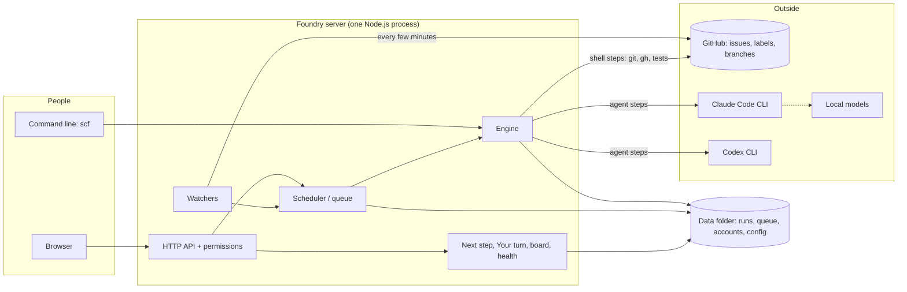
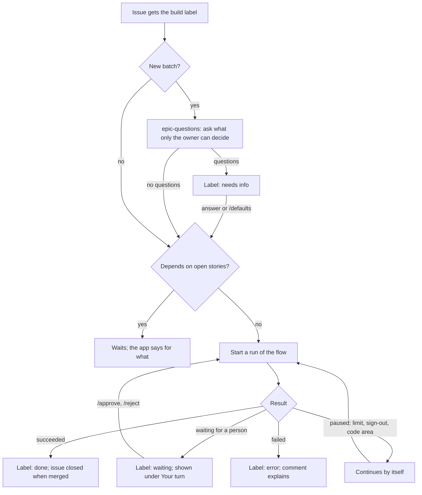
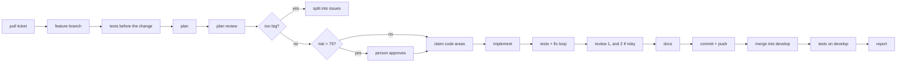
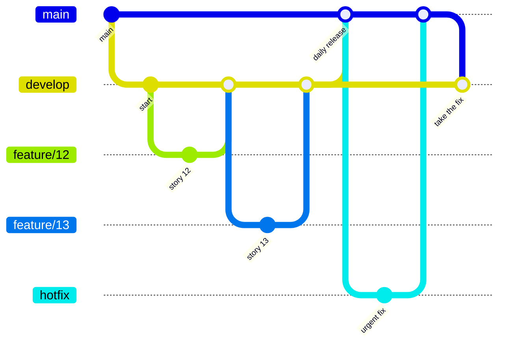

# Spaghetti Code Foundry — design

How the Foundry is built and why. For how to use it, see the [user guide](USER_GUIDE.md); for
the format of flows, [FLOW_AUTHORING.md](FLOW_AUTHORING.md); for the reasons behind many of
these choices, [LESSONS_LEARNED.md](LESSONS_LEARNED.md).

- [1. What it is](#1-what-it-is)
- [2. Design principles](#2-design-principles)
- [3. The parts](#3-the-parts)
- [4. Flows and the engine](#4-flows-and-the-engine)
- [5. Agents and models](#5-agents-and-models)
- [6. The queue](#6-the-queue)
- [7. Watchers: from GitHub issue to merged code](#7-watchers-from-github-issue-to-merged-code)
- [8. The two pipelines](#8-the-two-pipelines)
- [9. Branches: gitflow](#9-branches-gitflow)
- [10. What happens next](#10-what-happens-next)
- [11. Accounts, roles and repositories](#11-accounts-roles-and-repositories)
- [12. Safety](#12-safety)
- [13. Data on disk](#13-data-on-disk)
- [14. The server and its restarts](#14-the-server-and-its-restarts)
- [15. The web interface](#15-the-web-interface)
- [16. Tests](#16-tests)
- [17. Self-repair](#17-self-repair)
- [18. Where it is going](#18-where-it-is-going)

---

## 1. What it is

An AI coding factory that runs on one machine. Work is described as **flows**: YAML pipelines of
agent steps (Claude Code or Codex), shell steps, approvals and branches. The Foundry runs them
headlessly against git repositories — from a task someone types, or automatically from GitHub.

Its main use: put one label on a GitHub issue, and the Foundry asks the open questions, plans,
codes, tests, reviews and merges the story, asking a person only when it has to.


Node.js and TypeScript (ESM), no web framework, no database. About 15,000 lines of source and
2,100 tests.

---

## 2. Design principles

1. **Facts by code, judgement by agents.** Whatever can be checked by a shell step (tests pass,
   size is under the limit, the branch is clean, no secret is pushed) is checked by a shell step.
   Agents plan, write and review.
2. **A person only where a person is needed.** A risk score decides; questions are asked up
   front; everything else continues by itself, at once.
3. **Always say what happens next.** Every story and run has one plain sentence: who acts next
   and what they do.
4. **Runs are isolated and resumable.** Each run has its own folder and its own copy of the
   code. Any run can be continued from the step where it stopped.
5. **State lives in files and on GitHub.** No database. A run is a folder; the queue is a file;
   the backlog and its status are GitHub issues and labels.
6. **Safe by default.** Protected branches, a secret scan, budgets, read-only tools for
   reviewers, permissions enforced on the server.
7. **Text from outside is data.** Issue text, comments and step output never become part of a
   shell command.
8. **Small parts, no magic.** Plain modules, plain JavaScript in the browser, flows generated
   from shared blocks.

---

## 3. The parts



| Folder | What it holds |
|---|---|
| `src/engine/` | Runs a flow: steps, jumps, budgets, guards, resume |
| `src/steps/` | The step runners: Claude Code, Codex, shell |
| `src/agents/` | Choosing agent, provider and model; limits, retries, sign-out |
| `src/flow/` | The flow format (schema), loading, blocks, publishing to users |
| `src/queue/` | Scheduler, watchers, dependencies between issues, status comments |
| `src/server/` | HTTP API, permissions, board, health, Your turn |
| `src/auth/`, `src/credentials/` | Accounts, sessions, repositories per user, stored tokens |
| `src/next-step.ts`, `src/words.ts`, `src/errors.ts` | The one vocabulary: what happens next, status words, explained errors |
| `ui/` | The web interface: plain JavaScript modules |
| `flows/`, `blocks/`, `scripts/build-flows.mjs` | The shipped flows, the block library, and the generator |
| `tools/` | Helper programs that flows call |

---

## 4. Flows and the engine

A flow is a list of **steps**. A step has a type:

| Type | What it does |
|---|---|
| `claude` | An agent step: a prompt, a model, allowed tools. Runs on Claude Code or Codex |
| `shell` | A command. Its output and exit code decide the path |
| `approval` | Stops and waits for a person |
| `parallel` | Runs several steps at the same time |
| `flow` | Runs another flow as one step |

**The path through a flow** is decided by each step's result: `on_success`, `on_failure`,
`routes` (a pattern in the output picks the next step), `pass_if`, and the reserved targets
`next`, `end`, `fail` and `stop`. `max_visits` limits loops such as test → fix → test.
`jump_only` steps run only when another step sends the run there.

**A run** is a folder with `run.json` (status, history of steps, variables, cost), a log per
step, a readable transcript per agent step, and the workspace. The flow definition is stored
with the run, so a resume behaves the same even if the flow changed meanwhile.

**Run states:** `running`, `waiting` (for a person), `stopped` (paused, can continue),
`succeeded`, `failed`, `cancelled`.

**Workspaces.** `worktree` (a git worktree on its own branch), `empty` (the flow clones what it
needs — used by the GitHub flows) or `inplace`.

**Passing information.** A step's output is available to later steps as a template value and as
an environment variable (`$FACTORY_OUT_<STEP>`); flow variables as `$FACTORY_VAR_<NAME>`. This
is how untrusted text travels: as environment variables, never pasted into a command.

**Shipped flows are generated.** `scripts/build-flows.mjs` builds `flows/*.yaml` from shared
pieces (plan phase, test-and-fix loop, review loop, merge). The YAML files are never edited by
hand.

### The skill path

Skills reach an agent in a fixed order. Each stage has its own module:

- **Profile and catalogue:** `src/skills/repo-profile.ts`, `catalogue.ts` and `run-catalogue.ts`.
- **Import evaluation** (`src/skills/evaluate-cli.ts`, read through `staged-cli.ts`): `scf skills selections evaluate` runs `evaluateSourceSkills` on a staged import and the selections. It is offline and writes nothing; no run reads it.
- **Collisions** (`collisions.ts`, rules in `collision-rules.ts`): pure classification and merge of normalized skills; reached from `run-catalogue.ts` only through its optional `candidate` dependency, which no run supplies yet.
- **Canonical selection** (`canonical.ts`, rules in `canonical-rules.ts`, facts in `canonical-facts.ts`): pure choice of one winner per exclusive capability, in the precedence order of `CANONICAL_LEVELS`; reached from `run-catalogue.ts` only through its optional `canonical` dependency, which no run supplies yet.
- **Reviewed frontend profiles** (`frontend-rules.ts`, data only; `frontend-connector.ts`, pure functions): used by `source-evaluation.ts` only for a source whose repository has a profile. Selection happens before normalization, and the profile is authoritative: its capabilities, technologies and category replace the upstream ones, and a `scope` is refused. A folder is reviewed only by a digest in its own rule, added by a code change.
- **Source evaluation** (`source-skill-evaluation.ts`, re-exported by `source-evaluation.ts`, Azure markers in `provider-rules.ts`): pure per-skill verdict of an imported source (selection, licence, undeclared provider needs, overlaps, provider rule); no run calls it yet.
- **Licence review** (`licence-review.ts`): the digest covers the whole licence evidence that can apply to the staged folders (every licence and notice file above or inside them, with its hash or problem), not only the attribution of the promoted skills. A change to a root `LICENSE` therefore needs a new review even when every skill keeps its own licence. Promotion reads it through `licenceReviewProblem`.
- **Provider assumptions** (`provider-assumptions.ts`): a pure, declarative scan of a skill's declared tools, `compatibility` and instructions for Claude, MCP and Anthropic API references. It is recorded in `SkillProvenance.provider` and never grants a tool or blocks a skill.
- **Source profiles** (`src/skills/source-profiles.ts`): pure parser and safe reader of `skill-source-profiles.yaml`, read only by `scf skills profiles check`; no run reads it yet.
- **Skill lifecycle** (`lifecycle.ts`, commands in `lifecycle-cli.ts`): the record `skill-lifecycle.jsonl` in the data folder is append-only JSON lines, one transition or run allowance each, with `seq` counting from 1. The reader replays every line through the same rules as the writer (`lifecycleTransitionProblem`: no same-state change, nothing leaves `revoked`; an allowance only for a quarantined key). A line that is invalid, has an unknown field, has a `seq` gap or a `from` that does not match, a symbolic link, or a file over 4 MiB makes the read fail closed; the reason never holds the file content or the path. Writes take the data-folder lock (`openAppendLocked`) and check the size under it, so a write that would pass 4 MiB is refused with `full` and nothing is written. `effectiveLifecycle` merges the local status with the revocations of approved release manifests: a release revocation wins, and it carries no allowances. The registry (`registry.ts`) keeps the non-active statuses (`lifecycle`) and the release revocations (`revoked`) separately from `byKey`. A registry with an unreadable record has a `lifecycle` problem, and then every id is refused with `ineligible`. Selection (`resolve.ts`) refuses quarantined, retired and revoked versions with reason code `ineligible`, with no fallback to another version of the same id. Run locks (`run-lock.ts`) apply the policy to versions that are already locked: revoked always stops, quarantined stops unless the run is allowed, and the other states only add notes (`runSkillLockNotes`, written by `src/engine/skill-lock.ts`). The admin routes in `api-skills.ts` call the same apply functions as the command line, with `waitMs: 0`, and clear the registry cache after a write.
- **Evaluation gate** (`evaluation.ts`, thresholds in `evaluation-rules.ts`): pure verdict of a candidate from its evaluation record; see "Evaluation gate" below. No run calls it yet.
- **Import review** (`import-review.ts`, rules in `import-review-rules.ts`, command in `review-cli.ts`): pure report of a staged import against the registered skills (licence, attribution, scan, collisions, category); reads only, promotes nothing.
- **Request:** `src/skills/request.ts`; the gates are `risk_gate` and `post_plan`, and the check is the tool `tools/skill-request`.
- **Check after the gate:** `planRunSkills`, `startRunSkills` and `recheckRunSkills` in `src/skills/run-plan.ts`, with `resolve.ts` and `assessSkills` in `unresolved.ts`.
- **Plan record and carry:** `src/skills/plan-record.ts` and `carryRunSkills` in `src/engine/plan-carry.ts`.
- **Lock:** `ensureSkillLock` in `src/engine/skill-lock.ts` and `src/skills/run-lock.ts`.
- **Session:** `skillSession` in `src/engine/skill-lock.ts`, `src/skills/payload.ts` and `src/agents/run.ts`.
- **Run page:** `src/server/skill-view.ts` and `ui/run-skills.js`.

Design rules:

- The resolver and the policy are pure modules: same input, same answer.
- Nothing is written to the workspace, so no skill file appears in a diff.
- Messages are built from validated fields, never from request text.


#### Evaluation gate

A candidate skill is promoted only on one verdict from its evaluation record (`src/skills/evaluation.ts`, #501):

- **Record.** `EvaluationRecord` (`schema: 1`) holds the candidate, the suite digest and scenario inputs, the runtime, the time, the scores of every sample per dimension, findings and evidence. Its digest hashes a header line and canonical lines, so key order does not change it. A credential-like text anywhere in the record is refused.
- **Dimensions.** `selection`, `instructions`, `conflicts`, `context` and `tools`. The four offline ones are always mandatory; `instructions` is mandatory only when the suite says so. A suite can make a threshold stricter, never looser.
- **Verdict.** `evaluationGate` passes only when every mandatory dimension meets its threshold, the safety gate (`promotionBlockers`) has no blocker and the licence is `allowed`. Each failure has a reason code.
- **Modes.** `new` uses absolute thresholds. `upgrade` also requires that no score is lower than the baseline (the record of the current canonical version) by more than the sample spread or 0.1. `duplicate` compares two candidates for one capability and names the clearly better one, or reports no clear difference.
- **Outcome.** `evaluationOutcome` turns the result into the `passed` or `failed` value of `CanonicalCandidate.evaluation`.

The gate reads no clock, file, process or network, and gives the same answer for the same input in any order. Running suites and storing records is a later step.

#### Agent runs of the scenarios (#536)

`scf skills score <source> --agent` (`src/skill-eval/score.ts`, runner in `src/skill-eval/run.ts`, packages in `package.ts`, fixtures in `fixture.ts`) runs each `instructions` scenario with a Claude agent. Each run is one arm of the flow built in memory: `workspace: empty`, skills `explicit`, and the steps `fixture` (a clone of the snapshot), `work` and `check`, all boxed. It is not a flow file.

- **The user's run is reused.** The temporary data folder has no user entry for its owner, so `userAccount` treats the run as a user's run and fails closed. That turns on the OS sandbox, the short environment, step isolation and the private agent home (`sandboxedRun`, `shortEnvRun`, `stepIsolated`, `agentHomeEnv`) without a change to the engine. The evaluation adds only what a user's run lacks: the evaluation limit below, and a `dontAsk` work step with the tools of its scenario policy.
- **One process-wide folder switch.** `switchDataFolder` sets `FACTORY_HOME`, `SCF_HOME`, `FACTORY_LOCK_DIR` and `SCF_LOCK_DIR` to the temporary folder. The four are needed because the sandbox, the running-job and monitor code each read a different one first. It also sets `FACTORY_NO_NOTIFY=1` and `FACTORY_NO_FAILURE_MODEL=1`, and clears `SCF_STEP_ENV_PASS` and `FACTORY_STEP_ENV_PASS`. `serverPassList` (`src/engine/short-env.ts`) is always applied, so the environment of a run holds only the model key. Everything is restored in `finally`. The real data folder gets only the evaluation record, and its `skills.lock.json` and `skills/` stay byte for byte the same.
- **Arms run one after another.** The candidate is written as a Foundry package with `id` as the `SKILL.md` name, and its digest is kept as evidence `agent-package`. A baseline is copied unchanged and its digest is checked. Each arm has its own `skills.lock.json`, so no arm sees another arm's skill. The arm folder is removed when the arm ends.
- **Paired baselines.** Each of the (at most four) baselines from `gateChecks` runs the same number of times as the candidate, with the same suite. Its offline score is made too. The results go into the candidate's `agent` block, so the gate compares the pair in one record. This is needed because adding `instructions` changes the suite digest, which makes every stored baseline record of an older suite mismatch. `gateImport` and `compareBaseline` therefore prefer the paired baseline.
- **Limits.** While a run is in progress, the evaluation limit (#534) holds: outbound TCP only to the model's port, the real data folder unreadable, and only the scenario's tools. The network is therefore not host-limited, and the record says so (`agent.network`).
- **Stop and cleanup.** Each job has a deadline: fixture 120 s, work `timeout_sec`, check 300 s. On SIGINT, SIGTERM or an error, every job is cancelled and awaited before the folders are removed and the environment restored. Then the run prints `PROBLEM the evaluation was interrupted` and writes no record, so a record is never written from a partly run arm.
- **Refusals first.** Before anything is made, a run is refused when the sandbox is missing or switched off, the suite has no `instructions`, the agent is not Claude, the model key is missing, or a fixture's hash differs from the suite digest's (`evaluationSuiteDigest` covers profile findings only, so instruction fixtures get their own content hash).
- **Shared code.** `scoreImport` in `src/skills/evaluate-cli.ts` is split into `prepareScoring` and `writeScores`, so the offline and agent paths write the same record. `skillsCommand` gets the runner as `agentScore`, so `src/skills/cli.ts` starts no process; a guard test forbids a dynamic `import()` there.

#### Skill effect (#456)

`scf skills effect` (`src/skills/effect.ts` for the pure logic, `src/skill-eval/effect.ts` for the run, store in `evaluation-store.ts`) asks whether a skill changes an agent's result on the sample tasks. It reuses the runner of #536: each offered `instructions` scenario runs `repeat` times with the skill and `repeat` times without it, on the same model, in the same sandbox. The user guide says how to run it ([Measure the effect of a skill](USER_GUIDE.md)).

- **Measurement.** The outcome is the pass rate of the scenario check, counted per run. Tokens and time are recorded and reported, and they do not enter the verdict.
- **Why not review findings.** A reviewer session per run would double the cost. The reviewer is itself a model that can be swayed by the skill it reviews, and there is no fixed scale to compare runs on.
- **Why not fix rounds.** The evaluation flow has one work step. Fix rounds exist only in full flows, and they are capped, so they would mostly measure the reviewer.
- **Rule.** A two-sided Fisher exact test on the pass counts of the two arms (`EFFECT_RULE`: p ≤ 0.05 and |difference| ≥ 0.2). The result is `helps` or `harms` when both hold, otherwise `no-measurable-effect`. A skill that is not offered in any scenario, or is never loaded in the with arm, is `never-selected`. The test is exact rather than a normal approximation, and each arm is capped at 200 runs (`EFFECT_LIMITS`), which bounds the computation.
- **Sample size.** With fewer than 4 runs per arm no result can be significant: 3/3 against 0/3 gives p = 0.1. The recommended size is 5 scenarios × `repeat` 4 = 20 runs per arm, which detects 0.9 against 0.5 (18/20 against 10/20, p ≈ 0.014) but not 0.8 against 0.5 (16/20 against 10/20, p ≈ 0.096).
- **Cost.** `sessions ≈ offered × repeat × 2`, and tokens ≈ sessions × T, where T is the tokens of one session. *Estimate:* T ≈ 40k, so about 1.6 M tokens per skill at the recommended size. This is an estimate, not a measured value.
- **Both arms always run.** When any scenario is offered, both arms run in full, even if the with arm never loads the skill. The arms therefore always have equal repetitions; the only run-free case is that no scenario is offered.
- **Records.** One file per run of the command: `skill-effects/<id>/<digest hex>/effect--<sequence>.json`, `schema: 1`. The writer uses the store's shared publish step, so a file is written once and is never replaced. The reader `readNewestEffect` checks the newest file with the full record parser, which recomputes the verdict, enforces the run limits and scans the text for credentials. It never falls back to an older file. `effectState` maps the newest record of a skill and digest to `helps`, `no-effect`, `harms`, `not-measured` or `invalid`; the list (`scf skills`) shows it.
- **Promotion (#543).** `effectPromotion(read, decisions, id, digest)` in `src/skills/effect.ts` is the one rule of `scf skills gate` and `scf skills promote check`. It returns `{ verdict, code?, decision? }`: `harms` (`effect-harms`) and an invalid record (`effect-invalid`) always fail; `no-effect` (`effect-no-effect`) and no record (`effect-not-measured`) fail unless an owner decision matches the skill, the digest and the kind. The decisions are the `effect_decisions` list of `skill-evaluations.yaml`, parsed with the same owner, date and note checks as the evaluations (`src/skills/suite-records.ts`). The codes are not evaluation reason codes, so `judgeItems`, `release publish` and the evaluation records do not change. Known gap: `release publish` does not apply the rule yet.
- **Sample tasks.** The owner-written `instructions` section of the suite. The example set is in `evals/skill-effect/kafka/`. Files shipped inside upstream skills are not used as tasks.
- **What `scf eval` lacks.** `scf eval` already supports `repeat` (up to 20) and runs the repetitions, so this is not missing. What it does not have: an automatic comparison with and without a skill, the statistical verdict, loading a staged candidate (it runs flows × models only), and storage against a skill digest.

### Evidence formats

`src/evidence/` defines two formats for what a run did (#134). The engine writes the events (#135,
see "The evidence stream" below). Both are extra files in the run folder, so `run.json` stays as it is.

- **`EvidenceEvent`**: one line of `runs/<run-id>/evidence.jsonl`. Every event has `version`, `id`,
  `seq` (its place in the stream, from 0), `runId`, `time` and a `type`: eight for the run
  (`run.created`, `run.queued`, `run.started`, `run.stopped`, `run.resumed`, `run.cancelled`,
  `run.failed`, `run.completed`) and eight for a step (`step.started`, `step.routed`, `step.retried`,
  `step.denied`, `step.approved`, `step.failed`, `step.completed`), with `step.profiled` (the tool
  profile of one try, see "Tool profiles") from version 3, and `policy.decided` from version 2
  (a decision of a policy pack at a boundary, see "Policy hooks in observe mode"), and `repo.operation` from
  version 4 (one repository operation of the broker, see "Repository broker"). `prevHash` and `hash` come
  together and are for the hash chain.
- **`RunEvidence`**: `runs/<run-id>/evidence.json`, the manifest of a run that ended (`succeeded`,
  `failed` or `cancelled`): the flow and its hash, the event file with its count and last hash, base
  and final commit, models, policies, approvals, test results, files, the diff and the pull request.
  Only `finalizedAt` depends on when it was written.
- **Identities** (`identity.ts`): step, model, tool, policy, approval, test result, commit, pull
  request, and who acted (an account id, the command line, a watcher or the Foundry).
- **No secrets by shape.** There is no free text: only short one-line names, ids and codes. Every
  object refuses unknown fields. A tool has a name and no arguments; an account has an id and no
  name; a pull-request address has no sign-in data, query or fragment.
- **Files are named, not copied.** An `ArtifactRef` is a path inside the run folder (relative, no
  `..`), its SHA-256, its size, and `required` (false: the file may be removed later).
- **Versions.** `parseEvidenceEvent` and `parseRunEvidence` look at `version` first. A higher version
  than this Foundry writes is refused with one sentence that says so; a lower one goes through the
  steps in `EVENT_MIGRATIONS` or `MANIFEST_MIGRATIONS` and is then checked. A new field means a new
  version and a step. `readRunEvidence` gives `absent` for a run without a manifest (every run made
  before this), and never throws.

### Policy contracts

`src/policy/` defines what a policy is, what it is asked and what it answers (#141). Nothing in the
engine asks a policy yet; the stories after it do. The folder has no side effects: schemas, version
numbers and pure functions.

- **`PolicyPack`**: one version of one policy. `version` is the version of the format. `policy` is
  the `id` of the pack and the `version` its author gave the contents: the same pair evidence
  carries as its policy identity. `mode` is `observe` (decisions are only recorded) or `enforce`.
  `rules` are read from the first to the last; `defaultOutcome` (`allow` or `deny`) decides when no
  rule applies.
- **A rule** has an `id`, the `boundaries` it is about, `when`, an `outcome` and a `reasonCode`.
  `when` has at most one condition per fact, and all of them must hold: `in` or `notIn` with
  patterns for a text (`*` stands for any characters, nothing else is special), `in` or `notIn` with
  fixed values for a choice, `anyIn` for the changed paths, `over` for a number (more than, never
  equal), `true` or `false` for a flag.
- **`PolicyInput`**: `version`, `boundary`, `runId` and `facts`. The boundaries are `run.start`,
  `step.before`, `step.after`, `repository.access`, `agent.write`, `push`, `approval.consume` and
  `run.complete`. The facts are a closed list (`FactsSchema`): repository, branch, flow, step, tool,
  workspace, owner role, credential, changed paths, secrets found, output bytes, elapsed time, step,
  run and daily cost, and six flags. All are optional and none is free text. A caller gives what it
  knows and never a guess.
- **`PolicyDecision`**: `version`, `policy`, `packSha256`, `mode`, `boundary`, `inputSha256`,
  `outcome`, `reasonCode`, `rule` and `evaluatedAt`. The outcomes are `allow`, `warn`,
  `require_approval` and `deny`. The input itself is not kept, only its hash. The hashes are the
  SHA-256 of the canonical JSON (keys sorted, no spaces).
- **Reason codes** are a closed list (`src/policy/reasons.ts`), each with one sentence. A code is
  never renamed, reused or removed; a new meaning gets a new code. Codes for rules:
  `branch.protected`, `branch.hotfix-exception`, `secret.detected`, `path.forbidden`,
  `output.limit-exceeded`, `timeout.exceeded`, `budget.step-exceeded`, `budget.run-exceeded`,
  `budget.daily-exceeded`, `sandbox.required`, `workspace.admin-only`, `repository.not-allowed`,
  `credential.scope-exceeded`, `identity.missing`, `tool.not-allowed`, `issue.closed`,
  `flow.retired`, `approval.required`, `exception.granted`. Codes only the evaluation gives:
  `policy.no-rule-matched`, `policy.input-incomplete`, `policy.invalid`, `policy.unavailable`. The code
  only the break-glass gives: `policy.break-glass` (a `warn` in `enforce` mode, see "Break-glass" below).
- **`evaluatePolicy(pack, input, evaluatedAt)`** gives one decision and is deterministic: no file,
  network, model, clock or randomness; the caller gives the time. A rule that does not name the
  boundary of the input is passed over. The first rule whose conditions all hold decides. A rule
  that needs a fact the input does not have cannot be judged: the answer is `deny` with
  `policy.input-incomplete`. An exception (such as the hotfix merge) is a rule before the rule it
  is an exception to. Bad data decides nothing: the pack, the input and the time are checked first
  and a `PolicySchemaError` names the fields that are wrong.
- **Evidence.** `policyIdentityOf(decision)` is the policy identity of #134, and
  `policyDenial(decision, tool?)` is the `denial` of a `step.denied` event: only for `deny` in
  `enforce` mode. Every reason code fits the evidence format.
- **Versions.** Each contract has its own number in `version.ts`. A record with another version is
  refused with one sentence. Every object refuses unknown fields, so a new field means a new version.
### Policy hooks in observe mode

`src/engine/policy-hooks.ts` asks the configured policy packs at the boundaries of a run (#142). It
is the only place the engine calls `src/policy/`; `src/engine/policy-store.ts` holds the last-known-good copies and the restore. A decision changes a run in one case only: fail closed
(below), which an active break-glass can turn into a recorded `warn` (see "Break-glass"). Otherwise packs run in observe mode.

- **Where the questions come from.** The engine asks, so a flow cannot leave a boundary out: `runner.ts`
  asks `run.start`, `repository.access` (before a workspace is made), `approval.consume` and
  `run.complete` (only when the run succeeded); `execute.ts` asks `step.before` and `step.after` for
  every visit of a step through `beginStep` and `recordStep`, and `repository.access` for a step in the
  repository's checkout; `agents/run.ts` asks `agent.write` before a write-capable agent step.
  Built-in and custom flows take the same path.
- **Pushes.** `push` is asked once for each push a step makes. The pre-push hook (`guards.ts`) appends
  `<branch>\t<remote url>\t<secrets found>\t<identity>` to the file in `FACTORY_PUSH_LOG`. The count is
  empty when the scan did not finish, and the identity is `1` or `0` (whether git can find a committer
  identity). Two-field lines from older hooks still read. `drainPushLog` reads and removes the file when
  the step ends, and reads only a plain file of at most 64 KiB and 100 pushes. A count that is not 1 to
  9 digits and an identity that is not `1` or `0` are left out. The repository of a push is set only
  when its remote is a GitHub address. The hook never fails a push. The count and the identity are
  observations only: a step can write to this file too, so they never drive a guard.
- **The push gap.** The hook is added only when something needs it: a protected branch, the secret scan,
  or configured packs (`protectedBranchEnv(…, observe)`). A run with both guards off and no packs keeps
  the hook out, so its pushes are not observed. `RunPolicy.observesPushes` says whether the hook is there,
  and the baseline's `push` rules are asked only then.
- **Facts.** `baseFacts` gives the run's repository, flow, workspace and owner; each boundary adds its
  own. `policyFacts` keeps only the values that pass their schema in `FactsSchema`; a value that does not
  is left out, never changed. The repository is lower case, and the placeholder `owner/repo` is no fact.
- **Packs.** `loadPolicyPacks` reads `<data folder>/policies/<id>.json` with `O_NOFOLLOW` and
  `O_NONBLOCK`, only as a plain file of at most 1 MiB. A pack that is missing, linked, not a file,
  unreadable, invalid, for another policy id, or in `enforce` mode becomes a `LoadedPack` with a
  `policy.unavailable` or `policy.invalid` problem. Its detail never names a path or file content.
- **Last-known-good.** `saveLastKnownGood` (called by `runPolicy` for each mandatory overlay that loaded) writes `policies/last-known-good/<id>.json` with `{ version, id, savedAt, policyPackSha256, pack }`. The folder is 0700 and the file 0600, written by a random temp file and one `rename`. It never throws: a failure is one `!` log line. `restorePolicy` (`policy-store.ts`, under `withAuthLock`, always on `dataHome()`) reads the copy with `readPolicyFile`, checks the id, `mode: observe`, the stored SHA-256 and the size of the compact JSON, and refuses a link, a folder, a changed copy or a valid current file without `--force`. It keeps the replaced entry as `<id>.json.replaced-<time>` (never overwritten), replaces the active file with one `rename` (the temp file is written with `wx`, and removed on failure), and writes `policy-restore` to the audit log. The SHA-256 is not a signature. The command is `policy-cli.ts`.
- **Layers and precedence.** `src/policy/compose.ts` (pure) gives the layers `mandatory` (the baseline and
  the admin's `policy.mandatory` overlays), `repository` (`policy.repositories` for the run's
  `owner/name`, matched in lower case) and `optional` (`policy.packs`). `layeredPackIds` keeps an id only in
  the first layer that names it. `combineDecisions` picks the most restrictive outcome; a tie goes to the
  higher layer, and a tie inside one layer to the first pack. So a repository pack cannot relax a
  baseline deny, and the answer does not depend on the order of the lists.
- **Baseline.** `src/policy/baseline.ts` builds `foundry.baseline`. The Foundry owns it: its version is
  the package version, and admins can only add overlays. It is always in the list of packs, so a run
  always asks it. The file's only read is `package.json`, once, for that version; it is the one file
  read in `src/policy/`. A bad or missing version becomes `unknown`.
- **Decisions.** `RunPolicy.at` asks every pack, in layer order, and returns `{decisions, combined}`, where
  `combined` is the winning decision. Each one is logged
  as `· policy <id> <version> [<layer>] · <boundary>: <outcome> (<reason>)`, with ` · wins` on the combined
  decision when there is more than one pack, and recorded as a `policy.decided` event
  (`RunRecorder.policyDecided`). A pack that cannot be evaluated is recorded as `policy.invalid`
  with `unknown` as version, and the log says so. A decision that cannot be recorded either marks the
  evidence incomplete (`RunRecorder.incomplete`). No method throws into the engine.
- **Fail closed (#614).** `privilegedBoundary(boundary, facts)` is true for `agent.write`, `approval.consume`
  and `repository.access` with the `machine` or `repository` credential. A pack in the `mandatory` layer
  that cannot be loaded (`policy.unavailable`/`policy.invalid`) or evaluated gets `mode: "enforce"` at a
  privileged boundary, from `decide`/`noPack`: the decision is `deny` with version `unknown` and no
  `packSha256`. `at` then sets `denied` on the answer (`PolicyDenied`: the reason from `deniedReason`, the
  decision and its `policyDenial`). If even the decision cannot be built (for example a bad id), `denied`
  has the reason only, and `fail()` marks the evidence incomplete. Nothing throws. The other layers and
  boundaries stay `observe`. `refuseByPolicy` (`execute.ts`) is the one place that acts on `denied`: it sets
  `accessFailed` (so `on_failure` is not followed), records `RunRecorder.stepDenied` (`step.denied` with
  kind `policy`) when there is a decision, and logs the reason. The shell step checks before `pushLogFor` and
  the bot token; the agent checks at `repository.access` and before each writing session; the approval
  checks at `approval.consume` and records no `step.approved`. `RunPolicy.mandatoryUnusable` stops the
  run from fetching the bot token up front. No push check is needed: `push` is not privileged, and the
  sign-in was already refused at `repository.access`.
- **Break-glass (#626).** `runPolicy` passes `RunPolicy` a reader, `() => activeBreakGlass(home ?? dataHome())`
  (`breakGlass` option; the default `() => undefined` fails closed). `RunPolicy.outage(id, decision, boundary)`
  is called for each mandatory pack's decision, in `decide` and in the `catch` path of `at`. It acts only on
  an `enforce` `deny` with `policy.unavailable` or `policy.invalid`, and only when the run has a recorder. Then
  the reader is asked; a throw or `undefined` keeps the denial. The replacement is `warn` with
  `policy.break-glass`, the same policy id, version `unknown`, the input hash of the denial, and no pack hash
  or rule. `at` keeps it only after `report` has recorded it: `RunRecorder.policyDecided` returns whether the
  event was written (`put` too). If it was not, the original denial stands, `denied` is set and the log says
  so. Rule decisions, the other layers and the other boundaries never call the reader. The run log line is
  `! policy: break-glass active until …`, and the policy line ends with `— break-glass: the step goes on`.
  `PolicyDecisionSchema` accepts `policy.break-glass` only with `outcome: "warn"` and `mode: "enforce"`, and
  `NO_RULE_REASONS` and `NO_PACK_REASONS` include it. The decision version is unchanged, so an older build
  refuses a run that has it. `breakGlassWatch(log, now)` (`policy-break-glass.ts`) is the server's watch: it runs
  at startup and every 60 s on an unref'd timer, logs while a record is active (first check, a new `startedAt`,
  every 15 minutes), writes the `expired` line through `endExpiredBreakGlass` on expiry and logs when the record
  is gone. It never throws. Counting break-glass decisions in the SLO input (`slo-input.ts`) is not done yet.
- **Evidence.** `policy.decided` has the decision and the step for every boundary about a step. It has no
  step for `run.start` and `run.complete`, nor for `repository.access` when it is asked for the run's workspace.
  The event is in `EVIDENCE_EVENT_TYPES`; `EVIDENCE_EVENT_VERSION` is 2 for it.
- **Baseline always asked, files only when configured.** With no packs in any list, `runPolicy` still
  returns a `RunPolicy` that asks the baseline at every boundary. It reads no file (`loadPolicyPacks` runs
  only for listed ids). Without packs the hook is added only for a guard, so pushes are observed only
  when a guard or a pack needs the hook. The engine's `policy` is set for every run it starts (`execute.ts`).

### Context bundle

`src/context/` defines the format that says what a run was given to read, and where each piece came
from (#151), and the selector that makes one (#152, see "Context selection" below). No run has a
bundle yet: the stories after it give the sources to the agents read-only (#153) and show them
(#154). It is an extra file in the run folder,
`runs/<run-id>/context.json`, so `run.json` stays as it is.

- **`ContextBundle`**: `version`, `runId`, `createdAt`, the one `repository` and commit it is about,
  a `budget`, `policies`, `sources` and `omitted`.
- **A source** has an `id`, a `kind`, a `uri`, a `revision`, `content` (file, SHA-256, size in
  bytes), `owners`, a `classification`, `retrievedAt`, `freshness`, a `selection` reason and
  `consumers`. Every field is required.
- **Kinds and addresses** (a closed list, `uri.ts`): `repository-file` (`repo:<path>`), `issue`
  (`issue:<number>`), `issue-comment` (`issue:<number>/comment/<id>`) and `refinement-notes`
  (`refinement:<session id>`). An address has no host, no folder of the machine, no query and no
  fragment, and only one spelling. The `id` is `s-` plus 16 hex characters of the SHA-256 of the
  address, so the same source has the same id in every run.
- **Revision.** A repository file has the full commit, and it must be the commit of the bundle.
  The other kinds have a `version`: the time of their last change, as their origin reports it.
- **Text is stored apart.** The bundle holds no source text. `content.path` is a file under
  `context/` in the run folder; `sha256` and `bytes` are of exactly that file.
- **Policy is named, not carried.** `policies` holds id and version only. No source kind is a
  policy, so source text is always data and never an instruction.
- **Owners** are host handles (`@user`, `@organisation/team`), never an e-mail address or a name. An
  empty list means no owner is known.
- **Classification**: `public`, `internal`, `confidential`, `restricted`, from least to most private
  (`classificationAtMost`).
- **Freshness**: `maxAgeSeconds` after `retrievedAt`, or `null` for a copy that does not go stale
  (`staleAt`, `isStale`; the caller gives the time).
- **Selection reason**: a code, not a sentence: `task`, `instructions`, `ownership`, `api-schema`,
  `discovery` (with the `rule` that found the file) or `refinement`. Each kind takes only its own
  reasons.
- **Consumers**: the roles that may be given the source (`planner`, `coder`, `reviewer`, `tester`),
  at least one (`mayConsume`).
- **Budget**: `maxSources`, `maxSourceBytes` and `maxTotalBytes`. A bundle over its own budget is not
  valid.
- **Omitted**: an expected source that is not in the bundle, with one reason: `missing`, `stale`,
  `ambiguous`, `over-budget`, `classification`, `generated` (the repository marks the file as made
  by a program) or `unsupported` (not a regular text file: a link, a submodule or a binary file).
- **Hash.** `serializeContextBundle` checks the bundle and writes it in one fixed form (lists and
  fields in a fixed order), so the same bundle always gives the same bytes. `hashContextBundle` is
  the SHA-256 of that text. `contextBundleRef` gives the evidence `ArtifactRef` for `context.json`
  (kind `other`, required), which is how evidence names the bundle by its hash; `contextSourceRef`
  does the same for the text of one source. `hashContextSources` is one hash over the sources only,
  the same in every run for the same repository state and task.
- **Versions and old runs.** `parseContextBundle` looks at `version` first, with the same rules as
  evidence: a higher version is refused with one sentence, a lower one goes through
  `CONTEXT_MIGRATIONS`. `readContextBundle` gives `absent` for a run without the file (every run
  made before this), and never throws. Error messages name fields, never values.

### Context selection

`selectContext` (`src/context/select.ts`) makes a bundle and the text of its sources from one
repository at one commit and the inputs of a task (#152). It is a function: no model, no network
and no clock (the caller gives `now`). The same repository state and task give the same sources and
hashes (`hashContextSources`). **It is not called by the engine yet**: giving a run its context is
#153.

- **Inputs.** A snapshot of the repository, the task (the issue text, its comments and the accepted
  refinement notes, all fetched by the caller; and the paths the task is about), a budget, the
  policy profile (id and version, which goes into `policies` and is never a source), and optionally
  the rules to run, a classification, the most private classification allowed, the consumers and
  how long a fetched input stays fresh.
- **Only the declared commit.** `openRepositoryAt(folder, commit)` (`repository.ts`) reads through
  git only: `ls-tree` of the full commit id, then `cat-file` by the object id from that list. The
  working tree is never read, so a changed, new or left-over file cannot get in. The folder must be
  the repository itself (a repository above it is not used), a branch, a tag or a short id is
  refused, and git runs without the caller's `GIT_*` variables, without user or system settings and
  without fetching missing objects. A link is listed as a link and never followed; its text is not
  read either. A path that is not a safe relative path is never looked at.
- **Rules**, in this fixed order (`CONTEXT_RULES`; the id is written to `selection.rule`):

  | Rule | Picks | When it is not there |
  |---|---|---|
  | `task-issue` | the issue text | nothing |
  | `refinement-notes` | the accepted refinement notes | nothing |
  | `root-instructions` | `AGENTS.md` and `CLAUDE.md` in the root | both `missing`, when there is neither |
  | `nested-instructions` | `AGENTS.md` and `CLAUDE.md` in every folder above a path the task names | nothing |
  | `ownership-file` | the first of `.github/CODEOWNERS`, `CODEOWNERS`, `docs/CODEOWNERS` | `.github/CODEOWNERS` is `missing` |
  | `task-comments` | the comments on the issue, oldest first | nothing |
  | `named-in-task` | files the task names: the paths the caller gives, and paths of the commit spelled out in the task text | a path the caller gave is `missing` |
  | `api-schema-files` | `openapi`, `swagger` and `asyncapi` files (`.json`, `.yaml`, `.yml`), `schema.graphql(s)`, `*.proto`, `*.graphql(s)`, `*.avsc`, `*.openapi.*`; nearest to the root first; not in `node_modules`, `vendor`, `third_party`, `dist`, `build`, `target`, `out` or a folder that starts with a dot | nothing |
  | `root-readme` | `README.md` in the root | `missing` |

  An address is decided by the first rule that finds it.
- **Checks per file**, the cheap ones first: not in the commit (`missing`); a link or a submodule
  (`unsupported`); too private (`classification`); marked `linguist-generated` in `.gitattributes`
  (`generated`; the nearest `.gitattributes` that speaks about the path decides); does not fit the
  budget (`over-budget`, known from the size in the list, so the file is not read); not UTF-8 text
  (`unsupported`); a comment in its first five lines says "Generated by", "@generated", "DO NOT
  EDIT", "automatically generated" or "auto-generated" (`generated`, as in `flows/*.yaml`).
- **Budget.** The order of the rules is the order of importance. Candidates are taken in that
  order; one that is larger than `maxSourceBytes`, or does not fit what is left of `maxSources` and
  `maxTotalBytes`, is left out as `over-budget` and the next one is tried. So what a later rule
  found is left out first, and a small file may still fit after a large one did not.
- **Owners** come from the ownership file, and only when that file is in the bundle: the last line
  that matches a path decides, as on the host. Only handles are kept; an e-mail address cannot be
  written in a bundle and is counted, not kept. Patterns are matched part by part with a table,
  never as a regular expression, so a hostile pattern cannot stall the selector (`patterns.ts`).
- **Diagnostics.** What a bundle has no field for is returned next to it as a code and a number:
  owners that are not handles, unsafe paths in the task, paths of the commit that were never looked
  at, a `.gitattributes` file that could not be read, and omissions above the 1000 a bundle lists.
- **Writing** (`store.ts`): `writeContextBundle(folder, bundle, texts)` checks every text against
  its hash, then writes `context/<source id>` per source and `context.json` last, and returns the
  evidence `ArtifactRef`. It never replaces a file: a folder that already has `context.json` or
  `context/` is refused. Nothing calls it yet.

### Tool profiles

`src/tool-profile/` defines what an agent session may do with which tools, and what an agent program
can be made to hold of that (#146). Every agent step works out one profile before an agent starts
(#148; see "Run time" below). The folder has no side effects: schemas, version numbers and pure functions.

- **`ToolProfile`**: `version` (of the format), `profile` (`id` and `version` of the contents) and
  `grants`. It names no agent program. It is closed: a kind, an operation or a target that no grant
  names is refused, and a profile without grants allows nothing.
- **Kinds and operations** are closed lists. `files` (the agent's own file tools): `read`, `write`.
  `shell`: `run`. `git`: `status`, `clone`, `fetch`, `branch`, `commit`, `push`. `github`:
  `issue.read`, `issue.write`, `pull-request.read`, `pull-request.write`, `pull-request.merge`,
  `checks.read`. `web` (the agent's own web tools): `fetch`, `search`. `mcp`: `call`. `builtin`
  (any other tool the agent program brings): `call`. A new kind or operation is a new version.
- **A grant** names one kind, its `operations` and its `targets`, and declares all of:
  `dataClassification` (`public`, `internal`, `confidential`, `restricted`: the most sensitive data a
  call may handle), `credential` (`none`, `repository`, `machine`: the list of the policy contracts),
  `timeoutMs`, `maxConcurrent` and `outputCapBytes` (for one call; `null` means no limit of its own),
  and `approval` (`none` or `required`). A `shell` grant also has `sandbox`: `filesystem`
  (`read-only`, `workspace-write`, `unrestricted`) and `network` (`none`, `unrestricted`) for the
  commands it starts. Nothing is optional and nothing has a default. One operation of a kind is in
  one grant only, so two operations can have different targets or conditions.
- **Targets** are patterns in which `*` stands for any characters and nothing else is special. Each
  kind has its own form: a path for `files` (relative: in the workspace; starting with `/`: on the
  machine; `/*` is every file), a command line for `shell`, `owner/name` for `git` and `github`, a
  host name for `web`, `server/tool` for `mcp`, a tool name for `builtin`. A command line that joins
  or redirects commands (`;`, `&`, `|`, `<`, `>`, a backquote, `$(`) is only allowed by the target
  `*`: a pattern is text, not a parser.
- **`checkToolCall(profile, call)`** answers `allow`, `require_approval` or `deny` for one kind,
  operation and target. A refusal has the policy reason code `tool.not-allowed`, or
  `repository.not-allowed` for a repository that is not a target; approval has `approval.required`.
  `toolCallDenial` gives the `denial` of a `step.denied` evidence event, with the tool name
  `kind.operation` (such as `git.push`).
- **Hash and reference.** `normalizeToolProfile` gives the one canonical form (grants, operations
  and targets in a fixed order). `toolProfileSha256` is the SHA-256 of its canonical JSON, so the
  order a profile was written in does not count. `toolProfileRef` gives `id`, `version` and `sha256`:
  what a run keeps of the profile it resolved: every `step.profiled` event carries it.
- **Least privilege.** `toolProfileExcess(a, b)` lists every point where `a` allows more than `b`;
  `isAtMostAsPermissive` is true when there is none. `resolveToolProfile(identity, profiles)` gives
  what all profiles allow under the strictest condition of any: an operation stays only when every
  profile grants it, a target only when every profile allows all of it, and of each condition the
  lowest is taken. Targets that overlap in part are dropped, never widened. The result does not
  depend on the order of the profiles.
- **`AdapterCapabilities`**: `version`, `agent`, and for every kind how the agent reaches it
  (`own-tools` or, for `git` and `github`, `shell`) and the controls the adapter can hold:
  `deny-kind`, `limit-operations`, `limit-targets`, `require-approval`, `timeout`, `concurrency`,
  `output-cap`; and the sandbox levels it can hold. A control that is not listed is not held.
  `unenforceable(profile, capabilities)` lists what a profile restricts that the adapter cannot hold,
  so a later story can refuse the profile or hold the rest another way (the sandbox of a user's run,
  a broker).
- **The two adapters today** (`adapters.ts`). Claude Code can deny a kind and limit operations and
  targets for files, the shell, web, MCP and its other tools, and can hold commands to the
  workspace. Codex has no list of allowed tools: it can switch off writing files and MCP servers and
  has three sandbox levels, and nothing else. Neither holds the network of a command, approval or a
  limit per call. For both, Git and GitHub are commands like any other: while an agent has a shell,
  a repository operation cannot be held by the adapter.
- **Flows of today.** `legacyToolProfile(settings)` turns the tool settings of an agent step
  (permission mode, `allowed_tools`, sandbox, the sandbox of a user's run, no tools, MCP servers,
  sign-in) into a generated profile with the id `generated.flow-settings`. It follows the same rules
  as `sessionTools` in `src/skills/tool-policy.ts`, and a test keeps the two equal. A rule it cannot
  express grants nothing and is returned in `unmapped`. No setting of today grants a Git or GitHub
  operation, a limit per call or approval, so the generated profile has none.
- **Skills.** `tool_profile` in a skill's `skill.yaml` stays what it is: what a skill needs, in three
  words (shell, network, filesystem). A `ToolProfile` is what a session is given.
  `skillCapabilitiesOf(profile)` puts a profile in those three words and `meetsSkillToolProfile`
  compares the two. The skill check itself is not changed.
- **Versions and errors.** Each contract has its own number in `version.ts`. A record with another
  version is refused with one sentence. A `ToolProfileSchemaError` has a code and the fields that
  are wrong, and never repeats a value of the record.
- **Run time (#148).** An agent step resolves its profile once, before an agent is picked
  (`resolveStepProfile` in `src/agents/tool-gate.ts`), from the settings the step gets: the same
  inputs as `legacyToolProfile`. The profile is then checked again for each try (`gateTarget`), so
  a retry or a fallback gets the same profile. A profile passed as `RunOptions.toolProfile` is read
  with `declaredToolProfile`, copied with `snapshotToolProfile` and saved in `run.json` as
  `toolProfile`, which resume reads. Like `owner`, it is trusted server state: a changed or deleted
  saved profile is not detected, but each `step.profiled` event carries its hash, so a change shows
  in the evidence. A saved profile that is no longer valid is refused on every step.
- **Refusal and partial.** A declared profile is refused before an agent is picked when the
  settings allow more than it (`toolSession`, and again after mapping with `mappedExcess`). Each try
  then asks `adapterFit` whether the agent holds it: rules with no meaning in a profile, data classes
  below `restricted`, controls the agent cannot hold, and the personal setup a session would load
  all refuse. The settings cannot say the data class or the network of a command, so those are not
  checked against them. A Codex shell command under its own workspace sandbox with no network is
  `held` by that sandbox, not a gap; that relies on the network assumption of #147. A generated
  profile is never refused: what the agent cannot hold is `partial` and only recorded.
- **The mapping only narrows.** `mapSessionSettings` gives the sandboxes a session really runs
  with. Claude's sandbox is never switched on, because it would auto-allow Bash; Codex's sandbox is
  only made stricter, never wider. A generated profile maps to today's settings unchanged.
- **Diagnostics.** A refusal or a log line uses only fixed words, error codes, counts and the first
  12 characters of the hash. Profile ids, versions, rules, Zod messages and exception texts are never
  echoed, so a profile cannot make a line look like a limit, an outage or a sign-in error to the
  classifiers in `targets.ts`.

### Repository broker

`src/engine/repo-broker.ts` and `src/engine/repo-request.ts` (#633, part 1 of 3 of #149) carry out
one repository operation on the server: `clone`, `fetch`, `branch`, `commit`, `push`,
`pull-request` and `status` (`REPO_OPERATIONS`). This part is a library only: no agent calls it yet,
so a run's behaviour does not change.

- **Request.** `RepoRequestSchema` is strict and discriminated on `op`. Unknown fields are refused.
  Branch names follow `git check-ref-format --branch` (checked in code, at most 255 characters); a
  commit message or PR body is 1–5000 characters with no NUL; a title is 1–256 characters on one line.
  A request never names a repository, URL or remote.
- **Target.** Always the run's `github_repo` variable, resolved on the server. The URL is the stored
  sign-in's (`repoAccess`), otherwise `https://github.com/<owner>/<name>.git`. A missing or
  placeholder repository is refused (`no-target`).
- **Checks, in order** (`brokerRequest(ctx, request, grant)`): 1. validate the request; 2. the target;
  3. the tool profile (`checkToolCall` with the repository as target); 4. pick the credential;
  5. the workspace's git settings; 6. the commit identity; 7. policy; 8. run the operation; 9. record
  one `repo.operation` event. The result is `{ outcome: "done" | "failed" | "refused", refusal?, output, pullRequest? }`.
- **Refusals** (`REPO_REFUSALS`): `invalid-request`, `no-target`, `not-in-profile`,
  `approval-required`, `deploy-key`, `no-credential`, `unsafe-git-settings`, `policy`, `not-empty`.
  A profile `deny` or `require_approval` also records `step.denied` through `toolCallDenial`. A policy
  denial goes through `refuseByPolicy`.
- **Credential.** The narrowest one available, never wider than the grant's `credential`:
  - `none`: no sign-in.
  - `repository`: only the repository's own stored sign-in. A GitHub App gives a fresh installation
    token limited to the repository and to the operation's permissions (`APP_PERMISSIONS`):
    `contents: read` for clone and fetch, `contents: write` for push, `pull_requests: write` for a
    pull request. A stored token is used as it is. A deploy key is refused (`deploy-key`). No stored
    sign-in is refused (`no-credential`).
  - `machine`: the repository's stored sign-in first. Only for a run that is not isolated does it fall
    back to the bot: a repository-limited `config.github_app` token with the same permissions, otherwise
    `bot.gh_token_env`.
  - Local operations (`branch`, `commit`, `status`) never get a credential.
  - `installationTokenInfo` takes an optional `permissions`, sent in the request and part of the
    cache key. `appTokenAccess` passes it on.
- **Processes.** Every `git` and `gh` process runs with an argument list, never through a shell.
  Network operations get `repoTokenEnv`: HTTPS only, no terminal or credential-manager prompts,
  `GH_PROMPT_DISABLED=1`, and a new empty `GH_CONFIG_DIR` removed in `finally`. Without a credential
  they get the same settings with no helper. A user's run uses `shortEnv`. The commit identity is the
  run's own (`stepIsolation(...).who`, otherwise the identity names).
  - clone: `git clone -q -- <url> .`, only into an empty folder.
  - fetch: `git fetch --no-tags --no-recurse-submodules -- <url> +refs/heads/<b|*>:refs/remotes/origin/<b|*>`.
  - push: `git push --recurse-submodules=no -- <url> HEAD:refs/heads/<branch>`. Never forced.
  - pull request: `gh pr create --repo <repo> --head … --base … --title …`, with `--draft` if asked and
    the body on stdin (`--body-file -`).
  - commit: `git add -A`, then `git commit -q --no-gpg-sign -m <message>`. With nothing staged it is
    `done` with "nothing to commit".
  - branch: `git checkout -q -B <name> [origin/<from>]`. status: `git status --porcelain=v1 --branch`.
- **Git settings.** Before an operation in an existing checkout, `git config --list --null` runs with
  `GIT_CONFIG_GLOBAL=/dev/null`, `GIT_CONFIG_NOSYSTEM=1` and `GIT_CONFIG_COUNT=0`. A key outside
  `ALLOWED_GIT_SETTINGS` refuses the operation. The allowlist is `core.{repositoryformatversion,
  filemode, bare, logallrefupdates, ignorecase, precomposeunicode, symlinks}`, `remote.origin.{url,fetch}`,
  `branch.<name>.{remote,merge}` and `user.{name,email}`. So an agent-written `http.proxy`,
  `http.sslVerify`, `include.*`, `url.*.insteadOf`, `filter.*` or `core.fsmonitor` cannot redirect
  traffic or read a token. The engine's own `GIT_CONFIG_*` entries (`core.hooksPath`, so the
  pre-push hook still runs) come first, and the credential settings come after them.
- **Policy.** Before the operation the engine asks `repository.access` (`tool`, `credential`,
  `isolated`). A push also asks `push` (with `branch` and `commitIdentity`). A `deny` refuses with
  `policy`. `RunPolicy.repository()` is not called, so the step's own push facts do not change.
- **Output.** Never holds a token. The issued token is redacted as `runShell` redacts its pinned
  secrets, and stderr is scanned with the token and key guards. The output is cut to the grant's
  `outputCapBytes`.
- **Evidence.** `repo.operation` (evidence version 4): `step`, `operation` (or `unknown`), `repository?`,
  `branch?`, `credential`, `policy?` (the combined outcome when policy was asked), `outcome`,
  `refusal?` (exactly when the outcome is `refused`) and `pullRequest?` (only a done pull request).
  `RunRecorder.repoOperation()` writes it. Telemetry maps it to `tool.called` with outcome `ok`,
  `failed` or `denied`, and cause `policy` or `tool` when refused. A done push also emits
  `delivery.push_attempted`.

### The evidence stream

Every run appends its events to `runs/<run-id>/evidence.jsonl` (#135).

- **Where it is written.** `src/evidence/record.ts` (`RunRecorder`) turns what the engine already
  has into events; `src/evidence/stream.ts` (`EvidenceStream`) writes them. The calls are at the
  edges of the engine: `runFlow`, `resumeRun`, `finish` and `cancelWaitingRun` for the run; the
  loop, `recordStep`, the parallel step and the model loop of `runAgentStep` for the steps. The
  scheduler passes who asked, when the job was queued and who cancelled. No prompt reads or
  writes evidence.
- **Order.** `run.queued` comes first when the run came through the queue (a new run has no folder
  while it waits, so the event is written at the start with the time it was queued), then
  `run.created` and `run.started`. A resume adds `run.queued` (when queued) and `run.resumed`. Every
  visit of a step is `step.started`, then what happened in it, then `step.completed` or
  `step.failed`. A run that waits for approval or pauses ends with `run.stopped`; the approval
  step itself starts when the decision is there.
- **One writer, one line.** An event is one `write` of one line to a file opened for append. The
  writes of a run come one after the other, also when parallel steps end together. `seq` is the
  place in the file and the id follows from it (`ev-000007`), so both are stable.
- **Checked before written.** Every event goes through `EvidenceEventSchema`. There is no free
  text: a refused tool is its name, a model is three labels, a log is a path with its SHA-256 and
  size (`required: true`). Reasons, notes, outputs and errors are not recorded.
- **Never in the way.** No call throws. The first problem (the file cannot be written, an event is
  not valid, the file holds a line that is not an event of this run) is written once to the live
  log, and the stream stops. It never goes on after a hole, and a
  stream that stopped has no end event, so such a run cannot count as verified later.
- **Restart.** The file is read when the first event of a start is written, and again when its
  size is not what this process left (another process wrote). Whole lines are never changed. A
  last line without a line end is a write that was cut off: a whole event gets its line end, a
  piece is removed.
- **Not followed, not waited for.** The file is opened without following a link and without
  waiting for a pipe, and only a plain file is used. The OS sandbox of a user's run denies writes
  to both evidence files.
- **Privacy.** `append` hides stored secrets in the texts of an event with the redactor of
  `credentials/redact.ts` (`secretRedactor`, one `stat` while the store is unchanged) and checks
  the finished line once more; a store that cannot be read, or a line that would still hold a
  secret, stops the stream like any other problem. `finalizeRunEvidence` checks the whole stream
  and the manifest text the same way and writes no manifest otherwise. There is no second
  redaction system.
- **Retention.** `cleanRuns` (`src/clean.ts`) removes the evidence of a run it keeps only when
  `evidenceOlderThanDays` is given, and then all four files, manifest first. It never removes a
  log and keeps the evidence, so a kept run is either verifiable or has no evidence.
- **API.** `GET /api/runs/:id/evidence` (rule `own`, `src/server/evidence-view.ts`) builds its
  answer from `verifyRunEvidence` and the manifest on each call and never throws; it sends
  references, not file content, and a user's answer leaves out models, policies and account ids
  and goes through `hidePaths`. It adds nothing to the engine.
- **Stopped means stopped.** The first problem also leaves an empty mark, `evidence.incomplete`,
  in the run folder. While it is there no start of the run continues the stream and the run gets
  no manifest (#136). Nothing removes it.
- **What is derived.** A shell step whose id has the word `test` or `tests` is a test run. The
  pull request of a run is known only when the run was started for one (`vars.pr`). A target
  without a model name is recorded as model `default`. A cancel or resume nobody is named for is
  the Foundry's (`system`).

### The hash chain and the manifest

The events of a run are a hash chain, and a run that ends gets a manifest (#136).

**Canonical form** (`src/evidence/canonical.ts`). One text for one value, the rules of RFC 8785:

- An object is `{`, its members, `}`. A member is `"name":value`; members are in the order of
  their names, compared by UTF-16 code unit, with `,` between them. A member without a value is
  left out.
- An array is `[`, its values in their own order with `,` between them, `]`.
- A string is in double quotes. `"` is `\"`, `\` is `\\`. The control characters U+0000 to
  U+001F are `\b`, `\t`, `\n`, `\f`, `\r` or `\u00xx` (lower-case hex); a lone surrogate is
  `\udxxx`. Every other character is written as itself. Nothing is normalized.
- A number is written as JavaScript writes it (`12`, `-3`, `0.5`); evidence only has whole
  numbers. `true`, `false` and `null` are these words. There is no space or line break.
- The text is UTF-8 when it is hashed or written.

**The hash of an event** is the SHA-256 (64 lower-case hex characters) of the canonical form of the
whole event without its `hash` field. `prevHash` is part of it: `null` for the first event, the
`hash` of the event before for every other. It is taken over the event as it is written, never
over one that was brought to a newer version. `tests/evidence-chain.test.ts` holds fixed texts and
hashes; they change only together with the event version.

**A stream is a chain** (`readEvidenceChain` in `chain.ts`) when every line is a JSON object in
canonical form, byte for byte; is a valid event with `seq` equal to its place, the run id of the
stream and an id no earlier line has; has `prevHash` equal to the `hash` of the line before; and
has the `hash` of its own content. The first line that is not is named with one of eight faults
(`not-json`, `not-canonical`, `unsupported-version`, `invalid`, `order`, `unchained`, `link`,
`hash`). The writer checks the chain before it adds to a file it did not write itself, and does
not continue a file that is not a chain. Someone who can rewrite a line and every line after it
gets a chain again, with another last hash: that is why the manifest holds the last hash.

**The manifest** (`finalize.ts`). When a run reaches `succeeded`, `failed` or `cancelled`
(`finish` and `cancelWaitingRun`, right after the end event), `evidence.json` is written:

| Field | From |
|---|---|
| `status`, `finishedAt` | the last event (`run.completed`, `run.failed`, `run.cancelled`) and its time |
| `startedAt` | the time of `run.created` |
| `flow` | `run.created`, and the SHA-256 of the canonical form of `flowDef` in `run.json` |
| `events` | `evidence.jsonl`, the number of events, the `hash` of the last one |
| `git` | base from `run.started`, final from `run.completed` |
| `models`, `policies` | every model a step was given to or ran on, every policy that refused something: each once |
| `approvals`, `tests` | every decision at an approval step and every test run, oldest first |
| `artifacts` | every log, transcript and report the step events name, each path once (named twice: as named last) |
| `diff` | `evidence.diff`, made at this moment: `git diff <base> <final>` with stored secrets hidden; `required: false` |
| `pullRequest` | `run.completed` |

- **Deterministic.** The same events and files give the same manifest. The one field that depends
  on time is `finalizedAt`: the moment of writing, and never before `finishedAt`. The diff is made
  again each time, from the two commits; it is left out when git fails, takes more than 15
  seconds or gives more than 20 MB.
- **Only for the end the run is at.** A resume removes `evidence.json` and `evidence.diff` before
  its first event; the events stay and the chain goes on. The next end writes a new manifest. The
  earlier end is still in the chain.
- **A failure is visible.** Finalizing never throws and never changes the run. When it cannot be
  done (the stream is not a chain, does not end with the end of the run, ends in another status,
  has the `evidence.incomplete` mark, or the file cannot be written), any manifest that is there
  is removed and the live log says so once. A run without a manifest is not a verified run.
- **Runs that started before evidence.** A resumed older run gets events from the resume on, but
  no manifest: its stream does not begin with `run.created`.
- **No secrets.** The manifest is checked with `RunEvidenceSchema` before it is written: ids,
  names, hashes, commit ids and one pull-request address. Files are written beside their place
  and moved over it, mode `0600`.

### Verifying evidence

`src/evidence/verify.ts` checks the evidence of a run (#137). `verifyEvidence` is pure: it gets the
texts of the manifest and the event file, the flow definition, and a function that looks at one
file. `verifyRunEvidence(runDir, runId)` reads them from a run folder. `scf evidence verify
<run-id>` (`src/evidence/cli.ts`) prints the result. No model, no network, no server, and nothing
is written.

The checks run in this order, and the first one that fails ends the run of checks (the later ones
are `skipped`):

| Check | Passes when | Failure codes |
|---|---|---|
| `manifest` | `evidence.json` is a valid manifest of a version this Foundry reads and of this run, and there is no `evidence.incomplete` mark | `incomplete`, `manifest-unreadable`, `manifest-version`, `manifest-run` |
| `events` | `evidence.jsonl` is a plain file that ends with a whole line | `events-missing`, `events-unreadable`, `events-cut` |
| `chain` | every line is canonical, a valid event of a readable version, at its place, linked to the line before, with its own hash | `chain-` + the fault of `readEvidenceChain`, with the line |
| `terminal` | the number of events and the hash of the last one are those of the manifest | `events-added`, `events-removed`, `terminal-hash` |
| `content` | the manifest built again from the events is the same manifest | `manifest-changed` |
| `flow` | the canonical hash of `flowDef` in `run.json` is the flow hash of the manifest | `flow-missing`, `flow-changed` |
| `files` | every named file is a plain file of the run folder with the same SHA-256 and size | `file-missing`, `file-changed`, `file-unreadable` |

- **Result** (`VerifyResult`, version 1): `status`, `verified`, `explanation` (one or two short
  sentences), `failure` (the first one: `check`, `code`, `message`, `line` or `path`), `checks`,
  `manifest` (the SHA-256 of the file, its status and time), `events` (count and last hash),
  `files` (each with `state`: `ok`, `changed`, `missing`, `unreadable`) and `missingOptional`.
- **Four outcomes.** `verified`; `failed`; `not-finalized` (an unbroken chain but no manifest: the
  run has not ended, or finalizing failed); `absent` (no evidence at all: a run from before
  evidence). Only `verified` sets `verified: true`.
- **Required and optional.** A missing file with `required: true` fails. A missing file with
  `required: false` is listed in `missingOptional` and does not fail. A changed file fails either
  way. All files are looked at, so the result shows every state; the failure is the first.
- **Files stay in the run folder.** A file is read without following a link; a link anywhere on
  its path, a folder or a pipe is `unreadable`. Messages name lines and paths inside the run
  folder, never content.
- **What it cannot see.** The manifest is the anchor: someone who can rewrite the events, the
  manifest and the files together gets evidence that verifies. The result gives the manifest's
  SHA-256 so it can be kept somewhere else (the delivery contract, #162).
- **Fixtures.** `tests/fixtures/evidence-runs.ts` writes four runs from fixed content, with its
  own canonical form and hashes: valid, a changed event, a missing file, and an old run without
  evidence.

---

### Telemetry

`src/telemetry/` writes one value-free event for each lifecycle fact of a run, to a local daily file (#584,
part 1 of 3 of #155). It is a second, smaller view of what the evidence already records; it does not replace
the evidence and nothing depends on it.

- **Envelope.** `envelope.ts` defines `TelemetryEventSchema`: `version` 2 (`TELEMETRY_VERSION`), a strict object with `id`, `time`,
  `kind` and `name` required, and optional labels that reuse the identity schemas of `evidence/identity.ts`,
  `evidence/schema.ts` and `policy/schema.ts`. The kind and name must match (`run`, `step`, `model`, `policy`,
  `tool`, `delivery`, `pull_request`, `watcher`). There is no free-text field, and unknown fields are refused.
  Version 2 adds the `run.measured` name and the `measures` object (see below); `measures` is present exactly for `run.measured`.
  The id is `ev:<run>:<evidence id>` (with `:pr` for the pull request of `run.completed`) or `tm:<32 hex>`.
- **From evidence.** `telemetryFromEvidence` maps every evidence body to at least one draft; it never throws.
  A line that was written gives the evidence id and `seq`; a body that was not written (the stream has
  stopped) gets a random `tm:` id and no `evidence`. `RunRecorder.put` takes one time for both the append and
  the telemetry, so the two agree. `watcherRef` gives the watcher part of an event.
- **Live events (#585, part 2 of 3 of #155).** Events with no evidence line are written by `emitLiveTelemetry(kind, name, fields)`
  in `telemetry.ts`. It gets a new `tm:` id and the time now, returns at once when telemetry is off, and never throws.
  Its `name` is typed against `TELEMETRY_NAMES[kind]`, so a wrong kind/name pair fails the build. Sources:
  `delivery.push_attempted` (`recordStep`, from the push log), `tool.called` (`onTool` of `runClaude`, Claude Code
  only, name only), `watcher.checked` / `watcher.failed` / `watcher.queued` (`Watcher`) and `pull_request.feedback`
  (`Watcher.submit` for a PR). Each label (repository, branch, tool name, actor) is checked with its own schema and
  left out when it fails, so one bad label does not drop the event.
- **Measures (#612, part 1 of 2 of #156).** `src/monitor/measures.ts` holds `MEASURES`, the catalogue of 12 measures. Each
  entry has a `name`, a `unit`, an `owner` (`admin` or `repository owner`, a role and never an account) and a
  `decision` (the detector or the setting it informs). A test fails when an entry lacks an owner or a decision.
  `measureRun(run, events)` is pure: it reads no files, calls no AI and never throws. Per step it gives duration,
  retries, tokens, cost, denials, context size and tool latency. Per run it gives queue time (`run.queued` to the
  first `run.started`), stops and resumes, approval latency (approval `step.started` or the stop at the approval, to
  `step.approved` or `step.denied`), policy outcomes (one count per outcome, and `policy.unavailable`/`policy.invalid`
  together) and the pull-request result. A missing source leaves its measure out. `readRunEvents(runDir, runId)` reads
  `evidence.jsonl` loosely: an unreadable line is skipped. `emitRunMeasured(run)` writes one `run.measured` event
  after evidence finalization in `finish`, `cancelWaitingRun` and `cancelStoppedRun`. Its `measures` object is
  `TelemetryMeasuresSchema`: numbers ≥ 0 only, all optional, strict. It is the sums and maxima of the steps and the
  run's own numbers. OTLP flattens these numbers on its own.
  - **Tool latency.** `runClaude` times each call from its `tool_use` to its `tool_result` (`streamMeter`, whole ms).
    `onTool(name, durationMs)` sends `tool.called` with `durationMs` when the result arrives. A call that never gets a
    result is sent at the end of the session without it. `StepRecord.tools` holds `calls`, `totalMs` and `maxMs`.
  - **Context size.** `StepRecord.contextTokens` is the largest input of one model turn (input, cache read and cache
    creation tokens from the `usage` of each assistant message). Claude steps only; Codex has none.
  - **Retries.** Tool times and context size are kept over all tries of an agent step, so a retry never hides an
    earlier, slower call or larger context.
- **Outcomes (#617, part 1 of 4 of #157).** `src/outcomes.ts` holds `OUTCOME_DEFINITIONS`, the ten outcome measures, and
  `computeOutcomes(runs, facts, window)`, which is pure and never throws (on an error or a bad window every measure is
  `null`). `src/outcome-facts.ts` turns one run's events into small facts (`outcomeFactsOf`, pure). `OutcomeFactsCache`
  reads `evidence.jsonl` for them. Each definition has a decision sentence and the detector or setting it informs.
  - **Delivered.** A run is delivered when it succeeded and a `push` policy decision has an outcome other than `deny`.
    So merge rate is "pushed work": a merge done by hand on GitHub is not seen. Observe mode is literal: an observed
    `deny` at `push` is not a delivery, unless another decision at that push allows it.
  - **Window.** Runs count by `finishedAt` in `[from, to)`. Work items count by the end of their first delivery
    (the earliest ended, delivering, evidenced run of the item). Issue-to-PR time starts at the earliest
    `run.queued` (or start) of the item's runs up to that delivery. Rework counts delivered items with a later run
    on the same item that ends before `to`. Returning users compare the owners of the window with the owners of
    the previous window.
  - **Exclusions.** Refinement runs are excluded everywhere and are never open. Open runs (not ended, started in the
    window) only count in `open`. Runs whose evidence is missing, too old, too large or a link are excluded from the
    measures that need evidence; cost, resumes and returning users do not need it.
  - **Unit of `excluded`.** Always runs, never work items, so the counts can be compared across measures. A run
    that is excluded for two reasons counts once.
  - **Pairing.** Every speed (`ms`) and cost (`usd`) measure lists `pairedWith` measures from the quality, rework,
    policy and user categories, so that a faster or cheaper result is always read with its effect on quality.
    A test checks this for every catalogue entry.
  - **Cache limits.** `OutcomeFactsCache` holds 2000 finished entries (the least recently used goes first). A
    run is read only when it has settled (`SETTLE_MS`, 2 minutes after `finishedAt`), at most once per run folder,
    run id and `updatedAt`, and calls that come while the read runs share it. The read uses the same guards as the
    SLO input: no links (`O_NOFOLLOW`) and no file over `MAX_EVIDENCE_BYTES` (16 MiB). The cache keeps the facts,
    never the events. The manifest and the incomplete marker are checked on every call, so a late file shows up.
  - **Owners.** The definition texts and the owners are a proposal, reviewed by the owner in the pull request.
- **Push log.** The pre-push hook already appends `<branch>\t<remote url>` to `FACTORY_PUSH_LOG` before its checks, so a
  refused push is logged too. `pushLogFor` returns that file also when telemetry is on and the protected-branch or
  secret-scan hook is installed. Hook installation is unchanged on purpose: `core.hooksPath` replaces the repository's
  own git hooks, so turning it on for telemetry would change every run in every repository.
- **Privacy.** `privacy.ts` (`privateTelemetry`) runs three checks, all closed. `id` and `runId` must not
  change under `scrub` (`identity`). Each redactable label is checked on its own with the stored credentials
  and `help.sensitive_patterns`; a label that changes is removed and listed in `redacted`. The canonical line is
  checked once more, reading the credential store again; an unreadable store drops the event (`privacy`).
- **Local file.** `local.ts` writes `<data folder>/telemetry/events-YYYY-MM-DD.jsonl` (UTC day) with `O_APPEND`,
  `O_NOFOLLOW` and `O_NONBLOCK`. The folder is made 0700 and the file 0600, loose modes are tightened, and a
  link or a path owned by another user is refused. `sweepTelemetry(keepDays)` removes only old plain files named
  `events-<day>.jsonl`, never through a linked folder. The sweep runs each time the writer opens a file.
- **Hub.** `telemetry.ts` holds the state: `configureTelemetry(config, { log })` reads `telemetry` and
  `help.sensitive_patterns`; a `log` replaces the current one, and without one the earlier is kept.
  `emitTelemetry` validates, checks and writes each event, and never throws. A drop is counted and each reason
  (`invalid`, `privacy`, `identity`, `write`) is logged once, in fixed words, through `DROP_WORDS`.
  `resetTelemetry` is for tests.
- **Wiring.** `runFlow` and `resumeRun` call `configureTelemetry` right after the config is loaded; `scf watch` does
  it right after `loadConfig()` (with its log line); the server does it after `readConfig()` and on every reload. With `telemetry.local: false` nothing is opened and no folder is made.
- **OTLP exporter (#586, part 3 of #155).** `otlp.ts` sends the same events as OTLP/HTTP JSON logs. It is made
  only when `telemetry.otlp.enabled` is true and has an endpoint, and it gets only events that passed the schema
  and the privacy check, so it adds no new field. `otlpLogsRequest` maps each event to a log record: the time as
  a string of nanoseconds, `traceId` = the first 32 hex characters of SHA-256 of the run id (the same for every
  event of a run), `scf.*` attributes flattened from the event, and WARN for `failed` or `denied`.
- **Why no SDK.** The OpenTelemetry SDK would add dependencies, its own timers and process listeners, and a
  global state that the hub cannot control. A request of a few lines of JSON with `fetch` is enough for the
  one signal we send, and every rule below stays in our code and our tests.
- **Exporter.** `OtlpExporter` keeps a queue of at most `OTLP_QUEUE_MAX` (1000) events; when it is full the
  oldest is dropped and counted as `failed`. A batch is sent at `OTLP_BATCH` (50) events, or by an unref'd
  2 s timer for a short batch. Flushes are serialized: one request at a time, each with `redirect: "error"`,
  `content-type: application/json` and an `AbortSignal.timeout(timeout_ms)`. There is no retry. Each response
  body is released, and a request that throws or returns a non-2xx status counts as `failed`. The exporter never
  throws and holds no process listener.
- **Log lines.** The first failure of a period logs one `!` line; the first success after it logs one `·` line.
  The text is fixed (`OTLP_WORDS`), so no value appears in it.
- **Hub.** `telemetry.ts` keeps one exporter for the current config. It is made on the first event. It is
  kept while the endpoint, the timeout and the enabled state are unchanged, and it is retired (closed, not
  dropped) when one of them changes. `fetch` is injected through `configureTelemetry(config, { fetch })`, and
  the hub counts `exported` and `failed` in `telemetryStats()`. A callback of an exporter from before a
  `resetTelemetry()` does nothing, so old requests cannot change the new counts or the log.
- **Shutdown.** `closeTelemetry(ms = 3000)` closes the local file, asks the exporter to send what is queued and
  waits at most `ms`. It waits for every exporter that is closing, also when called twice, and an event that
  arrives while it waits is sent if time is left. After the limit the queue is dropped and counted, and a request
  in flight is aborted. `exitAfterTelemetry(code)` runs it once per process and then exits with the code; the CLI
  uses it in the `main` handlers, the `watch` interrupts and the `serve` signal handlers (after the updater stops),
  and `server.close()` calls `closeTelemetry()` before the HTTP server closes.
- **Not yet.** Endpoint authentication and a Settings control (see `settings/exceptions.ts`). The synchronous
  restart in `src/supervise.ts` (`process.exit` after the restart) does not go through `exitAfterTelemetry`, so
  the last unsent batch can be lost there. This is a follow-up.

## 5. Agents and models

An agent step names what it needs (a model, an effort level, allowed tools); the Foundry decides
where it runs.

- **Two agent programs:** Claude Code and Codex, both run headlessly as child processes.
- **Model specs** such as `sonnet`, `codex:gpt-5`, `ollama:qwen3-coder`; **routing rules** can
  send steps to other models, with fallbacks.
- **Roles in the shipped flows:** a strong model plans, a different vendor's model reviews the
  plan and the code, a fast model writes the code. A reviewer from another vendor finds more
  than a model reviewing itself.
- **Reviewers are read-only.** Coding agents get edit tools and the project's build tools.
- **Failures are sorted** into: a usage limit (pause, try again later), signed out (pause until
  the user signs in), a passing capacity problem (retry after 1 and 3 minutes), or a real
  failure.
- **A clean environment.** Variables of the session that started the server are removed before
  an agent starts; secrets are never placed in an agent's environment.

---

## 6. The queue

One scheduler for all runs:

- A fixed number of **slots** (`concurrency`).
- **Locks**: a flow can ask for one run at a time per repository.
- **Fair use**: with `userLimits` and `startedToday` set (the server passes `effectiveLimits`), a
  user never has more runs active than `maxConcurrent`, and new runs wait once `maxRunsPerDay` are
  started today. `pump()` picks the next job: priority block first, then the owner with the fewest
  active runs, then the owner whose last start is oldest (kept in memory), then queue order, and
  re-evaluates after every start. Jobs without an owner are not limited and form one group.
  Resumes count for `maxConcurrent` only. Today's count comes from `src/queue/usage.ts` (run
  briefs, by run id) plus runs started in the current pump. `queue()` marks waiting entries with
  `limit` (`concurrent` or `per_day`); the status kind `user_limit` shows it without numbers, and
  `queue-stalled` ignores such jobs. The CLI and evals pass no options, so they have no limits.
- A persistent queue file, so queued work survives a restart.
- Runs that were active when the server stopped are marked *interrupted* and continued.
- When a run ends, the watchers of its repository check at once, so the next story does not
  wait for the next interval.

**Code areas.** A plan lists the areas of the code it will change. Before coding, the run claims
them with `tools/area-lock`. If another run holds one, the run **steps aside**: it stops and
frees its slot, and continues when the holding run has stopped working. Documents, Markdown
files and whole test folders are not locked.

---

## 7. Watchers: from GitHub issue to merged code

A watcher checks GitHub on an interval and starts runs. Sources: issues with a label, review
comments on the Foundry's pull requests, a red build, or a schedule.



What a watcher takes care of:

- **Labels as status.** One label is set by people (the trigger). The Foundry sets the others:
  working, done, needs info, waiting, error. At every check the labels are compared with the
  newest run and corrected.
- **Dependencies.** `Depends on` / `Blocked by` in the issue text, by number or by title. A
  story waits until what it depends on is done.
- **Answers on GitHub.** A reply to questions, `/defaults`, `/approve` and `/reject` continue
  the run.
- **GitHub lags.** Before starting anything a second time, the watcher asks GitHub for that one
  issue again.
- **A status comment** on the issue that is edited in place, not a new comment each time.
- **Tidying:** closed issues lose their status labels; runs that wait for a person end when
  their issue is closed.
- **Issue states.** At every check an issues watcher stores whether each issue with an
  unfinished run (failed, stopped, waiting or cancelled, any flow, any age) is open or closed
  (`src/issue-states.ts`). Issues in the open list of the check are stored as open without
  asking GitHub; the rest go in one batched `gh api graphql` call (more than 500 are sent in
  sequential chunks). If the call fails, nothing changes, `failedAt` is set and the watcher
  shows the error `checking closed issues: …`. `knownIssueState(repo, issue)` answers `open`,
  `closed`, `unknown` or `undefined` (no enabled issues watcher). Nothing a user sees uses it yet.


---

## 8. The two pipelines

**Gitflow pipeline (default)** — one label, one flow, a person only for risky plans:



- **Risk score 0–100** from the plan. Above 75: a person approves. Above 50: the plan is revised
  after review, and the code gets a second review.
- **Size limit** (default 15 files, 800 lines). Over it, the story is split into smaller issues;
  a low-risk split happens by itself.
- Supporting flows: `epic-questions` (questions up front) and `release-daily` (the daily pull
  request from `develop` to `main`).

**Human-in-the-loop pipeline** — for teams that want a person at each stage:
`issue-plan` (plan, person approves) → `issue-code-daily` (code on the day's branch) →
`daily-pr` (one pull request per day).

For the same plan and commit, both pipelines lock the same skills; see [The skill path](#the-skill-path).

A flow that a watcher uses cannot be deleted.

---

## 9. Branches: gitflow



- Every story: a `feature/…` branch from `develop`, merged back into `develop` as soon as it is
  finished. The tests run on the merge result; conflicts are resolved by an agent and judged by
  the tests.
- Once a day: one pull request from `develop` to `main`, merged by a person.
- Urgent fixes: on `main`, then `main` is merged into `develop`. The hotfix path of `issue-gitflow`
  does this for bug stories; it is off until an admin switches on Hotfixes.
- `main` is protected: runs and agents cannot push to it.

---

## 10. What happens next

One module (`src/next-step.ts`) turns the state of a story or run into one record: **who** acts
next (you, the Foundry, another story, GitHub), **what** they do, **why**, **where** to do it,
and since when. Everything that shows status uses that record:

- **Your turn** — only the items where *you* are next, one button each, sorted by how much work
  they unblock.
- **The board** — every story of a repository in columns.
- **The health line** — problems of the Foundry itself, under the top bar on every page.
- **Since you last looked**, notifications, the status comment on GitHub, and the run page.

Rules of the module: name the root cause (if A waits for B and B waits for you, A says so);
say "nothing — it continues by itself" when that is true; use one vocabulary
(`src/words.ts`); explain errors as *what happened, why, what you can do* (`src/errors.ts`).


---

## 11. Accounts, roles and repositories

- **Sign-in is required** for the web interface. The first account is the admin.
- **Passwords.** A password has 12 to 200 characters and is not on a short list of common ones
  (`common-passwords.ts`). An admin's **reset** removes the hash, ends the sessions and stores a
  24-hour one-time link (only its SHA-256 is kept). Wrong tries are throttled in memory
  (`sign-in-throttle.ts`), not in `users.json`: one counter per e-mail (shared by sign-in and Change
  password) and one per client address. A try is counted before the slow check, so tries that arrive
  together cannot pass the limit; it is given back when the password was right. Entries of stored
  accounts are never dropped for room. A restart clears waits and locks.
- **Two roles.** An **admin** makes flows, watchers and settings and sees everything. A **user**
  runs the flows an admin published, on their own repositories, and sees only their own runs —
  no costs, no setup. Each role has its own display (`/` for admins, `/user/` for users); the
  server still decides what a call may do.
- **Published flows.** An admin decides per flow which variables a user may fill in, which are
  shown read-only and which stay hidden.
- **Repositories per user**, each with its own way of signing in. Tokens are stored encrypted,
  with the key in the macOS Keychain; they never appear in API answers, logs or agent
  environments.
- **Runs sign in with the repository's token.** `executeStep()` asks `stepRepoAccess()`
  (`src/engine/repo-access.ts`) when a shell step has `repo_access` (or is the old by-name
  refinement grant). The lookup happens when the step starts. `repoTokenEnv()` puts the token in
  the step's environment only: `GH_TOKEN`, an empty `gh` folder, and git config entries added
  after the engine's `core.hooksPath` (an empty `credential.helper`, a helper for the repository's
  host that prints the name and token from the environment, no extra header), https only, no
  prompt. A refusal ends the run (`Engine.accessFailed` skips `on_failure`).
  A **deploy key** step gets `<runDir>/sign-in/` (0700) with `key` (0600, via `sshKeyEnv()`), a
  `holder` note (pid and start time) and a `gh` stand-in that leaves a marker and fails with a
  fixed sentence; `repoKeyEnv()` sets ssh-only git, no agent and no `GH_TOKEN`, and the marker
  fails the step after it ends, whatever the script did with the exit code. A **GitHub App** step
  asks `appTokenAccess()` for a fresh token limited to the repository (never cached), used like a
  token; a refusal after its expiry gives the one-hour sentence. A step that holds a credential
  runs in its own process group, killed when the step ends. The folder is removed (key first, one
  chmod retry, a link removed as a link) in the step's `finally`, in `finish()`, in
  `cancelWaitingRun()`, at the start of `drive()` and by `sweepSignInDirs()` at server start,
  which keeps a folder only while its holder's pid runs with the recorded start time. Removal
  fails closed: a folder that stays fails the step or the resume (`SIGN_IN_NOT_REMOVED`).
  Limits: the `gh` stand-in catches `gh` by name only, and a process that leaves its group is not stopped.
- **Runs that never use the machine's login.** `stepIsolated()` (`src/engine/isolation.ts`) is true for
  every run with a user owner and for an admin's run on a repository with a stored sign-in
  (`hasStoredSignIn()`), and fails closed (unknown owner, unreadable file). It is asked per step from the
  scope's `github_repo`. For such a step `isolationEnv()` removes every token variable (`tokenVarNames()`,
  the bot's own included), gives `gh` an empty folder of its own, `GIT_CONFIG_GLOBAL=/dev/null`, no system
  config, no ssh agent or `GIT_SSH`, https and file only, no prompts, `user.useConfigOnly` and a credential
  helper reset (appended after the engine's own `GIT_CONFIG_*` entries, so `core.hooksPath` stays), and sets
  the commit name from `commitIdentity()` (bot name and e-mail from Settings, field by field, else
  `getUser(owner)`). With no identity the step is refused (`NO_COMMIT_IDENTITY`). `engine.botEnv()` gives the
  bot's token and name once per run, only to steps that keep the machine's login. In agent steps
  `agentEnv(spec, true)` ignores `ISOLATED_AGENT_ENV` names, Claude agents are always isolated
  (`--strict-mcp-config`), and a token variable is never an anthropic-compatible provider key. Since #304
  and #305 a user's run is also held by an OS sandbox profile (`os-sandbox.ts`); its agent steps get their
  own agent folders in the run folder and sign in by a token variable only (`src/agents/boxed.ts`).
- **Codex sessions belong to a Codex folder.** Each Codex step records `codexHome` (`codex_home` in
  `state.steps` and in the template context): `run` for the run's own folder, or `personal:` plus 12 hex
  digits of the path (never the path). `codexHomeId()` and `codexResumeRefusal()` are in
  `src/agents/codex-home.ts`. A step with `resume:` starts a new session, and logs why, when the recorded
  folder differs from its own or none was recorded (a record from before #420), so it never asks Codex for
  a session that folder does not hold.
- **Codex isolation (#421).** `codexIsolationMode()` picks `private` (a local model or a `CODEX_API_KEY`
  the step sees: `CODEX_HOME=<runDir>/home/.codex`, made 0700 by `privateCodexHome()`; a failure refuses the
  step), `ignore-config` (a Codex login: `--ignore-user-config`) or `off`. Boxed steps get no mode.
  `codexExecFlags()` probes `codex exec --help` or `exec resume --help` per command form (cached 10 min);
  a CLI without the flag turns `ignore-config` into `unsupported`: no flag, a `!` log line, the step runs.
  The Foundry assumes this CLI contract: the flag skips `config.toml` only, the sign-in stays in
  `CODEX_HOME`, and rules are separate (`--ignore-rules` is never passed). `fake-codex.mjs` models exactly
  this. Not yet checked on a real CLI: whether `exec resume` lists the flag, and whether a private
  `CODEX_HOME` hides personal skills kept outside it.
  The skill payload path (`skillSession()`, `withSkillPayload()`, `skillsRecord()`) is shared by both agents (#422): a lock with skills forces Codex isolation, and `unsupported` refuses it.
  Limits: macOS only, and `sandbox-exec` is deprecated; the token is visible to the agent's shell tool; the
  lock and hooks folders can be read; a Codex read-only step is held by the outer profile only; Docker
  steps are held by the container; with `sandbox.user_runs: off` nothing is held; the push hook does not
  run in a Docker step.
- **Evaluation limits (#534).** `src/engine/eval-limits.ts` holds one process-wide limit, unset by default, that a later evaluation command sets for untrusted skills. It adds three things to every sandboxed step: outbound TCP only to `*:<port>` or `localhost:<port>` entries (the profile denies `remote ip "*:*"`, then allows each `remote tcp` entry); `denyRead` folders denied before every allow exception (made real with `deepReal`); and, for a Claude agent, `--tools` with only the allowed tools, `disableAllHooks`, and strict MCP and setting sources. Only the port is filtered because Seatbelt accepts only `*` or `localhost` as the host, so a host name is refused. Limit: the tests check the profile text and the arguments, not Seatbelt or Claude Code's enforcement.
- **Permissions are enforced on the server.** Every API route has a rule in
  `src/server/permissions.ts`, and a test fails when a route has none.
- **Blocking** an account signs it out at once, optionally stopping its work.
- An audit log records sign-ins, account changes and what signed-in people do in the web interface. Lines older than `audit.retention_days` (default 180) are removed by the server, in a chunked scan under `auth.lock`.

---

## 12. Safety

| Risk | Measure |
|---|---|
| An agent pushes to `main` | Protected branches: git pushes to them are refused during runs |
| A secret is pushed | A secret scan blocks the push |
| A change touches things it should not | `forbidden_paths`, and a guard step after coding |
| A risky plan is built unseen | The risk gate: a person approves above the threshold |
| Runaway cost or loops | Budgets per run and per day (optional), `max_visits`, timeouts |
| Commands with text from an issue | Issue text and step output travel as environment variables only |
| A reviewer changes code | Reviewers get read-only tools |
| Untrusted test commands | Optional sandbox: Claude Code's sandbox or Docker |
| An untrusted skill is evaluated | Evaluation limits (`eval-limits.ts`): outbound TCP to listed ports only, listed folders unreadable, and a Claude agent with only the listed tools and no hooks |
| A candidate skill's scenarios run an agent | `score --agent` (`src/skill-eval/`): each arm in its own temporary data folder, a user's run (no GitHub token, empty `gh` folder, strict MCP, short environment, only the model key), the evaluation limit, and cleanup on every exit; the outbound network is limited to a port, not a host |
| A run acts with the admin's GitHub login | User runs, and admin runs on a repository with a stored sign-in, get no token, an empty `gh` folder, no machine git settings or ssh, and the bot or owner's commit name; environment only, not an OS sandbox |
| An admin looks at a user's display unseen, or changes things through it | "View as user": an audit line (`view-as`) per start, written first (no line, no view); `as=` only on `GET`, only with a running view for that user, answered by the user's own rules and cut-down views; views in memory only, 30 minutes, keyed by a hash of the session, never the token |
| Someone reads another person's Ask SCF conversation | Conversations are read and changed by their owner only; another account's id answers like an unknown one, an admin has no extra access, and "View as user" shows none |
| The help assistant is talked into doing something | A help turn has no tools, no MCP servers and no token; the server keeps only checked text and fixed pages from its answer, and the only actions are the server's two, and each is bound to a run the asker owns |
| Someone else on the network | Listens on this machine only, unless set otherwise |
| Private data in a public place | Paths and titles are filtered from what leaves the server unasked |

---

## 13. Data on disk

Everything is in the data folder (`~/.spaghetti-code-foundry`):

| File or folder | Content |
|---|---|
| `config.yaml` | Settings and watchers |
| `runs/<run-id>/` | `run.json`, step logs, transcripts, the workspace, `evidence.jsonl` (the events of the run), `evidence.json` (the manifest of a run that ended), `evidence.diff`, `evidence.incomplete` (a mark: the events are not whole) |
| `queue.json` | Queued jobs |
| `locks/` | Code-area and run locks |
| `users.json`, `sessions.json` | Accounts and sign-in sessions |
| `notifications.json` | What was already notified |
| `help.json` | The Ask SCF conversations of every account (mode 0600) |
| `help-stats.json` | The Ask SCF quality numbers: one row per UTC day of counts and latency buckets, no account or text (`src/help/telemetry.ts`) |
| `telemetry/` | `events-YYYY-MM-DD.jsonl`, one value-free lifecycle event per line per UTC day (0700 folder, 0600 files); old days are removed after `telemetry.keep_days` (`src/telemetry/`) |
| `issue-states/` | One file per watched repository: open or closed for each issue with an unfinished run |
| `issue-lists/` | One file per watched repository: the last full issue list read by the watchers (number, title, state, labels, links, dependencies; no issue text), with `readAt` and `cut`. Written atomically; removed when no watcher is left for the repository |
| `self-update.json` | The self-update record: `pending` (an install not confirmed yet), `tested`, `retry` (a test failure waiting for the next try: commit, tries, time), `failed` (with `tries` and the failing `tests` after the last try), `updated` |
| `flows/` | Your own flows (repository flows live in `<repo>/.claude-factory/flows`) |

A save of `config.yaml` edits the file text in place (`src/config-edit.ts`, `editConfigText` in `src/config.ts`): comments and key order stay, only the changed keys are written, and the result is parsed again before it is written. The settings and watcher reads send `X-Config-Version`, the sha256 of the file text; a `PUT /api/config` with a stale version gets 409.

The audit lines of a save come from the diff of the parsed configs before and after (`configChanges` in `src/auth/audit-changes.ts`): one line per changed leaf, with the watchers matched by id. `MASKED_KEYS` there is the one list of settings that say only "changed"; a value is rendered and cut to 80 characters. `auditActions` (`src/auth/audit.ts`) writes all lines of one save under one lock. The Slack webhook never leaves the server: `configView` (`src/server/config-view.ts`) answers `notify.slack_webhook_set`, and `withStoredWebhook` keeps the stored value when a save leaves the key out.

Run ids are timestamps, so folders sort by time. Old workspaces are removed by `scf clean`.

---

## 14. The server and its restarts

One process serves the web interface, runs the queue and the watchers. A supervisor notices a
new build and restarts the server — but only when no run is active. Until then it starts no new
runs and tells the user why (`Scheduler.drain()` stops queued jobs from starting; they stay in
`queue.json` for the new server). Runs that were interrupted continue after the restart.

**Self-update.** With `self_update` on, the server (`SelfUpdater`) is the one that decides: it
checks `main` of the named repository, builds and tests the new commit in a git worktree, and when
the active runs are done installs that exact commit in place (`git merge --ff-only`, `npm ci` if
the lock file changed, `npm run build`). It writes a journal first (`self-update.json`, `pending`
with phase `apply`, then `installed` with the build stamp) and exits with the restart code. The
supervisor guards the first start after an install: it reads the journal, finishes going back
when an install was cut off, and puts the previous commit back once when the server stops or
does not confirm in time. The new server confirms with `GET /api/ready` (loopback only) after it
checked that `HEAD` and its build stamp are those of the install. A failed go-back is a terminal
state (`failed.backOk = false`) that a person must repair. The monitor reads the same file. The release check (`release-daily` `verify`) writes `tested/<key>`, with `key` = `printf '%s\n%s\n' <tree> <cmd> | shasum | cut -c1-40`, as the one line `run <id>, <UTC time>, tree <sha>` only for a green run on a clean tree whose `HEAD^{tree}` did not change; self-update skips its test step only when the staged commit's tree and its own test command (alone or after `npm ci && `) match that exact line form, and runs the tests otherwise.

---

## 15. The web interface

Plain JavaScript modules, no build step, no framework. The places of the admin display:

| Place | Pages | Purpose |
|---|---|---|
| **Home** | — | What waits for you, what is running, what finished |
| **Board** | — | Where every story is |
| **Epics** | — | How far each epic is and its expected finish |
| **Refinement** | — | From a rough idea to a story |
| **Runs** | — | Every run, live log, steps and transcripts, changes |
| **Repositories** | — | Repositories and how the Foundry signs in |
| **Flows** | Flows, Library | Edit and create flows; reusable blocks |
| **Administration** | Overview, Problems, Watchers, Models, Dashboard, Users, All repositories, Credentials, Audit, Settings, Maintenance | Findings of the monitor, automation from GitHub, routing, cost, accounts, all repositories and credentials, audit log, settings, workspace clean-up |

**User display:** **Home**, **Epics**, **My runs**, **My repositories**, **Refinement**; **Start work** is a button. The source is `ui/ia.js`.


**Two displays.** The admin page is `ui/index.html` with `ui/app.js` (the router; the flow editor page is `ui/flow-page.js`, made by `createFlowPage`, with its header and navigator in `ui/flow-shell.js` and its pure state in `ui/flow-state.js`); the user display is `ui/user/index.html` with `ui/user/app.js`, served at `/user/` and `/user`. The user script imports only shared modules by absolute path (`/auth.js`, `/dom.js`, `/runs.js`, `/repos.js`, `/refinement.js`) and its own `/user/start.js` and `/user/runs.js` (it no longer imports `/runs.js` directly; that module is reached through `/user/runs.js`), and no admin module; a test checks this. `ui/user/runs.js` draws My runs (cards, queue, Remove) and the run page of a user (Now, Log, Steps, Changes, and the Approve/Reject dialog, Retry and Cancel); it reuses the helpers of `ui/runs.js` and `ui/next.js` and draws only the server's cut-down view. `ui/user/start.js` (the Start work page) imports relatively (`../api.js`, `../auth.js`, `../dom.js`, `../repos.js`) so a test can load it; in the browser these are the same module instances as the absolute ones. Both entries call `enterDisplay` in `ui/auth.js`: it signs in, and an account of the other role is sent to its own display before any page is drawn. The redirect is in the browser and is for comfort only; the server enforces permissions on every call, and the scripts are plain static files.

Dialogs (`modal()` in `ui/dom.js`) take the focus, keep Tab inside, close once on Escape and give the focus back to the opener. `mount()` keeps the focus on the control with the same `data-focus` name when a page draws itself again.

### Breakpoints and touch targets

Breakpoints are named by layout need. `ui/viewport.js` is the one place in code (`BREAKPOINTS = { compact: 767, medium: 1023 }`, `mediaFor(name)`; `initShell` and `renderWork` take their default `media` from it). Media queries cannot use custom properties, so the CSS repeats the numbers; `tests/ui-viewport.test.ts` fails when a `max-width` or `min-width` in `ui/` is not one of the values below.

| Name | Width | Layout |
|---|---|---|
| **compact** | below 768 px (`max-width: 767px`) | drawer navigation, one column, dialogs as bottom sheets, cards |
| **medium** | 768–1023 px | sidebar, one content column |
| **wide** | 1024 px and up | full layout |

The existing `max-width: 1100px` rule stays as "two panes side by side".

**Touch targets.** `--size-touch` (44 px) and `--size-touch-min` (24 px) are in `ui/tokens.css`. On coarse pointers buttons, `.btn` links, form inputs and selects, `summary`, sidebar and sub-navigation links, table row actions and the dialog close button are at least 44 × 44 px, with at least 8 px between neighbours. On fine pointers the minimum is 24 × 24 px.

**Sheets and wrapping.** Below 768 px a dialog (`.modal`, and the kit's `.scf-dialog`) is a bottom sheet: full width, fixed to the bottom, at most 90 % of the viewport height, scrolling inside, with a sticky head so the close button stays reachable. This is CSS only; `modal()` is unchanged, so the focus trap and Escape work as before. `.toolbar` actions wrap below the title. `.log`, `pre.diff` and long names scroll or wrap inside their own box, so the page never scrolls sideways at 360 px.

The rules for these live in `ui/css/responsive.css` (imported last by `ui/style.css`); width rules that belong to one component stay next to their base rules.

**Support levels.** `supportLevel(pageId, width)` in `ui/viewport.js` maps a page id from `ui/ia.js` to `"full"` or `"read-only"`: administration pages are read-only at 767 px and below (`BREAKPOINTS.compact`), `flows`, `flow` and `new-flow` at 1023 px and below (`BREAKPOINTS.medium`); everything else, an unknown id and a missing or `NaN` width are `"full"`. `levelNotice(pageId, { dirty })` returns the notice text or `null`. In `ui/app.js`, `route()` fills the single `#level-note` element above `#main` and passes `readOnly` to the renderers; `NOT_YET` lists the pages not wired yet (they stay full, with no notice); `flows`, `flow` and `new-flow` are wired (read-only at 1023 px and below), while the repositories, models, problems and maintenance pages are still in it. The flow page asks `isReadOnly` (from `supportLevel("flow", innerWidth)`) at the moment of every change, so `save`, `remove`, `newBlank`, `generateDialog` and the late Retry callbacks do nothing once the window is narrow. `markDrawn(to)` records the drawn page and its notice. The flow list in the sidebar has its own check in `onWidth`: it redraws whenever 1024 px is crossed and the destination is `flows`, also on the Library page. The width is read from `globalThis.innerWidth`; the listeners are on `mediaFor("compact")` and `mediaFor("wide")`, and a change redraws only if the level of the drawn page changed. While `#modal-root` holds a dialog the crossing is remembered, and a `MutationObserver` on `#modal-root` redraws once it is empty. `lockReadOnly(root)` in `ui/fields.js` makes the controls under `root` read-only: inputs and textareas get `readOnly`, selects and checkboxes are `disabled`, buttons are removed. There is no blanket disabled `fieldset`, so text can still be focused and scrolled. `renderUsers`, `renderUserDetail` and `renderSettings` take a `readOnly` option and pass it on when they redraw themselves. `operations`, `watchers` and `watcher` have left `NOT_YET`: `renderOperations`, `renderWatchers` and `renderWatcherDetail` take `readOnly` too (also in their `reload`). Read-only leaves out "Cancel run" (`renderHealth`); the add buttons, Check now, Edit, Enable/Disable, Delete and the bug-stories switch (`ui/watchers.js`, `storiesRow`); and the mute row, the Actions column and "End mute" (`monitorLists`, `mutesTable` in `ui/monitor.js`). The header health panel and the Problems page do not pass it.

### Development gallery

`scf ui --dev` and `scf serve --dev` set `ServerOptions.dev`. With it, the static branch in `src/server/server.ts` serves `ui/gallery/` (`/gallery` and `/gallery/` map to `gallery/index.html`, like `/user`). Without it, `isGalleryPath` (`src/server/http.ts`) catches every spelling of a path under `/gallery` (`..`, `\`, case) and the server answers 404 before `serveStatic`. The switch is on the command line only. The gallery is plain static files under the existing CSP, adds no API route and so needs no rule in `permissions.ts`. See `docs/UI_COMPONENTS.md`.

### UI styles

`ui/style.css` is only a list of `@import url("/css/…")` lines. The rules live in small modules under `ui/css/`. There is no build step: the browser follows the imports. `/css/…` is served like `/style.css` (static, no sign-in, `text/css`), and the CSP allows same-origin `@import`. `ui/index.html` and `ui/user/index.html` link `/tokens.css` (the token values) and then `/style.css`.

**Modules and who owns what.** Every module starts with a comment that says what belongs in it and what does not.

| File | Owns |
|---|---|
| `tokens.css` | Only a pointer: the custom properties (colours, type, spacing, density, the `--layer-*` scale, `--size-form`) are in `ui/tokens.css`, which is linked before `/style.css`. No selectors. |
| `reset.css` | Bare elements: body, headings, links, `code`, `pre`, `details`. `.mono` stays here because it shares the `code, pre, .mono` rule. |
| `layout.css` | The page frame and the run grid: body, `.layout`, `aside`, `main`, `.run-grid`, and how they collapse on narrow screens. |
| `templates.css` | The page templates: `.page`, the eight `.page-<name>` roots and their regions, and grids scoped under a template root (`.page-overview .dash-grid`, and the editor grid under `.page-editor`). No component rules, no `z-index`. |
| `components.css` | Controls and boxes used on more than one page: buttons, inputs, `.field`, `.pill`, `.badge`, `.card`, `.table`, `.table-box`, `.modal`, `.backdrop`, `#toast`, `.seg`, `.tabs`, `.chips`, `.spinner`, `.empty`, `.errors`, focus rules, and the toolbar and status helpers. **Every variant of a component lives here too**, such as `.pill.who-you`, `.card.failure`, `.table.compact` and `.modal:has(.block-grid)`, even when only one page uses it. |
| `utilities.css` | One-purpose helpers: `.row`, `.grid`, `.spacer`, `.muted`, and the classes listed under "Utility classes" below. |
| `pages/*.css` | One file per page area: `shell` (top bar, health, subnav, sidebar, view bar, user display), `editor`, `runs`, `dashboard`, `turn` (holds, next step, Your turn, help), `board`, `start`, `refinement`. `ask` is the Ask SCF drawer. |

**Page templates.** `ui/templates.js` has eight templates: `overviewPage`, `collectionPage`, `boardPage`, `masterDetailPage`, `editorPage`, `settingsPage`, `conversationPage` and `detailPage`. Each returns `div.page.page-<name>` (`overview`, `collection`, `board`, `master-detail`, `editor`, `settings`, `conversation`, `detail`). The module imports only `./dom.js` and `./kit/product.js`; it has no `api`, `fetch(` or `style`.
- **Head.** The options `title`, `back`, `status` and `actions` go to `pageHeader({ layout: "toolbar", title, back, meta: status, actions })`, so there is one header component. Alternatively `head` is a ready node (the first child, no `h1` is made); `head` with `title` throws. `notices` comes right after the head.
- **Regions.** Plain `div`s in a fixed order, with no grid and no gap, so margins collapse as before. An empty slot (`null`, `false`, `[]`, `[null, false]`) draws no region. Slots: overview `summary`, `sections`; settings `sections`; collection `filters`, `list`, `empty`; board `filters`, `columns`; master-detail `master`, `detail` in `.page-body`; editor `main`, `side` in `.editor.page-body` (side first); conversation `thread`, `composer`, `side`; detail `meta`, `sections`, `side` (`.page-body` gets `with-side` only when `side` is filled).
- **Used by** the dashboard (`overviewPage`), the settings page (`settingsPage`), the flow editor (`editorPage`) and the refinement session (`conversationPage`). The other pages move over in later parts of #341.
- **Focus after a redraw.** `mount()` in `ui/dom.js` looks for the fallback heading in the target, then its parent, then the nearest `.page` ancestor, then the target itself.

**Where a new rule goes.**
1. A custom property: `tokens.css`.
2. A bare element: `reset.css`.
3. A control or box used on more than one page, or a variant of one: `components.css`.
4. A one-purpose helper: `utilities.css`.
5. Anything else: the page file of the area that uses it. A page file (and `templates.css`) does not start a rule with a shared component class (`.card`, `.pill`, `.table`, `.modal` …); put it in `components.css`, or scope it under a class of the page. A test (`competingSelectors` in `tests/helpers/ui-css.ts`) enforces this; a class whose base rule a page file owns goes on a short allow-list with a reason.

Use a token, not a number, for z-index and for the widths below. Keep rules that override each other in the same module and in the same order.

**Import order, and why.** Tokens, reset, layout, templates, components, utilities, then the pages. Rules of equal weight are decided by source order, so a later file wins. Tokens come first because everything reads them. Reset comes before any class. Components come before utilities, so a helper such as `.muted` can override a component. Pages come last, so a page can adjust what it uses. Do not reorder the list, or the rules inside a module, without checking the cascade. The shell rules at the end of `pages/shell.css` (for example `.spacer`) come after `utilities.css` on purpose.

**z-index scale** (`--layer-*` in `ui/tokens.css`; a test fails on a `z-index` that is not a layer token):

| Token | Value | Used by |
|---|---|---|
| `--layer-sticky` | 10 | `.top` |
| `--layer-menu` | 40 | the account menu, `.scrim`, the drawer sidebar (+1) |
| `--layer-overlay` | 50 | `.backdrop`, and so every `.modal` |
| `--layer-toast` | 60 | `#toast`, `.skip` |

**Utility classes.** Defined once in `ui/css/utilities.css`; each has exactly the declarations of the inline style it replaces. Build the class string in place with `h()`, for example `class: "row tight text-sm mt-8"`. There is no `style` helper.

| Group | Classes |
|---|---|
| Stacking | `.stack` (grid, gap 12px), `.stack.tight` (gap 6px), `.row.tight` (gap 6px), `.row.tighter` (gap 4px), `.row.center` |
| Margin and padding | `.flush` (margin 0), `.mt-4/6/8/10/16/22`, `.mt-neg-6`, `.mb-4/6/8/10/12/14/16`, `.mx-12`, `.px-12` |
| Width | `.fit` (auto), `.full` (100%), `.w-70`, `.w-80`, `.w-90`, `.maxw-520` |
| Text size | `.text-sm` 12.5px, `.text-xs` 12px, `.text-2xs` 11.5px, `.text-3xs` 11px (built from the type tokens) |
| Text flow | `.pre-wrap`, `.wrap-anywhere`, `.break-all`, `.select-all`, `.block` |
| Grid | `.span-all` (`grid-column: 1 / -1`) |

`.flush` comes before the margin classes, so `flush mt-4` gives `margin: 4px 0 0`. A compound margin such as `4px 12px` becomes `mt-4 mb-4 mx-12`.

**Inline style only for values computed from data.** Use a utility class for any fixed value. Use `style:` or `.style.` only when the value comes from data, such as the chart tip position and the rate bar width in `ui/dashboard.js`. To show or hide a part, set the `hidden` property; `ui/css/reset.css` has `[hidden] { display: none !important; }` so it also works on `.field` and other grid elements. `tests/ui-inline-styles.test.ts` lists every `style:` and `.style.` in `ui/**/*.js`, fails for a cleaned file unless the line is on its allow-list with a reason, and checks that every utility class used exists in the CSS.

**Content widths.** `--size-form` (640px, in `ui/tokens.css`) is used by `.start-form` and `.modal`; `.modal:has(.block-grid)` is 900px.

**Sticky regions.** There are two: `.top` (stuck to the top of the page at `--layer-sticky`; static in the user display on narrow screens) and `.page-editor .page-side > *` in the editor, the Overview pane (sticks under the top bar). The sidebar `.side` is sticky below the top bar too.

**Who scrolls.** The page scrolls. These scroll themselves: `.table-box` (sideways), `.log` (the run log), `.modal` (up to 90vh) and `.page-board .board` (sideways). Code blocks such as `.tl pre`, `pre.diff` and `.turn-text` have their own maximum height. On a narrow screen the sidebar is a drawer (`.side` with `body.drawer-open`) at `--layer-menu` plus one; it scrolls itself.

**Tests.** `readUiCss()` in `tests/helpers/ui-css.ts` follows the imports and returns the whole stylesheet, for tests that read CSS. It fails on an import that does not resolve and on a `.css` file under `ui/css/` that is not imported. `tests/ui-css.test.ts` checks the import order, that the rule set equals the frozen `tests/fixtures/ui-style-baseline.css`, the tokens, the z-index rule, the module comments, and that no page file starts a rule with a shared component class.

### Every setting has a control

The rule: every setting of `ConfigSchema` has a control in the interface or a reviewed exception. A new setting cannot be added without one.

- **What counts.** `settingKeys()` in `src/settings/describe.ts` lists every key down to the leaves, watcher options included. A record (`watchers`, `providers`, `router.rules`) or a list of records counts once, by its item shape, with the segment `*`. A setting counts as having a control when `describeSettings()` describes it and its control is either generated (`control: "generated"`, drawn from the description) or a named `ui/*.js` module whose text mentions the key. A field of a record counts when `ITEM_SETTINGS` lists it with its module.
- **Flow variables.** Every variable of every shipped flow needs a `var_info` entry or `set_by_run: true`.
- **Exceptions.** `src/settings/exceptions.ts` is the one list. Each entry has a reason. A key with a control and an entry fails the test, and so does an entry for a key that no longer exists.
- **The test.** `tests/settings-inventory.test.ts` is a unit test: it reads the schema, the description, the shipped flows through the flow loader and the text of the Settings modules. It names the key and says whether to describe it or add an exception.

---

## 16. Tests

- About 2,100 tests in 78 files (vitest), run before every change is accepted.
- **No real services.** Fake `claude`, `codex` and `gh` programs and a local git remote let
  whole flows run in seconds.
- Each test run has its own temporary data folder.
- Documents are checked too: flow examples in the authoring guide must validate, and the error
  texts in the user guide must match the code.
- **Browser tests (separate).** `npm run test:ui` runs Playwright specs (`tests/browser/*.spec.ts`)
  against the real server in a real browser. `npm test` does not run them and passes with no
  browser installed. Install the browser once with `npx playwright install chromium`.
  - A launcher (`tests/browser/server.ts`) starts the server on a free port with a temporary data
    folder, one admin, one user and seeded data: a run in each main status, a repository, a
    refinement session and a watcher (`tests/browser/seed.ts`).
  - `tests/browser/widths.ts` defines the widths once: 360, 768, 1024 and 1440 px.
    `openAs(browser, role, width)` opens a signed-in page; `expectNoSidewaysScroll(page)` fails when
    the document is wider than the viewport.
  - The navigation spec checks every primary link on both displays at all four widths. At 360 px
    it goes through the menu button and drawer.
  - Pages keep an event stream open, so the tests never wait for "network idle".
  - `tests/browser/responsive.spec.ts` (UI quality 1b, #368) checks at all four widths: no sideways
    page scroll on Home, Runs, a run detail (log and diff), Start work, Repositories and one open
    dialog; every visible interactive element in the header, sidebar and dialog is at least 44 × 44 px
    with a touch device profile (`touch` option of `openAs`); the dialog is a sheet at 360 px and
    centred at 1024 px.
  - **Visual check.** `tests/browser/visual.spec.ts` compares screenshots (`toHaveScreenshot`) with
    committed baselines. `tests/browser/visual-matrix.ts` defines the matrix once: 12 pages (the
    gallery stand-in `docs/ui-redesign/visual-system-demo.html` opened from disk, admin, user and
    sign-in pages), each in theme (light, dark) × density (default, compact) at 1440 px, plus
    light/default at 360, 768 and 1024 px. `tests/visual-matrix.test.ts` (vitest) checks the matrix.
    - `openAs` takes an options argument for theme, density and a fixed clock. Theme and density are
      set as `data-theme` / `data-density` on `<html>` before page scripts run.
    - Captures are deterministic: animations off, caret hidden, fixed height (`VIEW_HEIGHT`), scale
      factor 1, wait for the page's ready text. Changing parts (run ids, times, the live running
      run) are masked.
    - A changed area above `MAX_DIFF_PIXEL_RATIO` (in `playwright.config.ts`) fails the test.
      Expected, actual and diff images are written to `tests/browser/test-results/`. A harness test
      injects one style change and checks that the comparison fails.
    - Baselines live in `tests/browser/__screenshots__/{platform}/`. Only `darwin` has baselines; on
      other platforms the visual spec is skipped with a message, as it is on a Mac with no
      baseline folder.
    - **Update baselines** with `npm run test:ui -- --update-snapshots`, check every changed image,
      and commit them. A story that changes the look on purpose does this and lists the changed
      images in its pull request.
  - **Guide images.** `tests/browser/guide-shots.spec.ts` writes `docs/images/<name>.png` for every entry of the manifest `SHOTS` (`scripts/screenshots/shots.ts`). Run it with `npm run test:ui -- --grep @guide`. `tests/guide-docs.test.ts` checks that the guides, the folder and the manifest agree.

---

## 17. Self-repair

The Foundry watches itself and repairs what it can, in one loop:

```text
detectors → findings file → Reporter → bug story → goes first → hotfix → fix commit → 24-hour watch
```

- **Detectors** (`src/monitor/detectors.ts`, `work-detectors.ts`) read runs, queue, watchers and the
  server log. Findings are kept in `monitor-findings.json`.
- **The `Reporter`** (`src/monitor/report.ts`) turns a finding that lasts into one GitHub issue with
  the labels `bug` and the build label, from a fixed template, after cleaning (`clean.ts`).
- **Goes first.** The issue watcher builds a `bug` story before any other work, as a hotfix on `main`
  when Hotfixes are on. Only the unchanged built-in `issue-gitflow` may push `main`, in its step
  `push_main`.
- **The fix commit** is read from the finished run (`COMMIT:` of `push_develop`, `MAIN:` of
  `hotfix_done`). The 24-hour clock starts when the running Foundry has it; after 24 hours of normal
  work without the problem the finding is *fixed* (`src/monitor/fix.ts`).
- **Guard rails** (`guard.ts`, `breaker.ts`, `mutes.ts`): off by default, cleaning, one story per
  problem, 3 a day and 1 per check, quiet time, circuit breaker, never a story about a story, two
  tries, mutes.
- **Proof.** `tests/self-repair-incidents.test.ts` replays four real incidents with the real
  Monitor, Reporter, Watcher and flows; only the edges are fake (`gh`, `claude`, the git remote and
  the clock). `tests/self-repair-rules.test.ts` proves the five rules. See the
  [user guide](USER_GUIDE.md#13-self-repair-for-admins).

---

### The model analyst

`src/analyst/` is a process of its own (`scf analyst run`, every 6 hours through its own login
agent), so that judging the models never depends on, or slows, the server. It is pure reading:
`collect.ts` turns the step records of the last 14 days into counts per flow, step, model and
effort; `advise.ts` turns the counts into one verdict per pair; `report.ts` writes Markdown. The
quality of a step is read from what came after it in the same run: a `fix_*` step means its work
was broken, an `address_*` or `revise_*` step after a review means it was sent back. Published
figures (`reference.ts`) are fetched once a week by a headless Claude Code session that may only
search the web. Each figure carries who measured it; makers' figures are lowered by a tenth and can
only veto a step down to a much weaker model.

With self-tuning on (`tune.ts`), advice becomes a trial: an entry in `analyst/overrides.json` (flow →
step → model, effort) that `runAgentStep` reads at the start of each agent step, below the user's
router rules. Flows are never edited, so a change is one small file that can be emptied. A trial is
a controlled change: one per flow at a time, a stored baseline, a fixed number of visits, and a rule
that puts the old value back when the step does worse (or, for a higher level, not better). The
effort a step ran with is stored in its step record, so that the visits before and after a change
can be told apart.

### The command line for the API

`src/remote/` makes every API call a command without a second implementation of anything. A command
is data: one entry in a table (`Cmd` in `spec.ts`) that names the route, its arguments and options,
and how to print the answer. One runner (`cli.ts`) turns the words into the call, sends it with the
session of `scf login`, and prints. So permissions, audit and locking stay in the server, where
the web interface already uses them. The session is the browser's: a cookie and the CSRF token
derived from it, so the server needed no change. The table is checked against the server's own
list of routes (`RULES` in `permissions.ts`) in both directions: a command for an unknown route
fails a test, and so does a new route without a command or a stated reason (`API_ONLY`). The file
commands keep their words: `remoteCommand` returns "not mine" for anything it does not know.

### Ask SCF: the contract

Ask SCF is the help assistant inside the product (epic #226). Its contract is code, in
`src/help/contract.ts`: pure data and pure functions, with no model, no storage and no route. Every
later part (stored conversations, the turn service, the pages) goes through it, so the text of a
model can never widen what a reply holds.

- **Questions.** Four types (`QUESTION_TYPES`): product help, status, troubleshooting and guided
  resolution. `QUESTION_RULES` says which evidence each needs: `doc` (the installed documentation)
  or `state` (what the asker may see now, with `observedAt`).
- **Parts of a reply.** Five kinds (`PART_KINDS`, `PART_RULES`): answer, recommendation, navigation,
  draft and action. Only an action has `changesState` and `needsConfirmation`. `ACTIONS` is the
  server's list of actions (`resume-run` and `cancel-run`, see "confirmed actions" below). Nothing
  is carried out yet, and `ACTION_RULES` names the five conditions (server list, preview,
  confirmation, a second permission check, read-back) that a later story must meet before one runs.
- **`checkReply(raw, { role, offered, uncertain, targets, clean })`** turns what a model answered into
  the `Reply` the server keeps (`ReplySchema`). Nothing is trusted: evidence must be one of `offered`
  (the model names ids only), a link must be a page in `NAV_PAGES` that the role has and gets the
  page's own title, an action must be in `ACTIONS` and bound to an offered source (see below), texts
  are cut and cleaned, and `dropped` lists what was left out in fixed words. `displayText(reply)`
  writes the text a person reads from the checked parts; it is never the model's own text.
- **Uncertainty.** `certaintyOf` lowers the level to `unverified` when no evidence of the needed
  kind is left; the model may be less sure, never more. The sentences are `CERTAINTY_WORDS`.
- **Requests that are not served.** A model answers them with a code only (`LIMIT_CODES`);
  `limitationFor(code, role)` gives the fixed limitation and the safest next step, and never a page
  the role does not have. The codes `refinement`, `next-step` and `monitor-finding` are the
  hand-offs to Refinement (#73), "what happens next" (#31) and the Problems page.
- **Roles.** `forRole(role, value)` removes every field in `ADMIN_ONLY_KEYS` (model, provider,
  cost, tokens, server detail) for a user, at any depth, and `hideNames` takes model and provider
  names out of a text. `contractFor(role)` is the contract as a person of that role may read it.

`tests/help-contract.test.ts` checks each rule, that `NAV_PAGES` matches `ui/ia.js`, and that
chapter 14 of the user guide holds the same sentences as the code.

### Ask SCF: confirmed actions

Part 1 of 2 of #567 (#569), behind `help.actions`, off by default. It only binds a proposal to the
run the server knows about. Part 2 of 2 (#570) carries out a previewed action through the API. The
drawer's review and confirm control is #568: `ui/api.js` (`prepareHelpAction`, `confirmHelpAction`,
`cancelHelpAction`, all through `req`), `ui/ask.js` (`reviewAction`, the `review` option that tests
replace), `ui/ask-model.js` (`previewRows`, `outcomeOf`) and `ui/ask-view.js` (`reviewDialog`,
`outcomeNodes`). The prompt lists the role's action ids only when `help.actions` is on (`turnPrompt`).

- **The list.** `ACTIONS` has `resume-run` (`reversible`, `undoable: true`) and `cancel-run` (`high`,
  `undoable: false`), both for `admin` and `user`. Each has a fixed `effect` text written by the
  server. A kept action stores `def.effect` as its `impact`; the model's text is never shown.
- **The binding.** A source may carry `about` (`AboutSchema`: kind `run` and an id). Only the server
  sets it. `liveEvidence` sets it on a run snapshot that is fresh, whose run the asker owns
  (`scheduler.ownerOf(id) === owner`), and only when no conflict source is present. An admin gets no
  exception. `prepareTurn` takes `about` off what is offered (`EvidenceSchema` stays strict) and
  returns it as `Prepared.targets`, only for sources that were offered.
- **The check.** `checkReply` keeps an action only when its source is cited, offered, of kind `state`,
  not in `uncertain`, and has a run target in `targets`, and when its impact text claims no result
  (`claimsAction`: `claimsResult`, plus "was/is/has been … resumed, cancelled, stopped …" and the like).
  The claim check reads the model's whole raw text, so nothing cut or marked as removed can hide a
  claim. Duplicates on `id` and `about.id` are kept once. The three drop words are `ACTION_DROPPED`.
- **The switch.** `HelpTurns.run` passes `targets` to `checkReply` only while `config.help.actions` is
  on. Off, every proposed action is dropped. The prompt still says `"actions": []`.
- **Outside check.** `actionProblems(reply, ready, role)` in `src/server/help-evals.ts` re-checks each
  kept action against the prepared turn, and `scf eval help` reports each problem as `unsafe-action`,
  which blocks a release. The scenarios are in the `action` group.

**Part 2 (#570): preview, confirm and cancel.** `prepareAction`, `confirmAction` and `cancelAction` in
`src/server/help-actions.ts`; the routes are in `src/server/api-help.ts`, before the generic POST block.
Every error that is a refusal becomes an `ActionRefused` with a code, a status and a fixed sentence.

- **Preview.** `previewOf` builds the answer from fixed words and the run's own fields; no model text
  is in it. Only the grant is written, in memory.
- **Grants.** `ActionGrants` (`src/help/grants.ts`) keeps each token under its sha256; the token is never
  stored. A grant lasts `GRANT_TTL_MS` (5 minutes), at most `GRANTS_PER_OWNER` (5) per owner and
  `GRANTS_MAX` (1000) in all, and a new preview replaces the grant for the same reply action. `peek`
  reads a copy without using the token; `take` uses it up, and burns it when the binding does not match
  (owner, conversation, reply, index). `grantsOf(ctx)` keeps one set per server in a WeakMap.
- **State version.** `stateVersion(scheduler, runId)` is a sha256 of the run (status, history length and
  last record, answers, next and waiting step, resumes, finish time) and of the queue: whether the run
  is queued or active, and the identity of its queued job (`scheduler.queuedJob`: enqueue time, kind,
  `from`, decision, source, priority, who queued it). A job taken out and queued again changes it.
- **Confirm, in order.** `peek` gives a fast 409 for an unknown, used or expired token. A resume then
  awaits `checkResume` (the same gate as the run's page; the await may take a while). Then one
  synchronous block, with no `await`: `take`, the binding and the proposed action again, the state
  version, the switches and the account (`checkSwitches`, read again), `mayAct` (the run's rule, the
  owner only) and `applies`. Two confirms cannot both pass, and a permission change during the gate
  wait is seen here. Refusals are audited once (`refused: <code>`) and change nothing.
- **Executor and error boundary.** `startResume` (sync submit and audit) or `cancelRun` runs inside
  one `try` that covers the executor and the read-back. A throw there leaves the token used, is logged
  as "did not end cleanly" and does not become a 500. The state is then read again, best effort.
- **Read-back.** `watchRun` subscribes to the scheduler's events and waits at most `READ_BACK_MS`
  (5000, overridable by `deps.readBackMs`). `armed` is set after `subscribe` returns, so replayed events
  are ignored; the timer is `unref`'d; the subscription and timer are released in a `finally` on every
  path.
- **Result.** `decide` works from the fresh state only. `done` is reported only after read-back. For a
  cancel, `cancelled` is checked before "still active", so a stop that was saved while the run finishes
  is `stopped` only when the status says `cancelled`; a run that ended with another status first is
  `not-done`. `OUTCOME_WORDS` gives the fixed words and recovery for each result.
- **Storage.** `addOutcome` (`src/help/store.ts`) adds the outcome to a finished reply and keeps the
  newest `OUTCOMES_KEPT` (10). `OutcomeSchema` (`src/help/outcome.ts`) is strict. A failed store or audit
  write answers `stored: false`; the outcome is still returned.

Tests: `tests/help-grants.test.ts`, `tests/help-actions.test.ts` (the checks, with a replaced gate),
`tests/help-actions-run.test.ts` (the real scheduler: stale evidence, read-back, the error boundary) and
`tests/help-actions-api.test.ts` (HTTP with `FAKE_HELP`).

### Ask SCF: stored conversations

`src/help/store.ts` keeps the conversations in `help.json` (`{ version: 1, conversations }`), read
and written like the other account files: `withAuthLock`, a temporary file and a rename. The schema
is strict, so a file of another version or with unknown fields is refused and left untouched.

- **Records.** A conversation has an id, its owner, a title, a state and its messages. A message
  is a question (`role: user`, with the bounded page context) or a reply (`role: assistant`,
  `replyTo` its question). A reply holds `status` (`pending`, `done`, `failed`, `cancelled`), the
  checked `reply` of the contract (citations are `reply.evidence`, proposals `reply.actions`) and,
  apart from it, `text`, which `finishTurn` writes with `displayText`. `finishTurn` parses the
  reply with `ReplySchema` again, so nothing unchecked is stored.
- **Ownership.** Every call that reads or changes takes the owner from the session. An id of
  another account is `not-found`, the same as an unknown id. The routes (`src/server/api-help.ts`)
  use only `user.id`; the role adds nothing, and a call with `?as=` is refused, so the support
  access of administrators is: none. `deleteUser` removes the conversations of the account under
  the same lock (`removeHelpLocked`).
- **Turns and retries.** `addQuestion` stores the question and a `pending` reply. The turn ends
  through `finishTurn` or `failTurn`, which take a `TurnRef` (`message`, `tries`) and write only
  while that reply is pending with that try: a result of an earlier try, of a stopped turn or of a
  deleted conversation is dropped. `retryTurn` sets the same reply to `pending` again and counts
  `tries`; no message is added. `settleInterrupted` (at server start) marks leftover pending replies
  as failed with `interrupted`.
- **States.** `active`, `failed` and `cancelled` follow the last turn; `completed`, `archived`
  (with `stateBefore`) and `deleted` are set by the owner. Completing and archiving are refused
  while a reply is pending.
- **Retention.** `deleteConversation` replaces the record with an empty one (`wiped`): no title, no
  messages. `current()` applies the policy on every read and write: a conversation unchanged for
  `KEEP_MS` (90 days) is wiped as `expired`, and a wiped record is dropped after `DELETED_KEEP_MS`
  (30 days). `helpSweeper` runs it hourly.

Tests: `tests/help-store.test.ts` (ownership, retries, states, retention, older and newer files),
`tests/help-api.test.ts` (the routes, both roles, the preview, a restart, a broken file) and
`tests/remote-help.test.ts` (`scf ask`).

### Ask SCF: the turn service

`src/help/turn.ts` runs a help turn. It is a runner of its own, apart from flow runs, the
refinement flows and `src/server/generate.ts`: no flow, no run folder, no scheduler job.

- **One call, no tools.** `HelpTurns.run` resolves the target from `help.model` (else
  `default_model`) with `toTarget`, and calls `runClaude` like the failure summary does:
  `noTools`, `noMcp`, `isolated`, permission mode `dontAsk`, no GitHub token variables, an empty
  temporary folder as working folder that is removed afterwards with the log of the call. A target
  that is not Claude Code is a `setup` failure (`helpTarget`): Codex always has a shell tool.
  The answer is text; `jsonOf` finds the JSON object and `checkReply` decides what is kept, so
  model output cannot name a tool, a command or an action that runs.
- **The prompt** (`turnPrompt`) holds the rules of the contract for the asker's role, then one
  JSON value with everything a person wrote: the question, the page context, the last
  `HISTORY_TURNS` answered turns (each cut to `HISTORY_CHARS`) and the offered sources. `evidence`
  in `HelpDeps` is where the context stories plug in; today it offers nothing, so every reply is
  `unverified`.
- **Queue and fair use.** `admit` refuses before anything is stored (`TurnRefused`): switched off,
  a turn of the same account running or waiting, a full queue, or the account's turns of the day
  used. Admitted turns wait in one first-come queue and `pump` runs `help.max_parallel` at once.
  Each job holds an `AbortController`: `cancel` (after the store marked the reply) and `drop`
  (a deleted conversation) abort it, `stopAll` on server close.
- **Failures** are classified by `classifyFailure` into the store's `FAILURE_CODES`; `RETRY` says
  which can be tried again at once. The stored text is the fixed sentence of the code. The log
  gets fixed words only.
- **Usage.** `help.json` has `usage` rows per day and account (`addUsage`): turns, failed, cost,
  tokens. A file without `usage` (the first version) reads as none. The per-turn cap and
  `help.daily_budget_usd` use these rows, not the run budget. `GET /api/help/usage` is the
  administrators' view; `forRole` and `hideNames` keep model, provider, cost and tokens from users.

Tests: `tests/help-turn.test.ts` (the service with a replaced model call, and the fake agent for
the arguments) and `tests/help-turn-api.test.ts` (the routes with the fake agent).

### Ask SCF: the page context

`src/help/context.ts` holds the envelope a browser may send with a question, and what the server
makes of it.

- **Shape** (`ContextSchema`, `checkEnvelope`): `page` (an address `#/…`), the selected things
  (`kind` and `id` of the first version, and `entities`), `filters` and `selection`. Strict: an
  unknown field (owner, role, permissions, a record, markup) refuses the envelope. Ids and filter
  values may not be markup or a file path; a filter may not be named after ownership, permission
  or a secret. The stored schema stays as lenient about `id` as the first version, so older files
  still read; new input is held to the stricter rule.
- **Size** (`CONTEXT_MAX`, measured as the JSON text): cut by `CONTEXT_PRIORITY`. A later part
  never pushes out an earlier one; `truncated` names what lost something and is written by the
  server only.
- **Pages** (`HELP_PAGES`, `pageOf`): the server's copy of the pages of `ui/ia.js`, with the same
  ids, addresses and roles (a test compares them). The address alone identifies the page; an
  address no page has and a page of the other role both give no page.
- **Lookup** (`resolveContext`, `EntityResolver`): at the time of the model call every named
  thing is looked up for the asking account. `helpResolver` in `src/server/api-help.ts` reads the
  account again (a blocked or removed account finds nothing; a changed role counts as the lower
  one) and asks the help context service. Not found and not allowed are one answer. Without a
  resolver nothing is found.
- **The help context service** (`src/server/help-context.ts`, #231): `helpSnapshot(ctx, asker,
  { kind, id })` gives a typed, bounded snapshot of one thing for one account, or undefined. It
  has no rules of its own. Each adapter names the API call it follows, asks the permission table
  for that call (`findRule`, `authorize`) and reads through the reader of that call: `run`
  (`GET /api/runs/:id`, `checkedRun` with the owner, then `userRun` for both roles), `queue`
  (`GET /api/queue`: `ownQueue` for a user, `queueWithNext` for an admin), `repository`
  (`GET /api/repos` with `listRepos(owner)`; `GET /api/admin/repos` for an admin), `refinement`
  (`GET /api/refinement/:id`, `sessionFor`, the check the route itself uses), `issue`
  (`GET /api/board`), `problem` (`GET /api/monitor/findings/:id`), and two without an id, `next`
  (`GET /api/next`) and `health` (`GET /api/health`). The last four are admin-only in the table,
  so a user finds nothing. A snapshot holds at most 24 fields, 300 characters per text and 2,000
  characters in all; every text passes `guardExcerpt`. It records its fields as included
  (`fields`), `omitted` (left out on purpose, or a text that reads like an order), `redacted` (a
  secret was taken out), `unavailable` (the record has none now) and `stale` (known to be old: a
  connection check older than a day, a finding that is gone). An unknown kind, a wrong id, a
  reader that throws: undefined, never an error. Nothing is logged. In this story only the label
  of a snapshot reaches the model; the fields are for the evidence stories (#233).
- **In the request**: `prepareTurn` takes the resolved context only. The model gets a `PAGE` part
  (page type and title, found things with the server's label, the count of things not found,
  filters), the marked text as an excerpt with the id `selected-text` (which is not a source and
  cannot be cited), and in `DATA` the address, or the address pattern (`#/runs/:id`) when its
  thing was not found. Labels, filters and marked text pass the guard.
- `POST /api/help/context` (`HelpTurns.describe`) shows the kept envelope and the lookup without
  storing or asking anything.

Tests: `tests/help-context.test.ts`, `tests/help-context-api.test.ts`.

### Ask SCF: the documentation index

`src/help/docs.ts` (#232) makes the evidence of a product question. No embedding model, no
network, no dependency.

- **Approved documents** (`HELP_DOCS`): `docs/USER_GUIDE.md` and `docs/FLOW_AUTHORING.md`, read
  from the install folder (`INSTALL_ROOT` in `api-help.ts`, next to the built-in flows). Both are
  in `files` of `package.json`. A repository that is worked on is never read: there is no switch
  for it.
- **Sections** (`sectionsOf`): a heading of level 2 to 4 starts a section; a heading inside a
  code fence does not. A section keeps its heading trail, its anchor and its role. In the user
  guide the role comes from the chapter number (`userChapters`); a chapter that is not listed is
  for administrators. The id is `doc-` plus 12 hex characters of the hash of path and trail.
- **Search** (`searchDocs`): the words of the question (three letters or more, no stop words, a
  plural "s" taken off) against the words of headings and text. A section counts with one heading
  word or two text words. The score is the sum of `log(1 + N/df)` per word, three times for a
  heading word; ties keep document order. At most `DOC_SOURCES` (4) sources, each a `Source` with
  `kind: "doc"`, the title "document: heading trail", the ref `path#anchor (SCF version)` and an
  excerpt from the best paragraph on, at most 1,200 characters.
- **In a turn**: `helpTurnsOf` passes `evidence: docs.sources(question, role)`. Nothing else
  changed: `prepareTurn` guards every source, `checkReply` keeps only cited ids that were
  offered, and without a fitting source the certainty is "unverified".
- **Stale index** (`HelpDocs`, `docIndexProblems`): the index holds the version of `package.json`
  and size, time and SHA-256 of each file. Before each use size, time and version are compared;
  on a difference the index is built again, and when version, hashes or missing files differ the
  reasons are logged and kept (`rebuilt`, `rebuiltBecause`). Missing documents are `problems`.
  `GET /api/help/usage` shows this as `documentation`.

### Ask SCF: live evidence

`src/server/help-evidence.ts` (#233) makes the `state` sources of a turn. It holds no business
rule: every fact is a field of a snapshot of the help context service (`help-context.ts`), which
reads through the permission table and the API's readers. The run snapshot now carries the
next-step record of `GET /api/runs/:id` (`nextFor`, and for a user `ownRecord` and `userRecord`).

- **Which snapshots** (`liveSnapshots`): the things of the page context (looked up again for the
  account as it is now), a user's two newest waiting or failed runs when the page names none,
  the queue, and for an admin the health. At most `STATE_SOURCES` (5). The queue entry of each
  run is read for the comparison only.
- **As a source** (`sourceOf`): id `state-<kind>-<hash>`, kind `state`, the label as title, the
  ref `<kind> <id> · <page>`, `observedAt`, and the fields as lines (at most 800 characters),
  with what is not available and what may be out of date. A snapshot with a stale field gives a
  source with `uncertain: true`.
- **Disagreement** (`conflictsOf`, `conflictSource`): three fixed comparisons (finished run in
  the queue; running run whose next step waits for a person; board status against the run's).
  A disagreement adds the source `state-conflict`, also `uncertain`.
- **In the turn**: `Source.uncertain` never leaves the server. `prepareTurn` strips it and lists
  the ids in `Prepared.uncertain`; after `checkReply`, a "confirmed" reply that cites one of them
  is stored as "likely". The prompt asks for "Observed:", "So:" and "You could:" in the
  explanation, and for saying that the state is uncertain when a source says so.
- `helpTurnsOf` offers the state sources first, then the documentation sections.

### Ask SCF: diagnoses

`src/server/help-diagnosis.ts` (#237) adds, to the `state` sources of a turn, what the product
itself says is wrong. It holds no diagnosis rule. A cause is one of three things: the
`failure` of the run's next-step record (`failureSummary` in `failure.ts`: `classifyFailure`
plus the table of `errors.ts`), the `why` of a next-step record (`next-step.ts`,
`server/next.ts`; for a queued run, a board issue and a health problem it is the field the
snapshot already holds), or nothing.

- **Reading** (`diagnosisSources`): for the shown snapshots, in order, at most `DIAGNOSES` (2).
  For a run the next-step record is read through `runWithNext` of `help-context.ts`, the same
  permission check and reader as the run snapshot (the snapshot adapter now uses it too), for
  the account as it is now. The run's reason goes through `explainError` for the role. Nothing
  else is read: no log, no transcript, no step output.
- **The diagnosis** (`diagnose`, pure): symptom, cause (optional), `confirmed`, supporting and
  missing evidence, the next check. A failed run whose explanation is `NOT_EXPLAINED` or "no
  reason was saved" has no cause, and the next check is the `todo` of `explainError`. A
  failure note of a model (`byModel`), a snapshot with a stale field and a question whose
  sources disagree give `confirmed: false`. A repository whose check failed and a monitor
  finding have no cause: the snapshot holds none. Kinds with nothing to explain give none.
- **As a source** (`diagnosisSource`): id `diagnosis-<kind>-<hash>`, kind `state`, title
  "Diagnosis of …", ref `diagnosis · <ref of the snapshot>`, the snapshot's `observedAt`, and
  five labelled lines within `DIAGNOSIS_MAX` (800). Each text is made one line, passes
  `guardExcerpt` on its own and is cut, so a record's text cannot add a labelled line; a text
  that reads like an order is dropped and named under the missing evidence. Without a confirmed
  cause the source is `uncertain`, so the existing rule of the turn makes a "confirmed" reply
  that cites it "likely".
- **In the turn**: one more rule in the prompt: build a "why does it not work" answer on the
  diagnosis, name the five parts, and never make up a cause or a detail no source holds.
  `liveEvidence` returns the disagreement, the snapshots, then the diagnoses. With the limit
  of 10 sources per turn, at least 2 documentation sections remain.

Tests: `tests/help-diagnosis.test.ts`.

### Ask SCF: offers

`src/help/actions.ts` (#565, part 1 of 2 of #239) is the registry of the offers of a reply: buttons
that open a page. It is pure data and functions and imports only types from the contract, so the
contract can import its values without a cycle.

- **Registry.** `OFFERS` has one row per type (`open-run`, `open-repository`, `open-turn-item`):
  its roles, the subject kinds it fits, its effect (`navigation`), the call whose permission rule is
  checked at the click (`call`, with `:id` for the subject) and `to`, the address it gives back.
  `offerDef(role, type)` finds a row for a role. A later read-only check adds a row with another
  effect; `EFFECT_KINDS` and `OFFER_TYPES` are the lists the contract and the browser check.
- **Addresses.** `subjectPage(kind, id)` is the only place that builds a page address. It always
  starts with `#/`, encodes the id, and maps `repository`, `run` and the other kinds to their pages.
  `LINKS` in `help-evidence.ts` moved here. The browser checks the address again with `pageLink`.
- **Subjects.** `sourceOf` (`help-evidence.ts`) gives each state source `subject: {kind, id}`, the
  kind in `SUBJECT_KINDS` (equal to `SNAPSHOT_KINDS`, tested). The name is `subject`, not `target`,
  because `target` is an admin-only key. `prepareTurn` keeps the subject out of what the model sees
  (`EvidenceSchema` is strict) and returns it as `Prepared.targets`, and `checkReply` gets it as
  `targets`.
- **Checked reply.** `checkReply` keeps an offer (`OfferSchema`, strict) only when its type is in the
  registry for the role, its evidence is a state source offered in that turn, and the subject kind
  fits the type. Every other field from the model is dropped; the title is the server's own. A reply
  without `offers` still parses. At most `OFFER_MAX` (3) are kept.
- **Clicks** (`runOffer`, `help-evidence.ts`; route `POST /api/help/conversations/:id/actions`). In
  order: the account (`currentAccount`); the conversation (`offerConversation`), where a deleted one
  answers 410 before any message is read, so ownership is still checked first (the `{question}` test
  of `help-governance` keeps passing); the strict body `{message, offer}`; the message and the offer;
  `offerDef` for the role now; `findRule` and `authorize` for the call, where a 404 is "stale" and
  any other refusal is "denied"; then the subject is read again through `helpSnapshot`, or through
  `turnFor` for `open-turn-item`. The answer is `{type, to}`. Fixed words (`OFFER_WORDS`) are the
  only texts a refusal carries.
- **Nothing is stored.** A click writes no conversation change, so it works in every state except
  deleted. The route is audited as `help-action` (ok with the type, or failed with `refused: denied`
  or `refused: stale`).
- **Your turn.** `open-turn-item` opens `#/home` only for an item in `data.groups[].items` or
  `data.continuing`. `buildTurn` (`src/your-turn.ts`) keeps a grouped release item's `members`
  (`{runId?, repo, issue?}`) on the server side; `publicItem` strips them, as it strips `stamp`. A
  dismissed item is not in those lists, so it is stale.
- **Browser.** `ui/ask.js` `runOffer` closes the drawer and then sets `location.hash`, through an
  injected `go`. `OFFER_EFFECTS` in `ui/ask-model.js` equals the server's effects (tested). The card
  (`offerNode` in `ui/ask-view.js`) only asks; it opens nothing itself.

Tests: `tests/help-actions.test.ts` (the registry, `subjectPage`, `OfferSchema`) and
`tests/help-offers-api.test.ts` (each type: allowed, role denied, rule denied, stale, another
account's target; the route refusals).

### Ask SCF: checks

#566 (part 2 of 2 of #239) adds two offers with `effect: "check"`: `refresh-evidence` (every subject
kind, `call: "read"`, so checked against `READ_CALLS[kind]`) and `test-repository` (repositories, checked
against `POST repos/:id/test`). They run only on a click and have no confirmation token. Helpers in
`src/help/actions.ts`: `READ_CALLS`, `callOf`, `CheckSchema`, `checkText` (fixed words), `checkOf`,
`checkSourceId` and `checkSources`.

- **The record.** A check is a `check` message in `help.json`: `status: "done"`, `replyTo` (an earlier
  assistant message), and `check` (`CheckSchema`, strict: type, offer index, subject, scope, title,
  outcome `read`/`passed`/`failed`, at most 30 lines of at most 300 characters, `observedAt`, and
  `uncertain` when it is stale). It has no `context`, `reply`, `failure`, `tries` or `updated`. The
  conversation refine checks that `replyTo` is an assistant message. `version` stays 1: the field is
  optional, and a file without checks loads unchanged.
- **Bounds.** `checkOf` cuts each value and line with `cutText` (300 characters, the marker ` …`
  included, which keeps the `help-context.ts` 302-character case inside the limit), cuts the title to 500
  and keeps 30 lines, with the `unavailable` and `stale` lines and the failed connection lines first. The
  result passes `CheckSchema.parse` before it is stored, so a snapshot with long values stores a valid check.
- **Pre-checks** (`runOffer`, `help-evidence.ts`, then `addCheck` in `store.ts`). Before any remote call:
  the conversation is `active`, no reply is pending, there is room for one more message
  (`MESSAGE_LIMIT`), and no other check runs in the same conversation (an in-memory set keyed by
  conversation). Otherwise the click answers 409 with `checkText`, and nothing is contacted.
- **The wait.** `testRepo` (exported from `api-repos.ts`) awaits the remote and saves the status before it
  returns. If the conversation then changed (a question, an archive, the limit, a delete), `addCheck`
  refuses with `changed` (409); a conversation deleted meanwhile answers 410 and nothing is restored.
  `addCheck` also refuses `not-found` (an unknown message, or an offer whose type or subject does not
  match). The click answers `CheckNotStored` with `checkText.notStored` (or the 410 sentence), and the audit line is
  `help-action` `failed` with `test-repository; <outcome>; not stored: <code>`. The test still ran; its
  result is on the repository page. The race is not prevented; its outcome is reported truthfully. Sharing a
  capacity reservation with `addQuestion` and archive was rejected: it would touch many store functions.
- **Refusals.** `testRepo` maps 404 to stale and 403 (including the App allow-list, `needOnAppList`) to
  denied; 409 and 500 pass through. `runOffer` takes the test function as an optional argument, so the
  race tests can interleave the wait deterministically.
- **Later turns.** `checkSources` gives the newest `CHECK_SOURCES` (2) checks as `state` sources. A check
  of the administrator's view is dropped for a user, and so is a check about a subject the account cannot
  see now (`visible`). A check older than `CHECK_FRESH_MS` (15 minutes) is marked uncertain. In
  `api-help.ts` the order is: live sources, check sources, then the documentation.
- **Audit.** `help-action` `ok` with `<type>; <outcome>`; a refusal stays `failed` with `refused: <code>`.
- **Tests.** `tests/help-checks-api.test.ts` covers the success paths, the authorization matrix (every
  refusal asserts that the fake remote and `gh` were not called and that no check was stored), the
  pre-check 409s, the interleavings, oversized values and the visibility of sources after a demotion.
  `tests/help-store.test.ts` covers `addCheck`.

### Ask SCF: authorization, retention, audit and limits

#243 adds no second mechanism; it uses the permission table, the audit log, the account limits,
the store's retention and the usage ledger.

- **Admission** (`helpAllowed` in `api-help.ts`, passed to `HelpTurns` as `allow`): after the
  off switch and the pause (`help.paused`, `helpPaused`; `HelpTurns.admit` refuses `paused` and
  `POST /api/help/context` answers 503 with the same sentence) and before anything is stored, the account is read again (`currentAccount`), then
  `help.audience` (`pilot` admits `help.pilot_accounts` besides the administrators),
  `help.disabled_accounts`, and the account's `dailyBudgetUsd` of `limits.json`
  against the cost of its help turns today (`usageToday`). The refusal code `not-allowed` is 403;
  `limit` is 429. A check that throws refuses. `POST /api/help/context` uses the same check.
- **Retention** (`setRetentionDays`, `retentionMs` in `store.ts`): `help.keep_days` replaces the
  fixed 90 days; the server sets it before each help call and each sweep. Account deletion
  removes the conversations and the usage rows of the account (`removeHelpLocked`); the audit
  lines stay.
- **Audit**: `help-ask` (ok with `turn <reply id>; try n`, or failed with `refused: <code>`),
  `help-delete`, `help-export`, `help-action` (an offer followed; see "Ask SCF: offers"). Written with `writeAudit` without waiting for the lock; a line
  that cannot be written is named in the server log and does not fail the call. The turn id is
  the correlation id: it is the id of the reply message in the conversation. No text of a
  conversation is in a line. `ui/audit.js` lists the three names for the filter.
- **Export**: `GET /api/help/export`, own conversations only, through `conversationView`.

### Ask SCF: feedback and quality numbers

#245 adds no second access rule. A rating is a field of its reply, so the conversation's owner check and
retention apply to it. The quality numbers are a separate file that names no account.

- **Rating.** `rateReply` (`store.ts`) sets or clears `feedback` on a finished assistant message under the
  data-folder lock. `checkFeedback` takes only `message`, `vote` and `reasons`; the reasons are the fixed
  `FEEDBACK_REASONS` and come only with `not-helpful`. The schema is strict, so an older build refuses
  `help.json` once a message has `feedback`. The route checks ownership before it reads the body: another
  account's id answers 404 and the body is not parsed.
- **Resolved.** `complete` counts `resolved` only when the body says `resolved: true` and the conversation
  was active with a finished answer. The count is taken in the route, because the store does not see the body.
- **Numbers.** `src/help/telemetry.ts` keeps `help-stats.json` (`version: 1`, `days`). A row is strict: fixed
  counter names, failure, refusal and reason codes, and six latency buckets. `addStats` runs under
  `withAuthLock`, adds to the row of today (or of the day a vote was given, `opts.day`), and ignores a day
  older than the keep time. A number that is not finite counts as 0 and no count goes below 0. `sweepStats`
  removes rows older than 90 days; the hourly sweeper calls it. A failed write is logged in fixed words by
  the caller (`HelpTurns.count`, `countQuietly`) and never fails a turn or a request.
- **Where counted.** `HelpTurns`: refusals by code (`refused`, including the limits of the store), turns and
  retries at `start`, stops at `cancel`, failures with their latency at `fail`, answers with their latency,
  sources, limits and actions offered at `finish`. The routes count `abandoned` (a pending turn of a deleted
  conversation), `resolved` and the ratings. `helpSweeper` counts the turns a restart interrupted on the first
  sweep only.
- **Stages.** `rolloutStage` (`api-help.ts`) derives off, paused, administrators, pilot or everyone from the
  settings alone. A queued turn checks the pause again in `run` and fails as `setup`, before any model call.
- **Actions.** `actionsOffered`, `actionsRun` and `actionsFailed` are in the schema now. The last two stay 0
  until #239 and #240 record them.

### Ask SCF: the guard

`src/help/guard.ts` stands between a text and the two places it can go: `help.json` and the model.
Everything except the asker's own question is untrusted: page context, documents, run records,
issue text, logs, and the model's answer.

- **Secrets** (`scrub`). Stored credentials are removed by value with the redactor of
  `src/credentials/redact.ts`; then the shapes in `SHAPES` (private key block, authorization
  header, cookie, sign-in in an address, token shapes, `name = value` for names that hold
  `password`, `secret`, `token`, …); then `help.sensitive_patterns`. A removed value is replaced by
  the fixed words of its category (`REMOVED_WORDS`), and the categories are returned. `Removals`
  collects them over several texts. The categories are stored on the message (`redacted`), and
  logged; a value never is.
- **Orders in copied text** (`looksLikeOrders`, `guardExcerpt`). A source is a piece of evidence
  with an optional excerpt (`Source` in `turn.ts`). `prepareTurn` scrubs the question, the page
  context, the earlier turns and every source, cuts an excerpt to `EXCERPT_MAX` (all together
  `EXCERPTS_MAX`, at most `LIST_MAX.evidence` sources), and drops a source whose title, place or
  excerpt reads like an order. A dropped source is not in `offered`, so `checkReply` drops a
  citation of it too.
- **Three parts in the request** (`turnPrompt`): the rules in the server's words; then
  `EXCERPTS`, one JSON value on one line; then `DATA`, one JSON value on the last line with the
  question, the page, the earlier turns and the list of sources. A text inside a JSON value has no
  line break of its own, so it cannot start or end a part.
- **`checkReply` is still the only way out.** The guard adds nothing to a reply. An answer that
  obeyed an injected order still loses every action that is not on the server's list or not bound to an offered run, every
  link that is not a fixed page of the role, and every source that was not offered.
- **Fail closed.** `scrub` throws `GuardError` when the credential store cannot be read
  (`BLOCKED`), when a stored credential is still found after its removal, when a configured
  pattern is broken, or when a text is longer than `GUARD_MAX`. `HelpTurns.ask` then refuses the
  question (`unsafe`, 503) before anything is stored or counted; `HelpTurns.run` ends the turn
  with `setup` before the model call; a reply whose check throws is not stored. A failing check
  for orders holds the text back.

Tests: `tests/help-safety.test.ts` (secret fixtures of every category, hostile texts, the three
parts of the request, and the fail-closed paths).
### Ask SCF: the drawer

The interface of Ask SCF is one drawer for both displays (#234). Three files, and the shells only mount it:

| File | What |
|---|---|
| `ui/ask-model.js` | The decisions, as pure functions: the page that goes with a question (`pageOf`, `whereOf`, `contextFor`), the suggested questions (`suggestionsFor`), whether Send sends (`sendPlan`), when the conversation is read again (`pollDelay`), what a message looks like (`entryOf`), what is announced (`announce`) and a failed call in plain words (`explainAskError`). No document, no fetch, no timer. |
| `ui/ask-view.js` | The nodes: the button, the drawer (`role="dialog"`, `aria-modal`, named by its heading), the question form, one message. Every text of a conversation goes in as text. |
| `ui/ask.js` | `initAsk(role)` asks `GET /api/help/conversations` once; only when `enabled` is true it calls `createAsk`, which puts the button into `#ask-scf` and the drawer at the end of `<body>`. It owns the state, the calls and the timer. |

- **Mounted once per display.** `ui/app.js` calls `initAsk("admin")`, `ui/user/app.js` calls `initAsk("user")`, and not in a preview ("View as user"): the server shows no conversations there, and a 403 in a preview would end the view.
- **The page is not touched.** The drawer is a sibling of the page, not a route. Opening and closing change no address and draw no page again. While it is open, `#top`, `#skip` and `#content` are `inert`; closing removes that unless the menu of a narrow screen is open.
- **Opening is free.** `open()` makes no call. Only when a reply was still waited for it reads that conversation again. A question, and the page it is asked on, go out with Send only. The context is `{ page }`: the address without its query, checked against the form the route takes. No `kind` and no `id` yet.
- **Keyboard.** The focus goes to the question box and comes back to the control that had it (the button when that control is gone). Escape closes; Tab is kept inside with `trapTarget` of `ui/dom.js`. A dialog in `#modal-root` lies over the drawer and gets the keys first.
- **Status.** `#ask-status` is a polite status line: it says once that Ask SCF is working, and once what came of it. Errors of a call go to `#ask-error` (`role="alert"`).
- **Reading the answer.** While the drawer is open and the last reply is `pending`, the conversation is read every 1.5 s, after ten reads every 4 s. Four failed reads in a row, or a 404 or 410, end it with a sentence.
- **Following a turn (#235).** `controlsFor` says which of Stop, Try again, Archive, Take back and Delete are offered; none while a call is on its way (`busy`), so a control cannot be pressed twice. Try again is offered after a stop and after a failure with `failure.retry` true, not after a limit (`entryOf` gives that the kind `limit`). The server keeps the two messages of a retried turn and counts `tries`; `triesNote` shows the count on the one reply. `waitNote` turns the waiting text after 20 s, measured in the tab from the moment it first saw this try.
- **Late answers.** Every call takes a ticket from `staleGuard` first. Leaving a conversation (a new one, another one, archive, delete) makes all earlier tickets stale, and a result with a stale ticket is not drawn and starts no reading. The two lists (current, archived) are told apart the same way. A change of the page behind does not leave the conversation.
- **After a reload.** The tab keeps the id of the open conversation in `sessionStorage` (`scf-ask-open`), nothing else. `restorePick` takes it only when the list the server sent at the start still holds it; without one it takes the conversation whose reply is being written. It is read when the drawer opens. A conversation that is gone gives an empty drawer.
- **History.** `GET /api/help/conversations` (and `?archived=1`) is read each time the list is opened. Delete asks with `confirmDialog` and names the consequence.
- **A reply by its parts (#236).** `replyLayout(reply, role)` turns the checked `reply` of a message into the short answer, the state of trust, the sources the question needs (`basis`), the cards and the sources with assumptions. A message without `reply` shows its text. `ui/ask-view.js` draws it with `h`, so every string is a text node: nothing of a reply is read as HTML and no address in a text becomes a link.
  - **Links are checked again in the browser.** `pageLink(role, to)` takes an address only when `resolve` of `ui/ia.js` gives the same address back for the role (no fallback, no alias, no query). A link of a reply must also be a page without an id (`fixed`); a source may point at one run or one repository. Anything else is shown as text in a card that says so. The name of a link is the page's own title.
  - **Trust has five states** (`trustOf`): `confirmed`, `low` (likely, or unsure with sources), `missing` (no source of the kind `NEEDS` names for the question, whatever certainty the reply claims), `conflict` (two sources with the same kind and place and different titles) and `limit`. Each has its own sign, name and border. The contract has no field for a contradiction, so `conflict` is derived from the sources; a later story may replace that by a field of the server.
  - **Cards never act.** `cardsOf` marks each card `read-only` or `changes-state`, as `PART_RULES` of the contract does. An action is drawn as a suggestion without any control; running one is #240.
- **Styles.** `ui/css/pages/ask.css`, class names start with `ask-`. The drawer is `--layer-menu` + 1, so a dialog and a toast lie over it. It is the whole width at 767 px and below. It has no transition and no animation.

### Ask SCF: scenario evaluations

`src/server/help-evals.ts` and `src/server/help-eval-scenarios.ts` (#244) prove the promises of
Ask SCF on fixed inputs. A scenario is a question, a role, optionally a page context with the
things the account can see, the sources the server would offer, the answer of a stubbed
provider, and what must hold.

- **The path** (`runScenario`): `resolveContext` → `prepareTurn` → `turnPrompt` → the model
  (a function) → `jsonOf` → `checkReply` → `doubted` (the rule of the turn service, now an
  exported function of `turn.ts`). Nothing is stored; the guard uses the scenario's own
  patterns and no stored credentials.
- **The sources** are made by `sourceOf`, `conflictSource`, `diagnose` and `diagnosisSource`,
  so a scenario offers what a server offers.
- **Checks** (`CHECKS`): `secret-leak` and `permission-leak` (a text the scenario names is in
  the prompt or in the kept reply), `unsafe-action`, `citation`, `grounding` (the certainty is no
  higher than the cited sources allow; with the stub it is also exactly the expected one), `withheld`, `refusal`, `usefulness`,
  `context-size` (`PROMPT_BUDGET`), `told`, and `sent` / `contract` when no reply is kept.
- **The verdict** (`runHelpEval`, `THRESHOLDS`): the zero-tolerance numbers, the rates, and
  with the stub any failed scenario. `blocking` says in fixed words what blocks a release.
- **The report** (`reportText`, `saveHelpEval`): ids, counts and fixed sentences only; the
  file goes to `evals/help/` (mode 0600), which `listEvalReports` does not read.
- **Providers**: `stubModel` in `npm test`; `liveModel` (the options of a turn: no tools, no
  MCP servers, no GitHub token, an empty folder, the cost limit of a turn) only behind
  `scf eval help --live`.

Tests: `tests/help-evals.test.ts`.

### Helper processes

`src/ops/` holds five helpers built like the analyst: a pure function that turns files of the data
folder into a result, a thin command, and a login agent of its own (`schedule.ts`). They share
nothing with the server but files. Two of them steer the Foundry, and both do it through one file:
`governor/caps.json` holds named, temporary caps on the runs at once, and the scheduler takes the
lowest that still holds (`caps.ts`). Every cap carries an end time and is ignored after it. That is
the safety rule of this design: a helper that crashes or is removed can only fail towards the
configured behaviour, never hold the Foundry down. The load governor also writes `test-slots/cap`,
which `tools/test-slot` reads. The flaky-test detector and the limit forecaster act only when
switched on (`auto`), because a wrong bug story or a wrong slow-down costs more than a late one.

## 18. Where it is going

- **Refinement:** (story drafts and the session's Epic are stored in the session; `src/refinement/draft.ts`
  has the schema and the pure `saveTyped` and `preview`, and each text and list item records `typed`,
  `accepted` or `accepted-edited`. The stored `dependsOn` list is the truth; the preview is text for
  reading, not for parsing back.) (the architect's read is built: `askArchitect` in `src/refinement/architect.ts`
  queues the shipped flow `refine-brief` with source `refinement <session id>`, the only way in;
  the scheduler's `onFinished` hook and every session read settle the end of the run into the
  session, which keeps the latest brief and the current run. The question round is the shipped flow
  `refine-round`, whose `check_round` step is `tools/refine-round-check`; the token grant of
  `src/engine/guards.ts` is per flow, and `isRefinementFlow()` guards user starts, publishing and
  deletion. A round and an own question start the same way: `askArchitect(deps, actor, id, { kind })`
  with kind `brief`, `round`, `question`, `suggest` or `review` (a review needs only the draft: `ask=review`, stored beside the
  draft by `setReview` in `src/refinement/draft-review.ts` with the text each remark was about, so `reviewView` marks it `stale`;
  `moveToNotes` there moves a text with a plan or how remark to the notes; the code checks are the pure
  `src/refinement/draft-check.ts`, computed in `view()` and never stored) (a draft and a field; `ask=suggest`, the field as flow
  variable, a cost limit of $1; suggestions are stored beside the draft by `addSuggested` in
  `src/refinement/draft.ts`; the task is built by `suggestText()`, whose third line holds the ids behind
  R1/E1/D1 so an orphan run can be adopted; a criterion's `tie` must name a rule or example, checked on load)
  queues `refine-brief` or `refine-round` (`ask=round` or
  `ask=question`); the talk goes in as `task` only, built by the pure `talkText()` in
  `src/refinement/talk-text.ts` (at most 90,000 bytes: oldest rounds, then the brief, then the end are
  left out, with a notice). The end is read from the step `check_round`, checked again with zod, and
  stored by `endArchitectRun` (a round, an answer or a failed mark that leaves the talk unchanged); an
  orphan run is adopted with its kind and question read back from the job's flow and task, and a run
  keeps free the log lines its end needs. The talk — rounds, answers, waiting proposals and the map — is stored in the session (`src/refinement/talk.ts`); `recordRound` is the way in for a round's result.) Help people write good stories before they reach the backlog, in the role of
  an architect — asking, checking against a Definition of Ready, showing impact and risk. The
  person stays the author.
  A split is confirmed by `confirmSplit` in `src/refinement/draft-parts.ts`: the parts are new drafts appended in plan
  order, and the original keeps `splitInto` (the part ids) while each part has `part: { of, hint? }`. Order is by
  position: a part may depend only on an earlier part, never on a later one or on its original (`partOrderProblem`,
  checked by the schema, `saveTyped` and `acceptSuggestion`). A draft with `splitInto` is never ready and is never
  published: the plan and the publish call use `withoutSplits` (`publish.ts`), which drops the original and points drafts that depended on it at each of its parts, in memory only, and `leftBehind` reports originals that still hold criteria; a part cannot be split again; a published draft cannot be split. The import rule: `draft-parts.ts` may
  import values from `draft.ts` and `draft-split.ts`, but `draft-split.ts` imports only types from `draft.ts`.
- **Multi-user completion:** separate watchers per repository, runs with the repository's own
  credentials, fair-use limits.
- **Later:** e-mail, per-user agent accounts, more than one machine.
