The pictures on this page are made from test data: the repository `acme/app`, the accounts Test Admin and Ann, and
runs named "Seeded … run".

## One web app, three views

Every page has the same frame: a sidebar on the left and a top bar. The sidebar has five places: **Today**,
**Changes**, **Ideas**, **Releases** and **Help**. **+ New change** in the top bar is the one main button. Pick your
view in the account menu:

- **Simple** for people who are not developers: your projects in plain words, questions as cards, results to check.
  No logs, costs, models, branches or flow names.
- **Advanced** adds the list of changes, ideas, releases and your repositories.
- **Admin** adds the board, flows and administration.

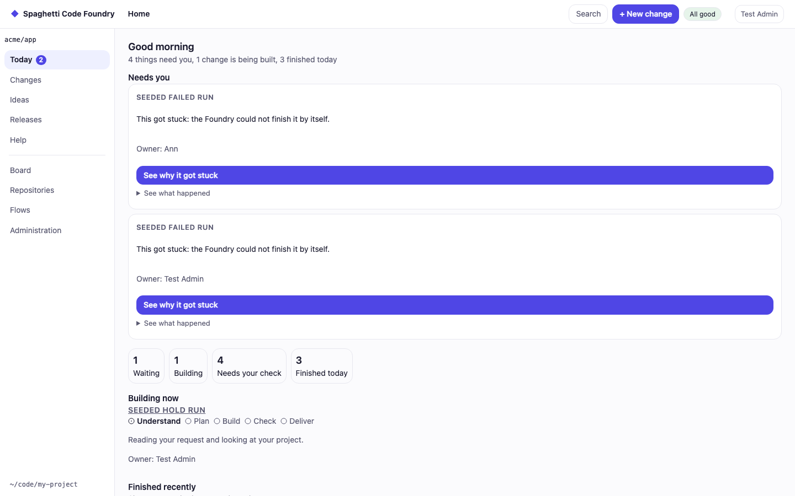

A **change** is one piece of work: a story, built by a run of a flow. **Today** shows first what waits for you, with
one button each, then four counters, what is being built now and what finished.

How-to: [follow your work on Today and the board](/how-to/board/) · guide:
[Simple, Advanced and Admin view](/guide/#simple-advanced-and-admin-view)

## Ask for a change in your own words

**+ New change** opens one box: "What would you like to change?". Write it in your own words and press **Make a
plan**. The Foundry asks its questions first, then shows its plan. No flow is needed; the flow and its fields wait
under **Advanced** for those who want them.

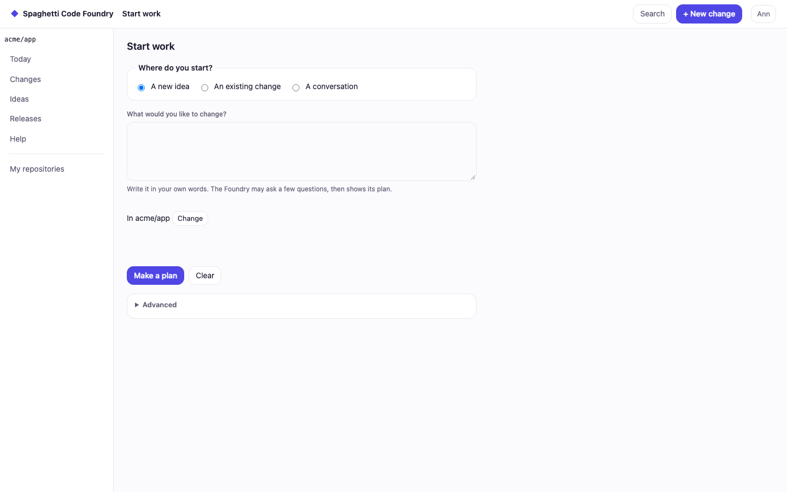

In the Simple view, **Ask for a change** on a project page does the same, and you can add up to five pictures to
show what you mean. The architect reads the pictures with your words. Each part of the change comes back as a card,
"This is what I understood: …". Press **Yes, build this**, or **Not now** to keep it for later.

## From issue to merged code

Put one label, `Factory_go`, on an issue or a whole epic. The Foundry asks its questions up front, then builds each
change in dependency order: plan, review of the plan, code, tests, code review, docs, merge. Changes that are too big
are split into smaller ones, and you can follow every step on the issue itself.

- **Questions first.** Open questions are asked before any code is written. Reply with your answers, or with
  `/defaults` to take the recommendations.
- **Risk-gated plans.** Every plan gets a risk score from 0 to 100. Above the threshold, the plan waits for your
  `/approve` or `/reject`.
- **Gitflow.** Each change on its own feature branch, merged into `develop` when it is done. Once a day, one pull
  request from `develop` to `main` for you to merge.

How-to: [let the Foundry build your GitHub issues](/how-to/github-issues/) ·
[answer questions and approve plans](/how-to/approve-and-answer/) · [hand it an epic](/how-to/split-epic/)

## A change, step by step

A change in progress shows five phases: **Understand**, **Plan**, **Build**, **Check** and **Deliver**, with one
sentence on what happens now. Three tabs hold the rest: **Progress** (the task, the acceptance criteria and the
questions), **What changed** (the diff) and **Details** (steps, evidence, skills and the live log).

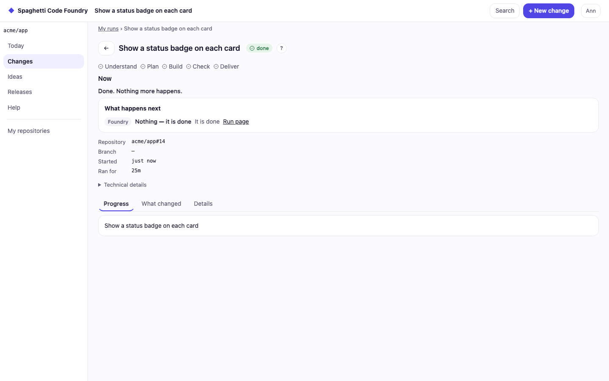

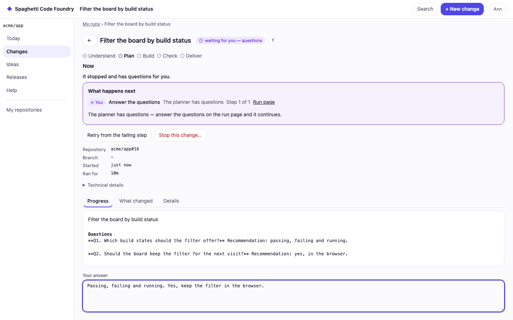

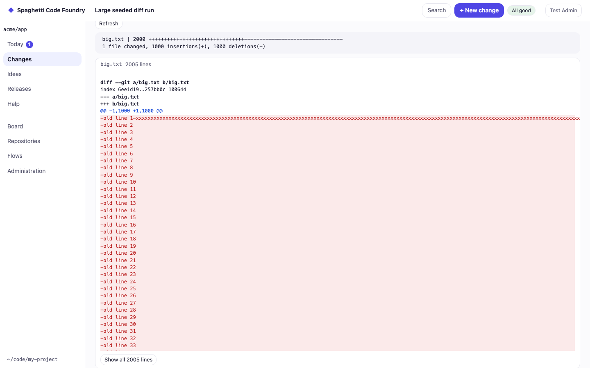

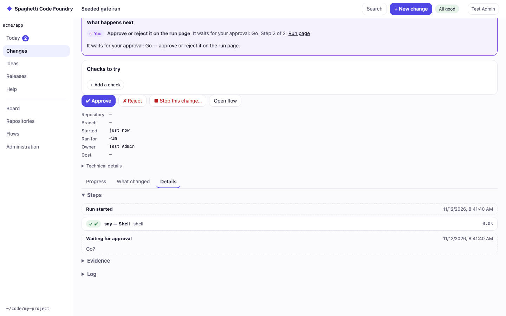

How-to: [resume, retry or approve a run](/how-to/resume-run/)

## Plans you can check

The Foundry tells you what it understood and lets you check what it made:

- **Asked and assumed.** The plan keeps what you asked apart from what it assumed itself, such as a file location or
  a default value. The change page shows both under **Your request**. **Change this** on an assumption sends your
  correction, and the Foundry plans again.
- **Checks to try.** The plan writes two to four checks a person can try, each with **Try** and **Expect**. Mark each
  one **Works** or **Not quite**. **Not quite** asks "What did you see?" and sends the change back with your
  sentence. You can add checks of your own, and they are shown again in the next round.
- **Safe points.** A project lists its recent versions that worked: the time, the changes in them and who started
  them. **Restore** first shows what would be taken back and what a restore does not undo, then opens a normal change
  that goes back to that version, with its tests and review. Nothing is reset or force-pushed.

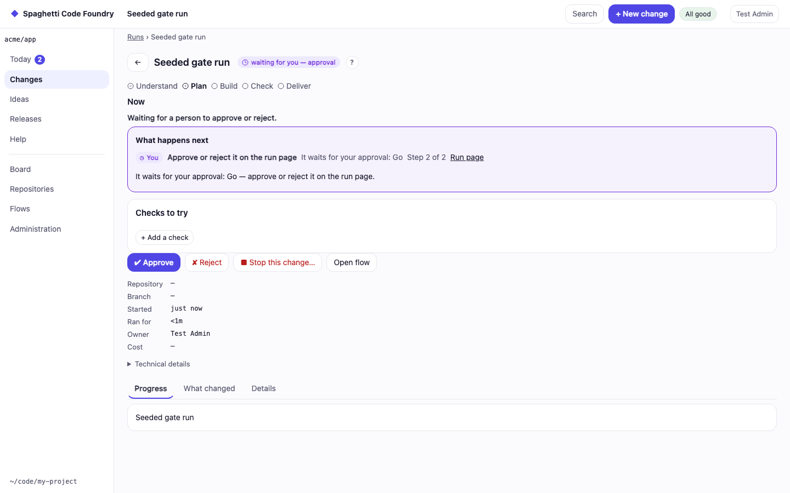

Guide: [checks to try](/guide/#checks-to-try) · [safe points](/guide/#safe-points) ·
[restore a safe point](/guide/#restore-a-safe-point)

## Not only for developers

The **Simple** view shows your work per project, in plain words. **Today** has **What do you want to build?** with
one **Start** button, the things that need you, what is running and your projects. A project page says what you need
to do, what is being made, and has **Try it** to start the app and see it.

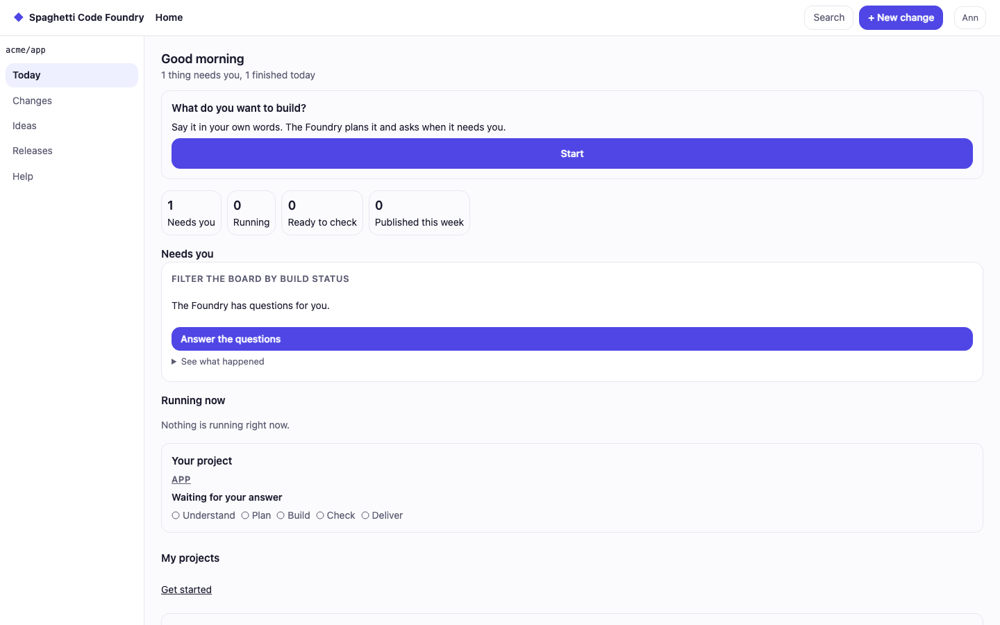

**Get started** is a step-by-step guide for a first project: check the computer, set up Claude and Codex, choose a
starter (a website, a web app or a small tool), say what it is for, and read the plan before it is built. An admin
can invite someone with a **Simple account**: their set-password link opens the guide after the first sign-in.

The **Help** page explains the Foundry's words in plain language, with short how-tos and who to ask.

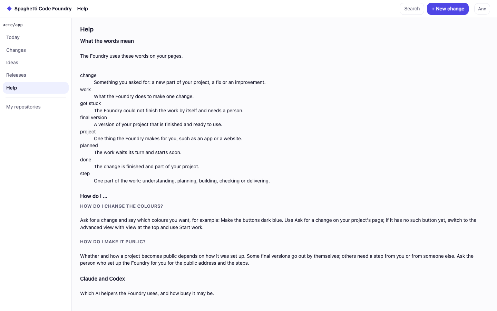

Guide: [Simple: My projects](/guide/#simple-my-projects-and-the-project-page) ·
[Simple: Get started](/guide/#simple-get-started)

## Ask Foundry

**Ask Foundry** is the help assistant in the app. Ask in your own words how the Foundry works, what your work is
doing or why something does not work. A reply names its sources and how sure it is. It reads and explains; nothing
changes unless you review and confirm an action. An admin switches it on.

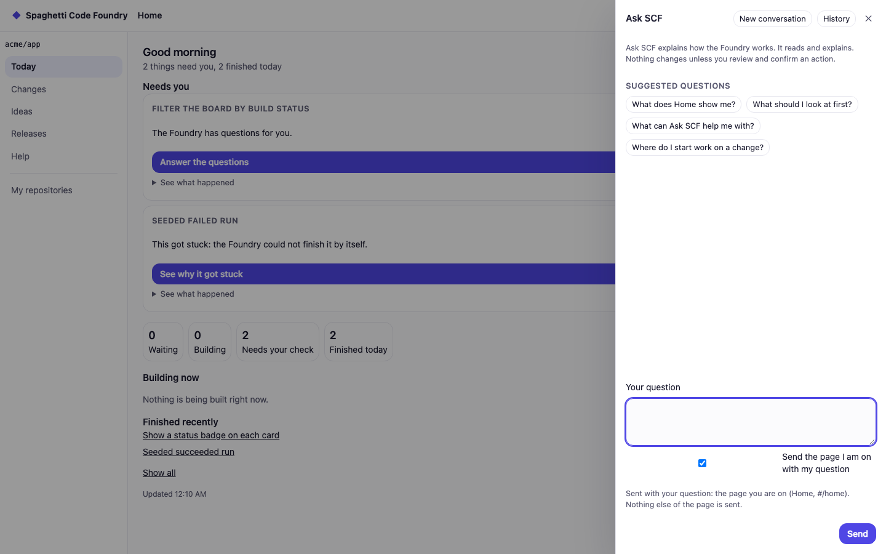

How-to: [ask Foundry for help](/how-to/ask-scf/)

## Five looks, your choice

**Appearance** in the account menu sets the theme (System, Light or Dark), the density and the look: **Calm**,
**Midnight**, **Friendly**, **Editorial** or **Bento**. The choice is kept per person. In the Simple view the look
also picks the layout of Today: cards, a list or tiles.

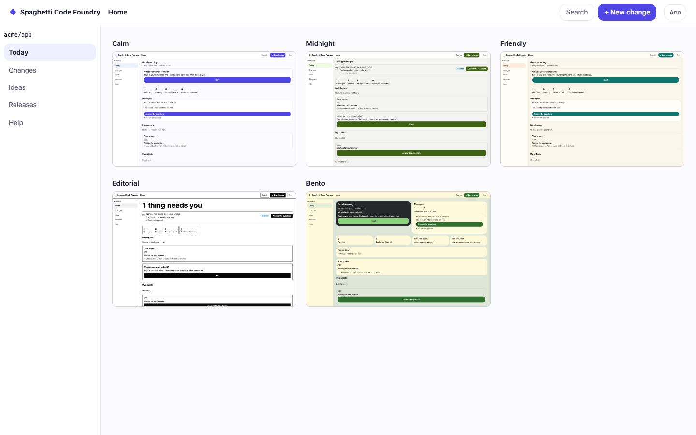

## Ideas and releases

**Ideas** turns a rough idea, or an existing issue, into changes that are ready to build. An AI architect reads your
repository, asks the questions that matter, suggests text for each draft and checks it against your Definition of
Ready. You publish the changes when they are ready.

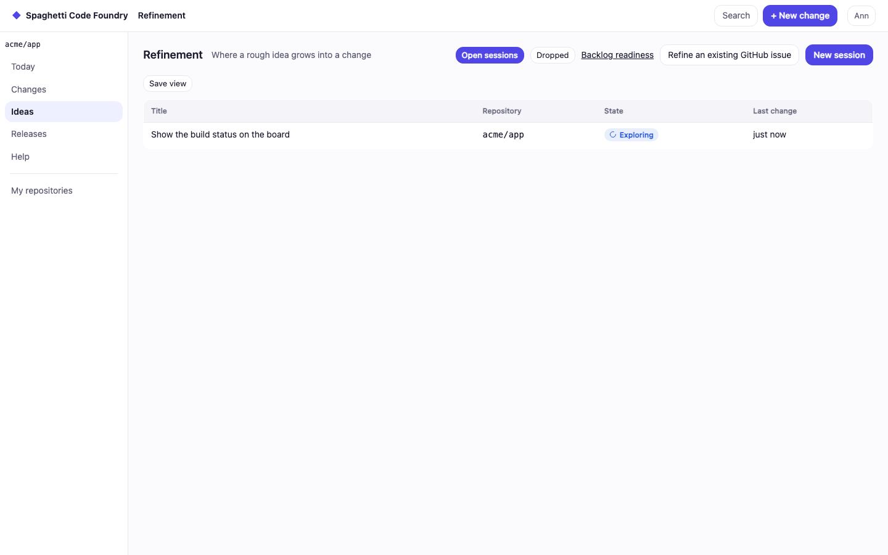

**Releases** shows how far each epic is, how it grew, what holds it up and when it will most likely be finished.

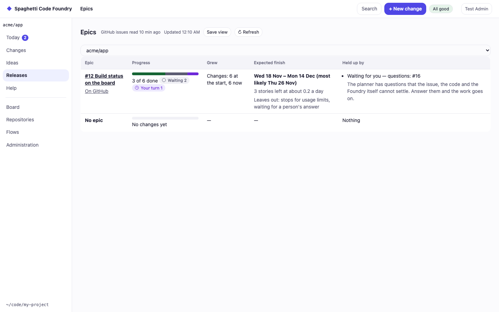

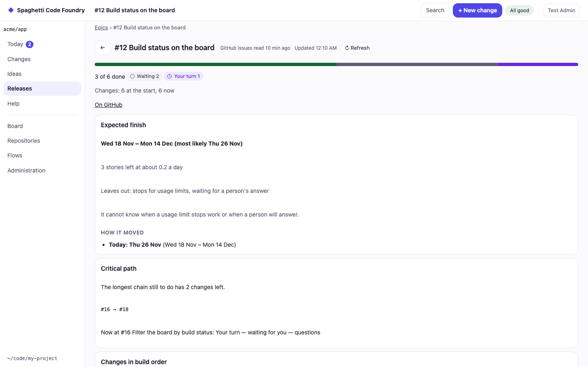

How-to: [refine ideas into stories](/how-to/refine-ideas/) · [hand it an epic](/how-to/split-epic/)

## Several changes at once

Runs lock the parts of the code they change, so changes in different areas are built in parallel without merge
conflicts. Changes that depend on each other wait for each other. In the Admin view the **Board** shows where every
change is, who has the next move and why.

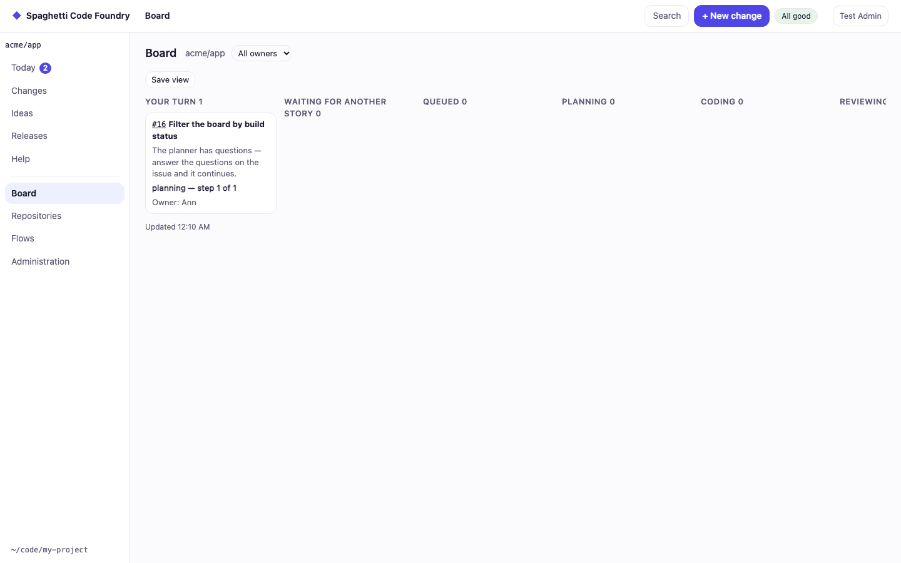

## Two agents, any model

Steps run on Claude Code or OpenAI's Codex CLI, on Anthropic, OpenAI or local models such as Ollama and LM Studio.
The shipped flows let one vendor's model review the other's work. Routing rules pick the model per step, with
fallbacks when a model hits a limit. The **Setup check** says what this computer still needs, and **Claude and
Codex** asks six plain questions and sets the Foundry up from your answers.

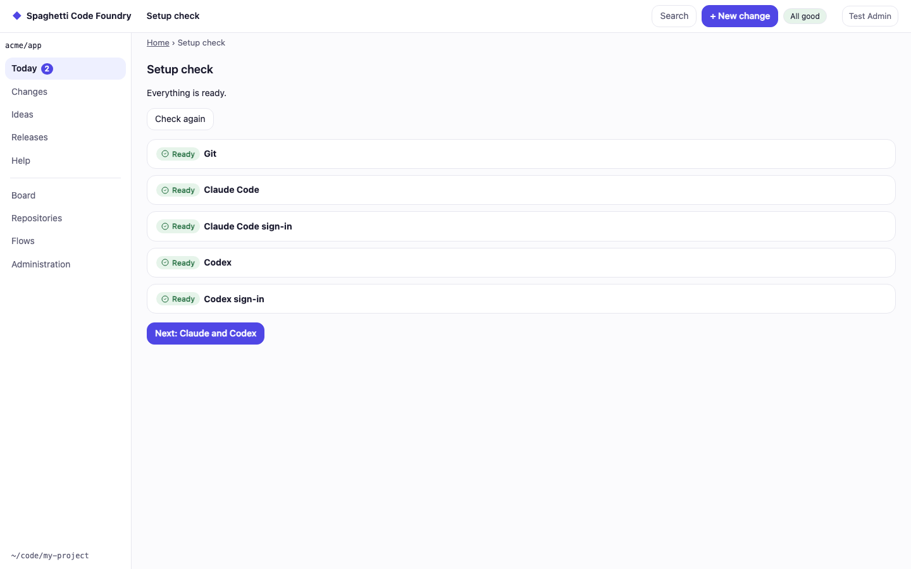

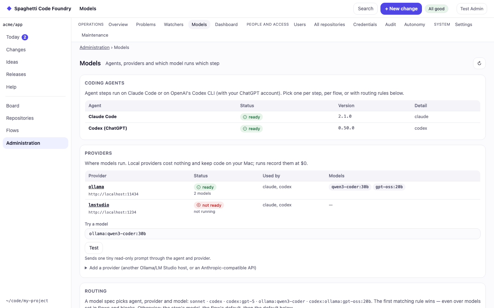

How-to: [choose models and routing](/how-to/models-and-routing/) · guide: [setup check](/guide/#setup-check)

## Your own flows

Work is described as **flows**: YAML pipelines of agent steps, shell steps, approvals and branches. Edit them
visually or as YAML, reuse steps from the block library, or give the [flow format reference](/flow-format/) to any
AI assistant and let it write one. `scf validate` checks the result.

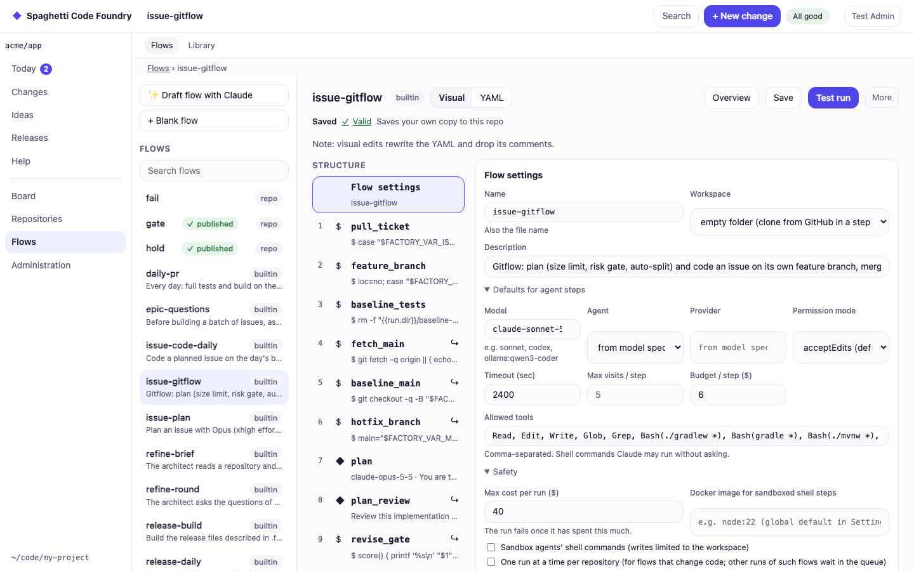

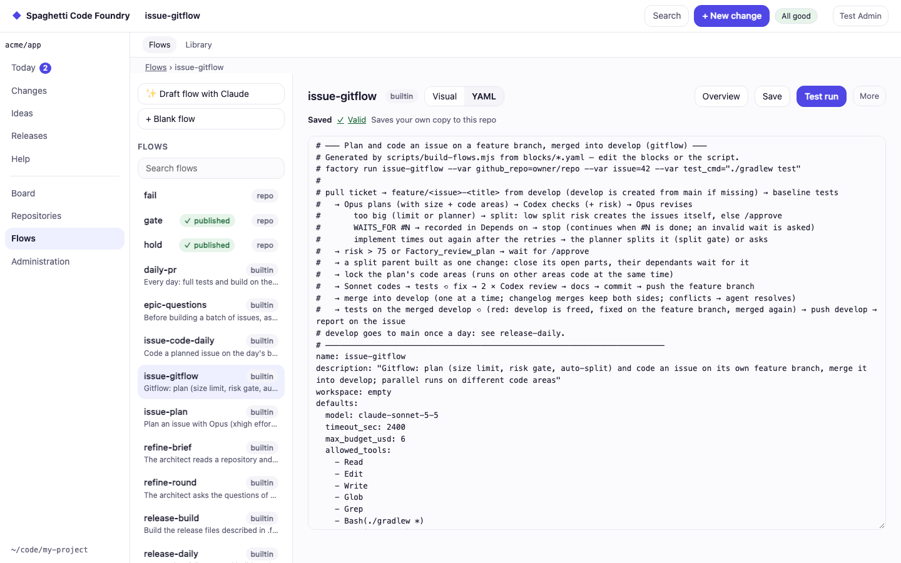

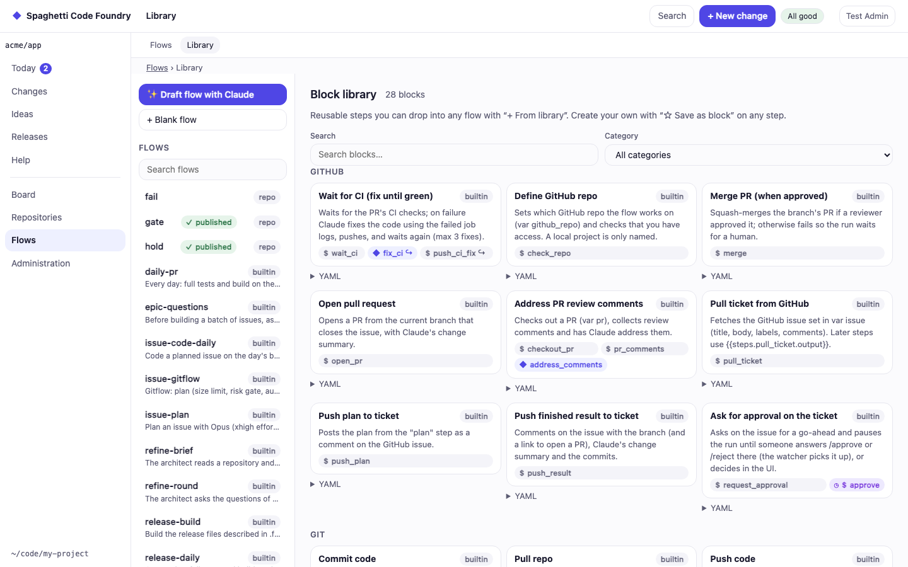

How-to: [write your own flow](/how-to/write-a-flow/)

## Watchers: work that starts by itself

A watcher starts a flow from a GitHub issue that gets a label, a review comment on a pull request, a red CI build or a
schedule. The Foundry also watches itself: a monitor reports problems with the Foundry, and an optional self-repair
loop turns them into bug changes. The **Problems** page shows what the monitor found and what happens to each finding.

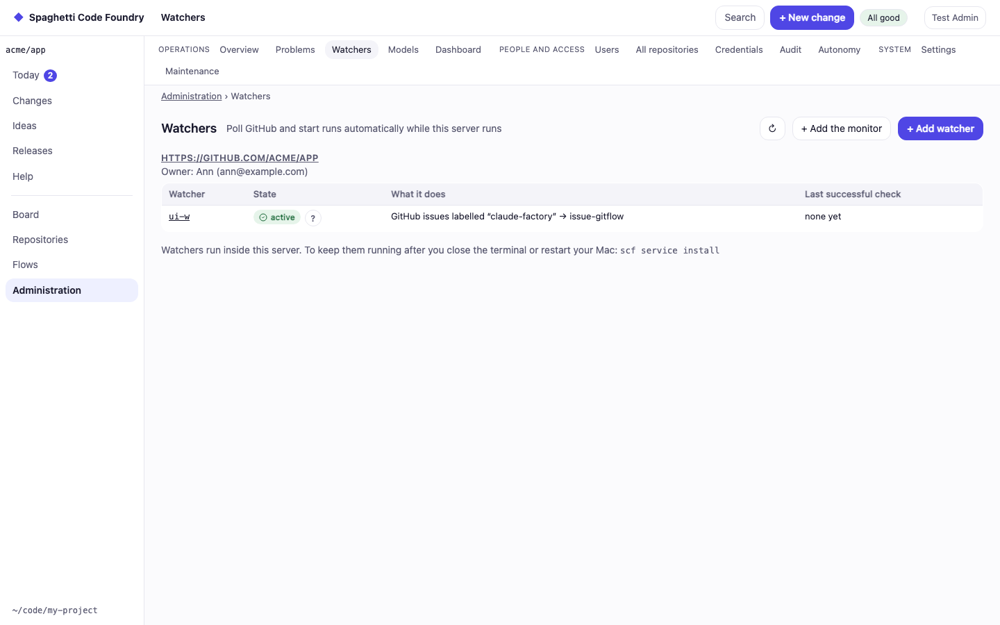

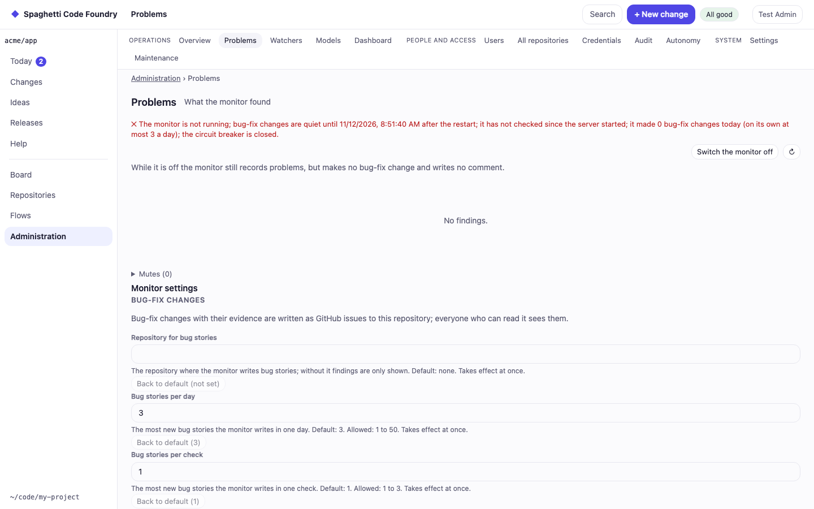

Guide: [the Problems page](/guide/#the-problems-page)

## Projects without GitHub

A local project is a git repository on your own machine. The Foundry plans, builds, tests, reviews and merges its
changes without GitHub, and nothing leaves the machine unless you turn on pushing. **Make this version final** turns
the tested `develop` into a release on `main`. When you are ready, an admin can move the project to GitHub.

Guide: [local projects](/guide/#local-projects) · [move a local project to GitHub](/guide/#move-a-local-project-to-github)

## Accounts, roles and teams

An admin makes flows, watchers and settings. Users run the flows the admin published, on their own repositories, and
see only their own work. Each repository can have its own sign-in: a fine-grained token, a deploy key or the GitHub
App.

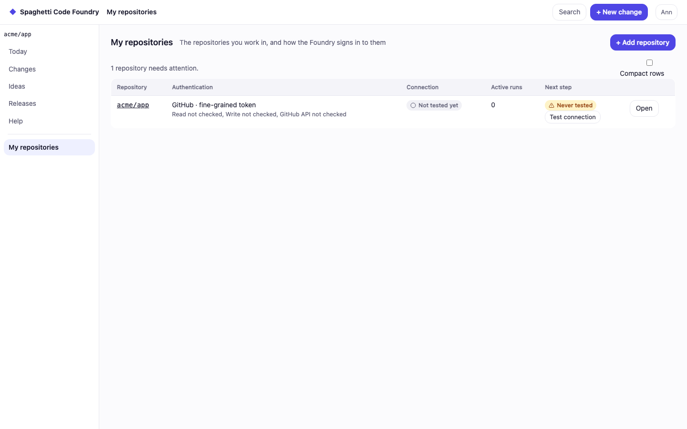

- **Workspaces** keep teams apart on one shared Mac. Each team sees only its own repositories and runs. Every step of
  a team's run is sandboxed, never uses the machine's GitHub login, and reaches only the hosts it is allowed to.
  Each workspace can have its own limits, and free slots are shared fairly between teams.
- **Your own account system.** A plugin can connect an identity provider: sign-in, role and workspace then come from
  your own accounts, with one local admin for emergency sign-in.

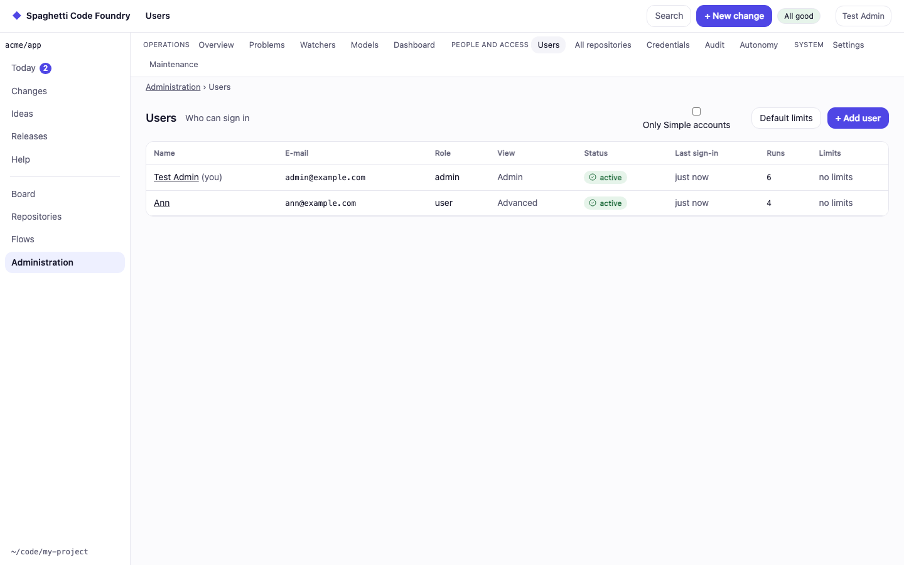

How-to: [invite users and set roles](/how-to/users-and-roles/) · [connect a repository](/how-to/connect-repository/) ·
guide: [workspaces](/guide/#workspaces) · [plugins](/guide/#plugins)

## Safe by default

Every run works in its own copy of the code. Pushes to protected branches and pushes that contain secrets are
blocked. Add approval steps, budgets and sandboxing where you want them. The [security page](/security/) describes
the threat model.

**Autonomy levels** set how far a run may go, per repository and per flow: from `observe` (read only) to
`delivery-handoff` (push and pull requests). A level goes up only through a promotion gate, and the Foundry can lower
it by itself after a critical finding.

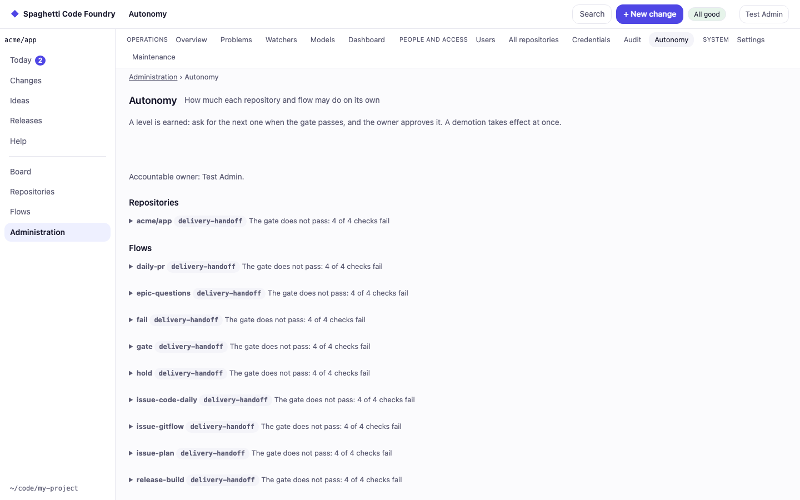

How-to: [keep your code and secrets safe](/how-to/safety/) · guide: [autonomy levels](/guide/#autonomy-levels)

## Skills that help, measured

Skills give the agents knowledge of your languages and tools. The Foundry picks them for each run. Open-source skill
libraries are added as reviewed sources: imported into quarantine, scanned, checked for their licence and evaluated
before use. A new skill can be written by the Foundry itself, and `scf skills effect` measures whether it changes
what an agent does: it runs the same tasks with and without the skill. A skill that does not help gets an issue to
improve it.

How-to: [use the skill library](/how-to/skills-library/) · guide: [write a skill](/guide/#write-a-skill) ·
[skill library sources](/guide/7-settings-and-safety/skill-library-sources/) ·
[measure the effect of a skill](/guide/#measure-the-effect-of-a-skill)

## Costs you can see

The dashboard shows what runs cost, how often they succeed and where time goes. Budgets per run and per day keep
spending in bounds, and so do limits per issue (with its split parts and retries), per month, per project and per
workspace. Evals compare flows and models on the same sample tasks. The **Overview** page of Administration shows
what needs attention on one page: problems, the queue, watchers, limits and the load of the machine.

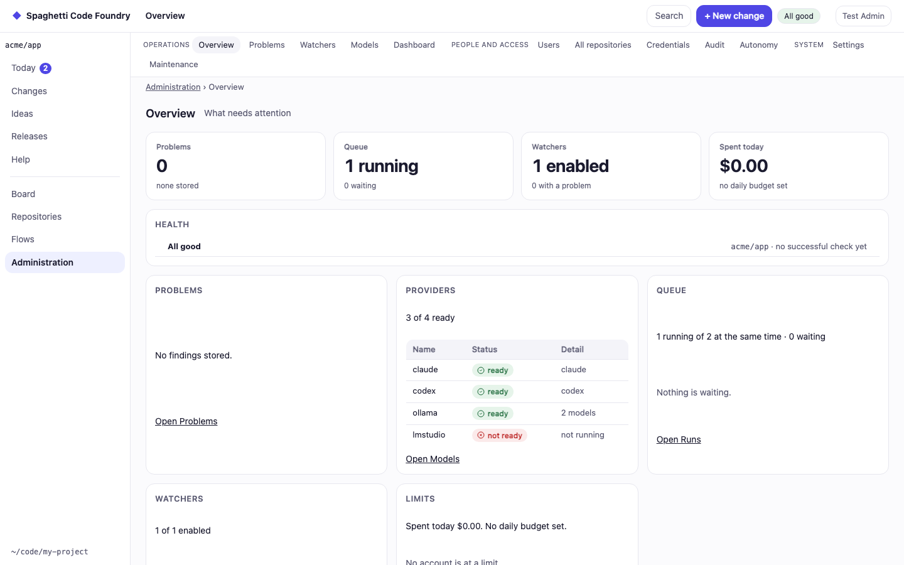

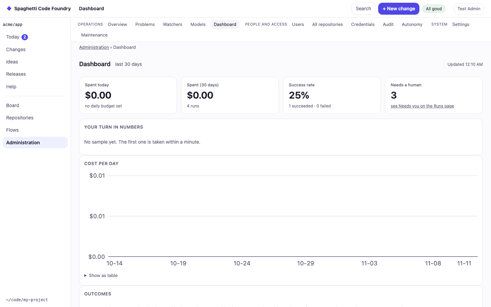

How-to: [control costs](/how-to/costs/) · guide:
[spending limits per issue and per month](/guide/#spending-limits-per-issue-and-per-month)

## Everything from the command line

Everything the web interface does is also a command: `scf login`, then for example `scf runs list` or
`scf turn list`. `scf doctor --simple` runs the setup check in a terminal. The Foundry can run as a macOS login
service and update itself when you merge a release.

How-to: [use the command line](/how-to/command-line/) · [keep it running as a service](/how-to/run-as-service/)
